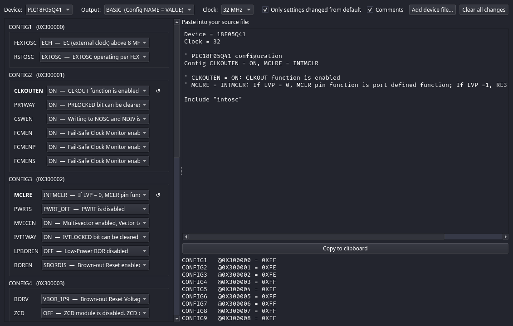

# Basic_Compiler

[](https://github.com/garyPenhook/PIC_Basic_Compiler/actions/workflows/ci.yml)

Pre-built `basil` for Linux, macOS and Windows (with `lib/`, `devices/` and the docs) is on the
[releases page](https://github.com/garyPenhook/PIC_Basic_Compiler/releases). Unpack it, put the
folder's `basil` on your `PATH`, and keep your programs inside that folder or pass `-L` and `--devices`.
You still need MPLAB XC8 (for `pic-as`) and the device pack, see QUICKSTART.md.

A BASIC compiler for PIC microcontrollers, built for small, fast code. It turns a structured,
typed BASIC (modules, subroutines and functions, structures, interrupts) into a `.hex` file, and
comes with a library of ready-made modules for the common peripherals.

First target: **PIC18F27Q10**. The **PIC18F04/05/06/14/15/16Q41** family, the enhanced mid-range **PIC16F17126/17146**, the
nine-part **PIC16F13113/13114/13115/13123/13124/13125/13143/13144/13145** family (8, 14 and 20 pins) and the eight-part
**PIC16F18313/18323/18324/18325/18326/18344/18345/18346** family and its low-voltage **PIC16LF** twins (8, 14 and 20 pins) and the six-part
**PIC16F15213/15214/15223/15224/15243/15244** family (8, 14 and 20 pins) are supported too (see
`docs/MANUAL.md`, "Supported device", for what is ported). More microcontrollers will follow, one at a time.

## A taste

```basic
Program Blink
Device = 18F27Q10
Clock = 64
Config FEXTOSC = OFF, RSTOSC = HFINTOSC_64MHZ, WDTE = OFF, LVP = ON
Include "gpio"
Include "serial"

Dim led As PORTB.0
Dim ticks As Word

Interrupt Tick()
    PIR0.5 = 0
    Inc(ticks)
End Interrupt

Gpio.GpioAllDigital()
Output(led)
Serial.SerialInit(115200)
T0CON1 = 65
PIE0.5 = 1
Enable(Tick)
T0CON0 = 128
While True
    Toggle(led)
    Serial.SerialWrite("tick")
    Serial.SerialNewLine()
    DelayMS(500)
Wend
```

```
basil blink.bas          # writes blink.hex (plus blink.S and blink.map)
basil --report blink.bas # also prints code and RAM sizes per routine and variable
```

## What works today

**Language**
* Types: Boolean, Bit, Char, 8/16/32-bit signed and unsigned integers (also spelled `SByte`, `SWord`, `Long`, `Dword` for the signed 8, signed 16, signed 32 and unsigned 32-bit types), `Float` (IEEE-754 binary32), strings, arrays (one or more dimensions, with initialisers and program-memory `Const` tables, also of strings), structures (with initialisers), overloaded and `Reentrant` routines
  and unions, constants.
* Full arithmetic, logic, shifts and comparisons at every integer width (hardware multiply is used),
  short-circuit conditions.
* `If`, `Select Case`, `While`, `Repeat`, `For` (with `Break`/`Continue`/`Exit`), `GoTo`.
* Subroutines and functions with by-value, `ByRef` and `ByRefConst` parameters; `Inline`/`NoInline`; modules and `Include`.
* `Abs`, `Min`, `Max`, `Inc`/`Dec` (with an optional amount), `AddressOf` / `@`.
* Preprocessor: `#define`, `#ifdef`, `#if` with `_clock` and `_device`.
* Interrupt handlers (one or two priorities) with automatic context saving and `Save … Restore`
  blocks; `Enable`/`Disable`; event handlers.
* Direct access to every device register and register bit by name, inline assembly, exact
  cycle-counted `DelayMS`/`DelayUS`.
* Compile-time checks: RAM use, hardware stack depth, recursion, array bounds, bad configuration
  values. Errors show the file, line, column and the offending source line.

**Code quality**
* Compared with Microchip XC8 on a set of small kernels, the output is roughly 20% smaller in total
  (median kernel about 11% smaller; a few are the same size or slightly larger) and about as fast (see `docs/BENCHMARKS.md`, including an interrupt-plus-multiply-and-divide case).
* Optimisations include constant folding, narrowing, Access Bank placement, overlapping of
  routines' variables that are never live together, counted-loop forms, tail calls, inlining of routines called once, a Byte argument passed in
  `WREG` and a peephole pass, and literal strings read through
  `TBLRD*+` with the table pointer set once per loop.
  Every test program is also built unoptimised (`-O0`) and checked to give the same results.

**Library** (`docs/LIBRARY.md`; `Float` support comes from `floatlib`, included automatically)

| Module | What it gives you |
|---|---|
| `intosc` | sets the internal oscillator to `Clock` (just `Include` it) |
| `system` | reset cause and clock check |
| `gpio` | port set-up, pull-ups, open-drain |
| `delay` | millisecond/microsecond/second delays |
| `timer` | Timer0, Timer1 (external clock, gate, pulse measurement), Timer2 (hardware-limit and one-shot modes) |
| `serial`, `serial2` | EUSART1 and EUSART2: send/receive bytes, strings and numbers |
| `adc` | 10-bit ADC reads, averaging, millivolts, FVR reference (silicon errata worked around) |
| `eeprom` | data EEPROM read/write (bytes and words) |
| `flashwrite` | program flash self-write: read, sector erase, word write, word update (errata 1.9.1 NOPs) |
| `i2c` | I2C host on MSSP1: write, read, register access, bus ping, bounded waits |
| `spi` | SPI host on MSSP1: all four modes, any clock down to FOSC / 1024 |
| `pinio` | run-time pin access by number (0..23), digital set-up, open-drain emulation |
| `shift` | bit-banged `ShiftOut` / `ShiftIn` (1..16 bits, either bit order) on any two pins |
| `rtcc` | Microchip I2C RTCCs (MCP7940M/N, MCP79400/1/2, MCP79410/1/2): time, alarms, trim, SRAM, EEPROM, protected EEPROM, time stamps |
| `rtccspi` | Microchip SPI RTCCs (MCP7951x/7952x, MCP795W1x/2x): the same, plus hundredths, watchdog and event detection |
| `lcd` | HD44780 character LCD, 4-bit: text, numbers, cursor, custom characters |
| `oled` | SSD1309 128 x 64 OLED over I2C or SPI: text (5 x 7 font), bitmaps, pixel/line/rectangle drawing in a frame buffer, fill, contrast, invert, flip |
| `strings` | `Len` of a `String` (any size, or a literal); `Left`, `Mid` and `Right` are built into the language |
| `aht30` | AHT30 temperature and humidity sensor over I2C: start, fetch with CRC check, 1/100 degree and 1/100 %RH results |
| `pwm` | four PWM outputs (CCP1, CCP2, PWM3, PWM4) with a shared frequency and per-channel duty |
| `dma` | PIC18-Q41 DMA: software-started copy (RAM/SFR, flash or EEPROM source), trigger-started feed with abort triggers, on four channels, done flag, stop |

## Still to do

* **Language:** `Reentrant` recursion is limited by the 31-level hardware stack.
* **Hardware:** everything has been verified in the Microchip simulator, **not yet on a real chip**.
  Serial output, PWM waveforms, I2C and SPI traffic, external timer inputs and the second EUSART
  are the main things that need a hardware run. `docs/MANUAL.md` Appendix B is the bench checklist.
* **C interop:** calls from Basic into C (`CFile`, `Extern`) and from C into Basic (`Export`), with `Float` and `ByRef`
  arguments, `Interrupt` handlers and `-g` (0.1.49, `docs/ABI.md` §7). An `Extern` call from a handler works (inside `Save`; interrupts are off during a call into C when any handler uses C),
  as do `ByRef` arrays of structures. Not yet: hardware runs.
* **More devices:** the PIC18F27Q10, the PIC18-Q41 parts, the PIC16F17126/17146, the PIC16F13113 … 13145, the PIC16F18313 … 18346 (with the PIC16LF twins) and the PIC16F15213 … 15244 are supported; each
  further device is added only after it passes its own tests. Nothing has run on a real part yet.

## Debugging

Build with `-g` and the ELF describes the program in BASIC terms: breakpoints and stepping on `.bas` lines
(library modules included), the call stack with routine names and parameter values, and global, parameter and
local variables with their types.

```
basil -g blink.bas      # blink.hex is identical to a build without -g; blink.elf gains the debug information
```

**In VS Code** (extension `vscode-extension/`, needs Microchip's *MPLAB Extension Pack* and the device pack):

1. *PIC BASIC: New Project* (or open a folder with a `.bas` file), then *Select Programmer/Debugger*: the simulator needs no hardware.
2. **Ctrl+F7** builds with `-g` and copies `.hex`/`.elf` into `dist/`.
3. **F5** starts debugging. F9 breakpoint, F10 step over, F11 step into, Shift+F11 step out, Shift+F5 stop.
4. **F7** builds a release, **F8** programs the chip with the selected PICkit / ICD / Snap.

**From the command line**, with the MPLAB X simulator: put `device PIC18F27Q10`, `hwtool sim`, `program blink.elf`,
`break blink.bas:37`, `run`, `wait 5000`, `where`, `print ticks` and `quit` in a file and run it with
`/opt/microchip/mplabx/v*/mplab_platform/bin/mdb.sh`.

Notes: code the compiler adds (start-up, runtime helpers) is shown under the nearest statement; a routine
inlined into its single caller has no frame of its own, so its locals are not listed; routines share RAM, so a
variable only means something while its routine is running. Checked with the simulator's command-line debugger;
the VS Code Locals/Watch panels have not been exercised. Full details, options and troubleshooting: *Debugging*
in `docs/MANUAL.md` and `vscode-extension/README.md`.

## Tools

* **VS Code extension** (`vscode-extension/`): highlighting, snippets, keyword and register-name
  case correction, formatting, diagnostics from `basil --check`, outline, go to definition, hover,
  completion, signature help, Build / Check / Report commands, a New Project wizard, device and
  programmer selection, programming (F8) and source-level debugging (F5) through Microchip's MPLAB
  extension. Debug builds use `basil -g` (see *Debugging* in the manual).
* **pic-config** (`tools/pic-config/`): a Qt 6 helper that turns drop-down choices into a `Config`
  line (or XC8 `#pragma config` lines) to paste into a program. Changed settings are marked and
  can be reverted one by one or all at once. Its Clock drop-down adds `Device`, `Clock` and
  `Include "intosc"` lines (with a note when `CSWEN = ON` is needed) so the output is a whole header.
  Covers every device basil supports (PIC18F27Q10, PIC18-Q41, PIC16F17126/17146, PIC16F13113 … 13145, PIC16F18313 … 18346, the PIC16LF18313 … 18346 and PIC16F15213 … 15244); more parts are a
  `.cfgdata` file away (see `tools/pic-config/README.md`).

  
* **devgen** (`tools/devgen/`): generates a device description (`devices/*.toml`) from a Microchip device pack and cross-checks it against numbers read from the data sheet.

## Using it

Requirements: a Rust toolchain to build the compiler, and Microchip's `pic-as` assembler (from
MPLAB XC8) to assemble and link. Simulator tests additionally need MPLAB X's `mdb`.

**Microchip's tools are not included and cannot be.** basil does not contain or redistribute MPLAB XC8
(`pic-as`, `xc8-cc`), the MPLAB X simulator or the device packs: you install them yourself from Microchip
and accept their licences. The XC8 licence forbids embedding or redistributing the Software and ties its use
to Microchip parts (`docs/license.txt` in the XC8 install). basil only finds the installed tools and runs them
(`/opt/microchip/xc8/*/pic-as/bin/pic-as`, `$BASIL_PICAS` or `--pic-as`; packs under `~/.mchp_packs`). Do not
ship a release archive that bundles them.

```
cargo build --release
target/release/basil prog.bas
```

Useful options: `--report` (sizes), `-S` (stop at assembly), `--check` (type-check only), `-O0`
(no optimisation), `-g` (debug build: BASIC line, variable and routine information in `prog.elf`).

Documentation: the user manual `docs/MANUAL.md` (also `docs/MANUAL.pdf`), language `docs/LANGUAGE.md` and `docs/GRAMMAR.md`, library `docs/LIBRARY.md`,
diagnostics `docs/DIAGNOSTICS.md`, clock and oscillator set-up `docs/CLOCK.md`, benchmarks `docs/BENCHMARKS.md`, efficiency worklist `docs/EFFICIENCY.md`. For contributors: `PLAN.md`,
`docs/PROGRESS.md`, `docs/DECISIONS.md`. Tests: `cargo test`, and
`BASIL_MDB=1 cargo test --test backend` for the simulator suite. MDB has no DMA, so DMA tests run with the model in `scripts/dma_sim.py` (see the manual, "Testing DMA code in the simulator").

Personal-use project. Vendor manuals under `reference/` are not part of the repository and must
not be redistributed.
