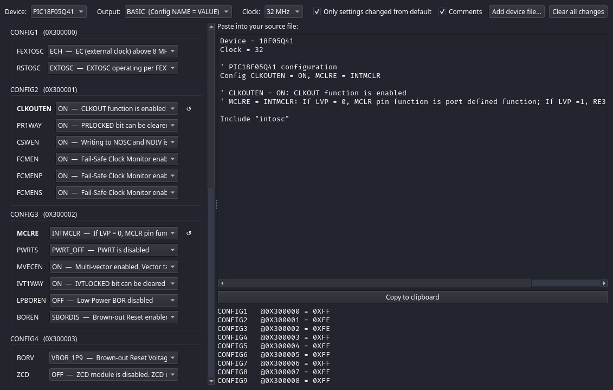

# Basil Manual

Revision for **basil 0.1.237**, target devices: the PIC18 and PIC16 parts listed in *Supported device*.

This manual describes exactly what the compiler accepts and generates today. It gives an overview of the
language, then one entry per command (Syntax, Overview, Parameters, Example, Notes), then one entry
per library routine, each under its own heading (listed in the contents of the PDF). Anything not listed here is not supported; Appendix A lists the alternative
spellings that are accepted and the common BASIC features that are missing or different, and
Appendix B is a checklist to work through when testing.

Status of the code: every feature below passes the Microchip MDB simulator suite and the host test
suite. **Nothing has been run on a real chip yet** (decision D6). Where a feature depends on pin
behaviour the simulator cannot model (serial bytes on the wire, PWM waveforms, external timer
edges, I2C/SPI traffic, LCD/OLED panels), that is stated, and those are the items to test on
hardware first.

Related documents: `docs/LANGUAGE.md` (formal language rules), `docs/GRAMMAR.md`,
`docs/LIBRARY.md`, `docs/DIAGNOSTICS.md`, `docs/CLOCK.md`, `docs/ABI.md`, `QUICKSTART.md`.

---

# Contents

1. Compiler overview
   - Supported device
   - Running the compiler
   - Debugging
   - Program layout
   - Identifiers, labels, comments, line continuation
   - Numeric representations and literals
   - Variables and types
   - `Static` locals
   - `Volatile` variables
   - Aliases and register bits
   - Constants and `Symbol`
   - Arrays, strings, structures
   - Float
   - Operators and expression typing
   - Procedures (Sub, Function, Proc)
   - Interrupts, events and context saving
   - Modules and `Include`
   - Device, Clock, Config
   - Calling C
   - Preprocessor
2. Language commands (in categories, alphabetical within each)
   - Branching and loops; Compiler and assembler; Delays; General; Math; Pin input and output
3. Library modules (in categories, alphabetical within each)
   - System and clock; Timers and PWM; Serial and buses; Analog and memory; Displays; Sensors, clocks and remote control; Bits, maths, strings and formatting
4. Diagnostics
5. Appendix A: Alternative spellings and unsupported forms
6. Appendix B: Test checklist

---

# 1. Compiler overview

## Supported device

<!-- MAINTENANCE: update this section, the library table in docs/LIBRARY.md ("Device support") and
     the Status column below whenever a device or family is added or changes status. A device is
     "Supported" only when it compiles, its standard test programs pass, and every library module is
     either ported for it or fails with #error (docs/DEVICE-FORMAT.md, "Adding a device", steps 7 and 8). -->

| Device | Core | Program memory | RAM | Status |
|---|---|---|---|---|
| PIC18F27Q10 | PIC18 (8-bit), legacy instruction set (`XINST = 0`) | 128 KB (65,536 words) | 3,359 usable GPR bytes (as reported by the build summary) | **Supported.** Device file `devices/18F27Q10.toml`, generated from pack `PIC18F-Q_DFP 1.31.492`. All library modules |
| PIC18F04Q41, PIC18F05Q41, PIC18F06Q41 (14-pin) | PIC18 (8-bit), legacy instruction set (`XINST = 0`), vectored interrupt controller run with `MVECEN = 0` | 16 / 32 / 64 KB (8 / 16 / 32 K words) | 1,024 / 2,048 / 4,096 usable GPR bytes; 512 bytes data EEPROM | **Supported.** Device files `devices/18F04Q41.toml` … (pack `PIC18F-Q_DFP 1.31.492`, data sheets DS40002242F and DS40002214G, facts in `docs/FACTS-18F-Q41.md`). Ports A and C. Library: every module except `floatlib`, which has not been run there (`gpio`, `delay`, `intosc`, `system`, `timer`, `serial`, `serial2`, `adc`, `eeprom`, `flashwrite`, `spi`, `lcd`, `i2c`, `pwm`, `oled`, `aht30`, and `dma`, which only the Q41 has); `i2c` is a software host and `pwm` uses the six PWM outputs (see `docs/LIBRARY.md`). Tested in the simulator (PIC18F16Q41) and built for every part; not run on hardware |
| PIC18F14Q41, PIC18F15Q41, PIC18F16Q41 (20-pin) | as above | 16 / 32 / 64 KB | 1,024 / 2,048 / 4,096 usable GPR bytes; 512 bytes data EEPROM | **Supported**, as the 14-pin parts, with port B (RB4..RB7) |
| PIC16F17126 (14/16-pin) | PIC16 enhanced mid-range (`pic16e`) | 16K words (28 KB) | 2,048 bytes | **Supported (0.1.50; library and `Float` complete in 0.1.51; assembly `Float` and peephole passes in 0.1.52).** Device file `devices/16F17126.toml` (pack `PIC16F1xxxx_DFP 1.32.471`, data sheet DS40002343F). Integer, Boolean, Char, array, structure, string, `Float`, `Interrupt`, `Reentrant`, `DelayMs/DelayUs` and every library module except `dma` (the part has no DMA) compile and run in the simulator; `AddressOf` of a `Const` array is an FSR address. **Not yet on this core:** calling C and interrupt priorities. `-g` writes the line table, routines and variables (0.1.155; an object that runs across banks is left out of the variable list). Single-call routines are inlined (0.1.53). `Float` is assembly on this core and its routines take their operands in `__A`/`__B` (0.1.54; `FMul`/`FDiv` rewritten on them in 0.1.55: a program using `+ * /` is about 605 words, the PIC18's about 615). Nothing has run on a real part |
| PIC16F17146 (20-pin) | PIC16 enhanced mid-range (`pic16e`) | 16K words (28 KB) | 2,048 bytes | As the PIC16F17126 (`devices/16F17146.toml`) |
| PIC16F18313 (8-pin), PIC16F18323 / 18324 / 18325 / 18326 (14-pin), PIC16F18344 / 18345 / 18346 (20-pin) | PIC16 enhanced mid-range (`pic16e`) | 2K / 2K / 4K / 8K / 16K / 4K / 8K / 16K words | 256 / 256 / 512 / 1,024 / 2,048 / 512 / 1,024 / 2,048 bytes; 256 bytes of EEPROM | **Supported (0.1.87; the LF parts 0.1.88).** Device files `devices/16F18313.toml` … `16F18346.toml` (pack `PIC16F1xxxx_DFP 1.32.471`, data sheets DS40001799F, DS40001800E, DS40001795K and DS40001839E, errata DS80000666H, DS80000667E, DS80000668L and DS80000709H, facts in `docs/FACTS-16F183xx.md`). The code generator is the PIC16F171xx one. The PIC16LF18313 … 18346 (1.8 to 3.6 V) have their own device files (`devices/16LF18313.toml` …) with the same registers; their FVR has no 4.096 V gain (DS40001839E Register 16-1). The portable programs and `tests/exec_p16` that apply, with `tests/exec_p183`, pass in the simulator on the PIC16F18346 and the PIC16F18326; every part builds `tests/exec_p183_parts/small.bas`. The power-up clock is chosen with `Config RSTOSC = HFINT32` (32 MHz) or `HFINT1`. Modules: `serial2`, `dma` and `intosc` stop with `#error` (one EUSART, no DMA, `intosc` not ported); `timer` has the old Timer1 and Timer2 (no clock-select or hardware-limit registers, so no `T2Mode*`/`T2Rst*` and no `Timer2StartLimit`); `pwm` offers CCP1, CCP2, PWM5 and PWM6 (channels 1..4); the 8-pin part has port A only and the 14-pin parts no port B. Nothing has run on a real part |
| PIC16F15213 / 15214 (8-pin), PIC16F15223 / 15224 (14-pin), PIC16F15243 / 15244 (20-pin) | PIC16 enhanced mid-range (`pic16e`) | 2K / 4K words | 256 / 512 bytes; no data EEPROM | **Supported (0.1.89).** Device files `devices/16F15213.toml` … `16F15244.toml` (pack `PIC16F1xxxx_DFP 1.32.471`, data sheet DS40002195E, errata DS80000918K, facts in `docs/FACTS-16F152xx.md`). Fixed clock (no clock switching; `intosc` only sets `OSCFRQ`), 10-bit ADC, one MSSP and EUSART, CCP1/2 and PWM3/4. Library: every module is ported or stops with `#error` (`eeprom`, `serial2`, `dma`); see `docs/LIBRARY.md`. Larger parts of the family (PIC16F15225 …) are not described. |
| PIC16(L)F15313 / 15323 (8 / 14 pin), 15324 / 15325 (14 pin), 15344 / 15345 (20 pin), 15354 / 15355 / 15356 (28 pin), 15375 / 15376 (40 / 44 pin), 15385 / 15386 (48 pin) | PIC16 enhanced mid-range (`pic16e`) | 2K to 16K words | 256 to 2048 bytes; no data EEPROM | **Supported (0.1.233, pin routing corrected in 0.1.234).** Device files `devices/16F15313.toml` … `16F15386.toml` and the 13 `16LF` twins (pack `PIC16F1xxxx_DFP 1.32.471`, data sheets DS40001897C, DS40001889E, DS40001865F, DS40001853E and DS40001866E, errata DS80000728D, DS80000721D, DS80000717K and DS80000725F, facts in `docs/FACTS-16F153xx.md`). The oscillator of the PIC16F183xx with HFFRQ codes 1 to 32 MHz (`intosc` works for `Clock` = 32 down to 1 and the divided 1 MHz), 10-bit ADC, one or two MSSP and EUSART, CCP1/2 and PWM3 to PWM6 (the library offers PWM3 and PWM4). Library: every module is ported or stops with `#error` (`eeprom`, `dma`, and `serial2` on the PIC16(L)F15313/23); see `docs/LIBRARY.md`. The run-time pin modules number the pins 0..47 (RA = 0..7, RB = 8..15, RC = 16..23, RD = 24..31, RE = 32..39, RF = 40..47), so every port of the 40- and 48-pin parts is reachable; on the 28-pin and larger parts PPS routes each signal to two ports only, which `pwm`, `spi`, `i2c` and `serial2` follow. |
| PIC16F18056 (28-pin), PIC16F18076 (40/44-pin) | PIC16 enhanced mid-range (`pic16e`) | 16K words (28 KB) | 2,048 bytes; 256 bytes of data flash (EEPROM) | **Supported (0.1.152).** Device files `devices/16F18056.toml`, `16F18076.toml` (pack `PIC16F1xxxx_DFP 1.32.471`, data sheet DS40002325C, errata DS80001014D, facts in `docs/FACTS-16F1805x.md`). Fixed clock (no clock switching; `intosc` only sets `OSCFRQ`), 10-bit ADCC, two MSSP and two EUSART, CCP1/2 and PWM3/4/5. Library: every module is ported except `dma`, which stops with `#error`; `spi` and `i2c` take pins of ports B and C, `pwm` offers CCP1, CCP2, PWM3 and PWM4 (channels 1..4); ports D and E of the PIC16F18076 are reached by name and by `Adc`/`Gpio`, not by the pin-number modules. Four of the portable test programs are held back in the simulator (see `docs/FACTS-16F1805x.md`). Nothing has run on a real part. |
| PIC16F13113 / 13114 / 13115 (8-pin), PIC16F13123 / 13124 / 13125 (14-pin), PIC16F13143 / 13144 / 13145 (20-pin) | PIC16 enhanced mid-range (`pic16e`) | 2K / 4K / 8K words | 256 / 512 / 1,024 bytes; no data EEPROM | **Supported (0.1.76; erratum 1.3.1 work around in 0.1.77).** Device files `devices/16F13113.toml` … `16F13145.toml` (pack `PIC16F1xxxx_DFP 1.32.471`, data sheet DS40002519D, errata DS80001115F, facts in `docs/FACTS-16F1314x.md`). The code generator is the PIC16F171xx one. The portable programs that fit the RAM and flash, `tests/exec_p16` and `tests/exec_p13` pass in the simulator on the PIC16F13145; every part builds `tests/exec_p13_parts/small.bas`. Modules: `serial2` and `eeprom` stop with `#error` (one EUSART, no data EEPROM), `dma` stops with `#error`; `pwm` offers CCP1, CCP2, PWM1 and PWM2 (channels 1..4); the 8-pin part has port A only. Nothing has run on a real part. Erratum 1.3.1 (revisions A2, A3, instruction fetch above 16 MHz) is worked around with a NOP at 0000h and at the handler start when `Clock` is above 16; `#option FetchNop = false` removes them for revision A4; an `Asm` `sleep` needs two `nop`s after it |
| PIC16F13214 / 13215 (8-pin), PIC16F13224 / 13225 (14-pin), PIC16F13244 / 13245 (20-pin) | PIC16 enhanced mid-range (`pic16e`) | 4K / 8K words | 512 / 1,024 bytes; 256 bytes data EEPROM | **Supported (0.1.176).** Device files `devices/16F13214.toml` … `16F13245.toml` (pack `PIC16F1xxxx_DFP 1.32.471`, data sheet DS40002686B, errata DS80001213B, facts in `docs/FACTS-16F132xx.md`). The code generator is the PIC16F171xx one; the part has two EUSART, one MSSP, two 16-bit PWM modules, a 10-bit ADCC (TAD from 0.5 us), the data EEPROM, a secondary oscillator, Timer3/4 and the CLB. Library: every module is ported except `dma` (no DMA), which stops with `#error`; `serial2` uses RA2/RA1 on the 8-pin parts; `pwm`, `spi` and `i2c` refuse pins the part does not have; `timer` adds the codes of this family. The portable programs that fit the RAM and flash, `tests/exec_p16` and `tests/exec_p132` pass in the simulator on the PIC16F13245; every part builds `tests/exec_p132_parts/small.bas` and `tests/exec_p132/pins8`, `pins14` and `pins20` check the pins of each size. Nothing has run on a real part. Erratum 1.1.1 (CCP compare toggle mode does not work, no work around) concerns only a program that uses that mode. No fetch erratum, so no NOPs at the vectors. |

`Device = 18F27Q10` (or `PIC18F27Q10`), the PIC18-Q41 parts (`Device = 18F16Q41`, `18F04Q41` …) the PIC16F17126/17146, the PIC16F13113 … 13145, the PIC16F13214 … 13245, the PIC16F18313 … 18346 (also `16LF18313` … `16LF18346`), the PIC16F15213 … 15244, the PIC16F15313 … 15386 (also `16LF15313` … `16LF15386`) and the PIC16F18056 / 18076 are the values that compile today. A device is added only
after it has its own description file and passes its own tests, and **adding one means more than the
description file**:

* a new core family needs its own code generator (PLAN §9.3);
* every library module must be reviewed for the new part: the modules were written for the
  PIC18F27/47Q10 and each one names registers, interrupt flags, pins and channel numbers that can differ
  or not exist. The state of each module per device is in the table in `docs/LIBRARY.md`, "Device
  support: work still to do". A module that is not ported must stop with `#error`, not use the
  Q10 registers;
* this section and that table must be updated, and the new part listed here.

Every register and register bit of the device is available by its pack name (`PORTB`, `LATA`,
`T0CON0`, `PIE0.5`, `SSP1CON1.SSPEN` ...), case-insensitively. A program or library module can ask
whether the chosen device has a register or bit field with `#if _has(REG)` / `#if _has(REG.FIELD)`
(Preprocessor, below), which is how one module serves several layouts.

## Running the compiler

```
basil [--check] [-S] [--report] [-O0] [-g] [-o OUT.hex] [-D NAME] [-L LIBDIR]
       [--devices DIR] [--pic-as PATH] [--version] [--help] <program.bas>
```

| Option | Meaning |
|---|---|
| *(none)* | Compile, assemble and link. Writes `prog.hex`, `prog.S` (assembly), `prog.map`. |
| `--check` | Front end only (syntax, types, declarations). No output files. Fast. |
| `-S` | Stop after writing the assembly (`prog.S`). |
| `--report` | Also print words per routine and every RAM object. |
| `--keep-vars` | Keep stores to variables that nothing reads (the optimiser normally drops them), so a test can inspect them in RAM. A `Volatile` variable is always kept. |
| `-g` | Debug build: adds line, variable and routine information to `prog.elf` for a debugger (see Debugging). The hex file is identical to a build without it. |
| `-O0` | No optimisation (the test suite builds everything both ways and compares). `-O1`, `-O2`, `-Os` are accepted and mean "optimise" (the default). |
| `-o FILE` | Output hex path. |
| `-D NAME` | Define a preprocessor name (visible in every file). |
| `-L DIR` | Add a library folder (repeatable). |
| `--devices DIR` | Folder holding the device descriptions. |
| `--pic-as PATH` | The `pic-as` assembler (otherwise `$BASIL_PICAS`, then `pic-as` on `PATH`, then the newest XC8 install). |
| `--dfp DIR` | The device pack's `xc8` folder (otherwise `$BASIL_DFP`, then `~/.mchp_packs/Microchip` and MPLAB X's packs; the newest installed version of the pack is used, with a warning, when the named one is missing). |
| `--xc8-cc PATH` | The `xc8-cc` C compiler (otherwise `$BASIL_XC8CC`, then the XC8 install of `pic-as`). |
| `--packs DIR` | An extra folder holding packs as `<pack>/<version>/xc8` (repeatable; also `$BASIL_PACKS`). |
| `--doctor` | Show the pic-as, xc8-cc and pack folders found, which of the device packs the supported parts need are installed (`ok`, `older`, `MISSING`), and a one-line test build for a part of each installed pack; ends with `ready: yes`, `partly` or `no`. Exit 1 unless ready (a missing pack for some parts is `partly`, exit 0). |
| `--version`, `-V` | Print the version. |
| `--help`, `-h` | Print the option summary and exit. |

Paths can be kept in a settings file, `~/.config/basil/config` (`$XDG_CONFIG_HOME/basil/config`, or
`%APPDATA%\basil\config` on Windows), so they need not be typed each time:

```
pic-as = /opt/microchip/xc8/v4.00/pic-as/bin/pic-as
xc8-cc = /opt/microchip/xc8/v4.00/bin/xc8-cc
dfp    = /path/to/pack/xc8
packs  = /extra/folder/of/packs
```

Order of precedence: flag, environment variable, settings file, automatic search. `basil --doctor` shows the
settings file it reads.

`basil --doctor` is the first thing to run on a new machine. It prints the `pic-as`, `xc8-cc` and pack folders it found,
then checks the device packs the supported parts need (the pack and version named by each device description):

```
device packs the supported parts need:
  ok       PIC16F1xxxx_DFP 1.32.471 (41 parts, e.g. 16F13113)
  ok       PIC18F-Q_DFP 1.31.492 (7 parts, e.g. 18F04Q41)
selftest: 16F13113 builds (1 words)
selftest: 18F04Q41 builds (1 words)
ready: yes, every supported part can be built
```

* `ok`: the named version is installed. `older`: it is not, the newest installed version of that pack is used (builds
  work, but the configuration-word bits can differ). `MISSING`: no version is installed; the parts listed cannot be
  built until you install the pack (MPLAB X, Tools > Packs, or unpack it to `~/.mchp_packs/Microchip/<pack>/<version>`).
* The self-test builds a four-line program for one part of each installed pack, in a temporary folder that is removed
  afterwards. It catches a broken `pic-as`, pack or licence, which a folder check cannot.
* The last line is `ready: yes` (exit 0), `ready: partly` (exit 0: some pack is missing but another family builds) or
  `ready: no` (exit 1: no `pic-as`, no usable pack or a failed self-test).
* `BASIL_DFP` and `--dfp` name one pack folder, so with either set doctor treats every pack as found there.

`lib/` and `devices/` are found by looking in the source file's folder and then each parent folder
(only the nearest of each is used), so keep programs inside the repository (for example
`my_src/`) or pass `-L` and `--devices`.

After a successful build the compiler prints the program size and a bar of flash and RAM used
against the device (colour only on a terminal, and not when `NO_COLOR` is set):

```
Program: 28 words (56 bytes)
basil: blink.bas -> blink.hex (28 words, 56 bytes)
```

Errors print as `file:line:col: error[CODE]: message`, with the source line and a caret. Several
errors are reported per run. Exit status is non-zero if any error was reported.

## Debugging

`basil -g prog.bas` builds as usual and also makes `prog.elf` describe the program to a debugger
in terms of the BASIC source:

* **Lines.** Every statement is preceded by a `#line` directive in `prog.S`, so pic-as writes a DWARF
  line table that points at the `.bas` files (library modules included), not at `prog.S`. Breakpoints
  and stepping work on BASIC lines. Code the compiler adds itself (start-up, runtime helpers) is shown
  under the nearest preceding statement.
* **Variables and routines.** After pic-as has run, basil appends one DWARF unit to the ELF: each
  global, and each routine's parameters and locals, with their types and fixed RAM addresses
  (`Byte`, `ShortInt`, `Word`, `Integer`, `LongWord`, `LongInt`, `Float`, `Char`, `Boolean`, strings and
  arrays; structures appear with their fields, nested structures and arrays of structures included; a field
  that is a bit of a byte is not listed). Interrupt handlers, routines that were not inlined and the runtime
  helpers (`__div2` ...) appear as functions, so the call stack shows names and parameter values. `__halt`, where the program
  ends, is recorded as a function with an empty range, so a debugger can stop there. The locals of a routine
  the compiler inlined into its one caller are listed with the globals as `Routine.name`. Several routines may share RAM
  addresses, so only the variables of the routine being stopped in are meaningful.
* **Symbols.** Each variable is also a real ELF symbol (`BLINK_TICKS`, the assembly name), and a global is
  also known by its BASIC name (`ticks`), so command-line debuggers can find it.

`-g` changes nothing in the generated code: the hex file is byte-identical with and without it (checked
over the whole `tests/exec` suite). A build without `-g` carries none of this information.
`prog.hex` and `prog.elf` are written next to the source (or beside `-o`).

The Basil simulator (`basil-sim`, `basil-sim-gui`) reads `prog.elf` beside `prog.hex` (or one folder up when the
hex is in `dist/`): it needs no `prog.S`, shows the BASIC source with the executing line, steps by line, lists
variables by name and type, and stops at `__halt`.

### Running a program without hardware: `basil-sim`

`basil-sim` is the command-line simulator of the separate `picsim` workspace (the window program, `pic-sim`, is
for a person at a screen; scripts and tests use only `basil-sim`). It runs a `.hex` from reset, cycle exact, until
`__halt` (or another symbol, or a cycle limit), then prints the stop line, serial text, pin and LED changes and the
variables you ask for. Its exit status is 0 at the halt and 1 for a cycle limit or Sleep, so it works in scripts.
It covers the PIC18F27Q10, the PIC18F0x/1xQ41 and the PIC16 enhanced mid-range parts basil builds for
(the PIC16 path reports less: no SPI, I2C, pin or LED lines).

```
basil -g prog.bas                                         # prog.hex, prog.elf, prog.S
basil-sim prog.hex --device 18F27Q10 --dump T_COUNT:2     # run to __halt, print the 2 bytes of T_COUNT
basil-sim prog.hex --until T_LOOP --bp T_TICK --bp-max 5  # stop at a symbol, list five hits of another
basil-sim prog.hex --stim board.toml --max-cycles 5000000 # drive pins, serial receive and ADC from a file
basil-sim prog.hex --trace 1000-1100 --trace-regs WREG,STATUS   # every instruction of cycles 1000..1100
```

* `--device` names a file of `devices/` (`18F27Q10`, `18F16Q41`, `16F17146`); the part is not read from the `.elf`.
* Variables are named by their assembly symbol (`basil --report` lists them: `T_COUNT`, `FORMAT_FMTBUF`).
* The simulator is checked against the data sheets and, where one was possible, against MPLAB X's `mdb`; it has not
  been compared with silicon. A peripheral without a model is plain storage, and the run ends with a
  `note: unmodelled SFRs touched:` line naming the registers the program used.
* `scripts/exec-test.py` uses it for the PIC18 programs of `tests/exec` (about 45 s for the whole set, against
  minutes in `mdb`); the PIC16 parts and anything the model does not cover run in `mdb` (`--engine mdb`).
* Its own manual is `picsim/docs/MANUAL.md` (options, the stimulus file, what is modelled).

### Debugging with the MPLAB X simulator (`mdb`)

Put these lines in `cmds.txt`:

```
device PIC18F27Q10
hwtool sim
program prog.elf
break prog.bas:37
run
wait 5000
where
print ticks
step
quit
```

then run `basil -g prog.bas` and `/opt/microchip/mplabx/v*/mplab_platform/bin/mdb.sh cmds.txt`.
`break file:line` takes a BASIC line, `where` shows the routine with its parameters, `print NAME`
prints a variable and `step` moves to the next BASIC line. A library routine is found by its own file
(for example `serial.bas`).

### Debugging in VS Code

The VS Code extension (`vscode-extension/`) runs the debug build and starts Microchip's debugger on the
result. It needs the *MPLAB Extension Pack* and the device pack of the target. Hardware (PICkit, ICD,
Snap) is only needed for a real chip; the simulator needs none.

| Command (Ctrl+Shift+P, "PIC BASIC: ...") | Key | What it does |
|---|---|---|
| New Project | | Creates a folder with the `.bas`, `picbasic.json`, `.vscode/launch.json`, `tasks.json` and `dist/`. |
| Pick Target Device | | Changes the `Device` line, `picbasic.json` and `launch.json`. |
| Select Programmer/Debugger | | Simulator or a connected PICkit / ICD / Snap, stored per project. |
| Build | F7 | `basil`, then copies `.hex`, `.elf`, `.map` into `dist/`. |
| Build Debug | Ctrl+F7 | `basil -g`, then the same copy. |
| Program Device | F8 | Builds and programs `dist/<name>.hex` with the selected hardware tool. |
| Show Build Output | | Opens the output channel. |

Start debugging with F5 (configuration `PIC BASIC: Debug`; F9 breakpoint, F10 / F11 / Shift+F11 step).
Run Build Debug first, or the debugger will not find `dist/<name>.elf`. The extension's settings are
listed in `vscode-extension/README.md`.

### Editing in Zed

The Zed extension (`zed-extension/`) gives the editor side of the same workflow. It does not program
or debug a chip (use the VS Code extension or `basil -g` with Microchip's tools for that).

| Piece | What it gives |
|---|---|
| Highlighting, outline, brackets, comments | A tree-sitter grammar for basil source (`grammar/`), case-insensitive keywords, with the keyword lists of the VS Code extension. |
| Language server `basil-lsp` | `basil --check` diagnostics (on change) with the file, line and column of each error; keyword and symbol completion (also after `.`); keyword hover; the document outline (`lsp/basil-lsp.js`, Node, no dependencies). It reads the standard library only. |
| Tasks | `basil: build`, `check (front end only)`, `debug build (-g)`, `resource report`, `build + open assembly`, `clean outputs`, `version` (Run Task: `task: spawn`). |
| Snippets | Common program shapes, installed as `snippets/basil.json`. |
| Project settings | `.zed/settings.json` pins `.bas` to Basil (another extension claims the same suffix) and turns off its language server. |

Install (needs Node, `rsync` and `basil` on the PATH):

```
cargo install tree-sitter-cli        # once
zed-extension/scripts/zed-install.sh # run from the repository root; safe to re-run
```

The script generates the parser, publishes `grammar/` as a local git repository and pins
`extension.toml` to it, links `basil-lsp` into `~/.local/bin`, and merges the tasks and snippets into
`~/.config/zed`. Then, in Zed, run `zed: install dev extension` and choose the `zed-extension` folder.
The extension is not published to the Zed extension store.

The keys are not installed by the script. To get the same keys as the VS Code extension, add
bindings to `~/.config/zed/keymap.json`:

```json
{
  "context": "Editor && extension == bas",
  "bindings": {
    "f7":       ["task::Spawn", { "task_name": "basil: build" }],
    "ctrl-f7":  ["task::Spawn", { "task_name": "basil: debug build (-g)" }],
    "f6":       ["task::Spawn", { "task_name": "basil: check (front end only)" }],
    "shift-f7": ["task::Spawn", { "task_name": "basil: resource report" }]
  }
}
```

## Program layout

A source file is a **program** or a **module**.

```basic
Program Name                        ' name is optional
    Device = 18F27Q10               ' required, before any Include or declaration
    Clock  = 16                     ' MHz; required for anything using delays or timing
    Config FEXTOSC = OFF, RSTOSC = HFINTOSC_64MHZ, WDTE = OFF, LVP = ON
    Include "module"                ' zero or more
    ' constants, types, variables, aliases
    ' subroutines, functions, interrupts, events
    ' statements - the main program
```

* There is no `Main`. The top-level statements run in order. Statements of included modules (their
  initialisation) run first, in include order.
* A program that runs off its end loops forever (a self-branch); it never runs into empty flash.
* **Order is enforced**: Device/Clock/Config, then `Include`, then constants/types/variables/aliases,
  then routines, then statements. After the first executable statement, `Include`, `Dim` and
  routine declarations are an error (`E-ORDER`).
* Identifiers must be declared before use. A routine that is defined further down can be announced with `Declare` (see *Forward declarations*).
* The program and all modules are compiled together. A module included by several files is loaded once.

A `Proc ... EndProc` flat/procedural layout is accepted (see *Procedures*).

## Identifiers, labels, comments, line continuation

* **Identifiers**: letter or `_`, then letters, digits and `_`. Not case sensitive (`Label`, `LABEL`
  and `label` are the same). A variable cannot have the name of a device register (`trisa` clashes
  with `TRISA`; `W-REGNAME`).
* **Reserved words** cannot be names (`E-RESERVED`). Notable ones that catch people out: `Inc`,
  `Dec`, `High`, `Low`, `Input`, `Output`, `Toggle`, `Clock`, `Device`, `Type`, `Result`, `Step`,
  `Next`, `Event`, `Loop`, `Do`, `Symbol`, `Proc`, `Declare`. The full list is in `src/lexer.rs`
  (`KEYWORDS`).
* **Labels**: `name:` as the first thing on a line with nothing after the colon. Labels are local to the
  routine (or to the top-level code) and must be unique there. Jump with `GoTo name`.
* **Comments**: `'` or `//` to end of line; `(* ... *)` or `{ ... }` for blocks (these nest inside
  each other, but not themselves with mixed closers).
* **Several statements on one line**: separate with `:`.
* **Line continuation**: end a line with a space and `_`.

## Numeric representations and literals

| Form | Example | Notes |
|---|---|---|
| Decimal | `100` | |
| Hexadecimal | `$FF`, `0xFF` | `0x` or `0X`; digits in either case |
| Binary | `%1010`, `0b1010` | `0b` or `0B` |
| Floating point | `3.14`, `1.0e3`, `1.5E-2` | |
| Character | `"A"` | a Char, or a one-character String, by context |
| Character code | `#65`, `#13 + #10` | Char with the given code; can be concatenated |
| String | `"Hello"` | up to 255 characters |
| Booleans | `True`, `False` | |
| `Null` | `Null` | string terminator / empty string |

## Variables and types

```basic
Dim Name As Type
Dim Name1, Name2 As Type
Dim Name As Type = constant          ' initial value
Dim Name = constant, Name2 = 5 As Type
```

| Type | Bits | Range / meaning | Alternative spelling |
|---|---|---|---|
| `Boolean` | 1 | `True` / `False`. Cannot hold a number | |
| `Bit` | 1 | 0 / 1 | `Bit` |
| `Byte` | 8 | 0 to 255 | `Byte` |
| `ShortInt` | 8 | -128 to 127 | `SByte` |
| `Word` | 16 | 0 to 65,535 | `Word` |
| `Integer` | 16 | -32,768 to 32,767 | `SWord` |
| `LongWord` | 32 | 0 to 4,294,967,295 | `Dword` |
| `LongInt` | 32 | -2,147,483,648 to 2,147,483,647 | `Long` |
| `Float` | 32 | IEEE-754 binary32, about +/-3.4e38, 6 to 7 digits | `Float` |
| `Char` | 8 | one character | |
| `String(n)` | n+1 bytes | up to n characters plus a terminating `Null` | |
| `Structure` | | see *Structures and unions* | |

**Note on `Long`:** here `Long` is the signed 32-bit type (`LongInt`), not a 24-bit
unsigned `Long`. There is no 24-bit type; 24 bits is only used inside the compiler. `SDword` and
`Double` are not accepted. A `Pin` type is not accepted.

* All variables are zeroed at start-up unless they have an initialiser. A routine's local variables
  are zeroed **at every entry**, and an initialiser is applied at every entry too (use `Static` to
  keep a local between calls).
* Declarations are `Private` by default; `Public` exports from a module.
* Name lookup order: local, then the current file, then the `Public` names of included modules.
  Qualify with `Module.Name` to resolve a clash.
* Global variables must fit the device RAM (`E-RAM`). The hardware return stack is checked at
  compile time (the device's depth: 31 levels on the Q10, 127 on the PIC18-Q41; `E-STACK`).

### Type conversion

`Byte(x)`, `Word(x)`, `Integer(x)`, `LongWord(x)`, `LongInt(x)`, `ShortInt(x)`, `Float(x)`,
`Boolean(x)`, `Bit(x)`, `Char(x)`, and the alternative spellings `SByte(x)`, `SWord(x)`, `Dword(x)`,
`Long(x)`. A constant that does not fit the target type is an error (`E-CONST-RANGE`). Conversion
to `String` is not supported. Float to integer truncates toward zero.

### `Static` locals

```basic
Static Dim Name As Type [= constant]
Static Dim Name(n) As Type [= (v1, v2, ...)]
```

**Overview.** An ordinary local is created afresh each time its routine runs: it is zero (or its
initial value) at every entry, and its RAM is shared with other routines. A `Static` local instead
keeps its value from one call to the next, like a `static` variable in C. It is still visible only
inside the routine that declares it.

**What the compiler does.** A `Static` local gets its own RAM address that no other routine uses.
It is cleared once at start-up, and an initial value (including a whole array or string
initialiser) is applied once before the main program starts, not at each call. The cost is that the
RAM is permanently reserved, whereas an ordinary local costs nothing when its routine is not
running.

**Rules.**

* Only inside a `Sub`, `Function`, `Interrupt` or `Event`. At module level every variable already
  lasts for the whole run, so `Static Dim` there is error `E-DIM`.
* Applies to a variable, not an alias (`E-DIM`). It can be combined with `Volatile`, in either order.
* It may be used in an interrupt handler (the value then persists between interrupts). `Save ...
  Restore` does not save or restore it, because it is not part of the routine's overlaid frame.
* There is one copy of it, shared by every caller. If a routine with a `Static` local is called
  from both the main program and an interrupt handler, they update the same variable, exactly as
  with a module-level variable; mark it `Volatile` as well if either side polls it.

**Example.**

```basic
Function NextId() As Byte
    Static Dim id As Byte = 100     ' set to 100 once, at start-up
    Inc(id)
    Result = id
End Function

Dim a, b As Byte
a = NextId()    ' 101
b = NextId()    ' 102
```

### `Volatile` variables

```basic
Volatile Dim Name As Type
Private Volatile Dim Name As Type
Static Volatile Dim Name As Type      ' inside a routine
```

**Overview.** `Volatile` tells the compiler that the variable can change, or be observed, by
something outside the code it is compiling: an interrupt handler, an `Asm` block, or the hardware
(for example a variable that mirrors a register). Every read and every write written in the source
is carried out, in the order written.

**What changes.** Normally the optimiser may keep a value in `WREG` or a scratch register and reuse
it, merge two reads into one, replace a variable by a known constant, or delete a store to a
variable that is never read. For a `Volatile` variable it does none of these:

| Source | Ordinary variable | `Volatile` variable |
|---|---|---|
| `x = flag : y = flag` | `flag` may be read once | read twice |
| `flag = 1 : flag = 2` | first store may be dropped | both stores happen |
| write to a variable nothing ever reads | store removed | store kept |
| `Do : If flag = 0 Then ... : Loop` | may reuse a loaded value | reloaded on every pass |

**Rules and cost.** Allowed on any scalar, array, string or structure `Dim` at any level; not on an
alias (`E-DIM`). A volatile access can be a word or two larger than the same access to an ordinary
variable, so use it only where it is needed. `Volatile` does not make a multi-byte access atomic:
a `Word` or `LongWord` shared with an interrupt handler can still change between its bytes; read it
between `Disable(Handler)` and `Enable(Handler)`, or keep the shared value to one `Byte`.

**Example.** A flag set by a handler and polled by the main program:

```basic
Volatile Dim tick As Byte

Interrupt Timer()
    tick = 1
    ' clear the flag of your interrupt source here
End Interrupt

' set up the source and its PIEx enable bit first
Enable(Timer)
Do
    If tick = 1 Then          ' reloaded on every pass of the loop
        tick = 0
        ' ... handle the event ...
    End If
Loop
```

## Aliases and register bits

An alias creates a second name for existing storage; it uses no RAM.

```basic
Dim LED As PORTB.0               ' a register bit
Dim Flags As Byte
Dim Ready As Flags.0             ' a bit of a variable
Dim LowNibble As Flags.Bits(4)   ' see the modifier table
Symbol Button = PORTA.3          ' alternative spelling, same effect
```

| Modifier | Gives |
|---|---|
| `.n` or `.Bits(n)` | bit n |
| `.Booleans(n)` | bit n as a Boolean |
| `.Byte0` ... `.Byte3`, `.Bytes(n)` | byte n of a multi-byte value |
| `.Word0`, `.Word1`, `.Words(n)` | word n |
| `.AsLongWord` and similar | a larger view of smaller storage (promotion), for example `Dim L As Arr(0).AsLongWord` |

Aliases may chain. A bit alias is a `Bit`; it cannot be used directly as a condition (`E-COND`):
write `If LED = 1 Then`. Any device register or register bit can be read and written by name
without declaring it: `PORTB`, `TRISB`, `ANSELB = 0`, `PIE0.5 = 1`, `SSP1CON1.SSPEN = 1`.

## Constants and Symbol

```basic
Const Name = expression               ' type inferred
Const Name As Type = expression
Symbol cLimit = 100                   ' the = is optional
Symbol LED = PORTB.0                  ' becomes an alias, chosen by what the value is
```

A constant without a type takes its type from the expression: `5 / 1024` is integer arithmetic and
is 0; write `5.0 / 1024` for floating point. Constants can be used in array sizes, `Case` values
and anywhere a constant expression is required. `_Clock` and `_Device` are predefined constants
(the `Clock` value and the device name), and so are `_FlashBytes` (a `LongWord`), `_EepromBytes` and
`_RamBytes` (`Word`s): the program flash, data EEPROM and allocatable RAM of the device, in bytes.

### Computing constants at build time

The compiler works out constant expressions itself, so a value that is a formula costs no code or run time.
Besides `+ - * / Mod`, shifts, `Min`, `Max`, `Abs` and the type conversions, these functions can be used
**in constant expressions only** (their arguments must be constants; there is no run-time version):
`Sin(x)` and `Cos(x)` (x in radians) , `Sqr(x)`, `Pow(x, y)` and `Log2(x)` give a `Float`; `Round(x)` gives
the nearest whole number, which then fits any integer type that can hold it.

`Table` fills a constant array from a formula. `Const Name(n) As Type = Table(i, expression)` makes `n`
elements; in element number `i` (0 to n-1) the expression is evaluated with `i` standing for the index. The table lives in
program memory like any other `Const` array.

```basic
Const N = 16
Const Square(8) As Byte = Table(i, i * i)                      ' 0, 1, 4, 9, 16, 25, 36, 49
Const Wave(N) As Byte = Table(k, Byte(Round(127.5 + 127.5 * Sin(k * 6.2831853 / N))))   ' one sine cycle
Const Pow4(4) As Word = Table(e, Round(Pow(2, e * 4)))        ' 1, 16, 256, 4096
```

Every element must be a constant that fits the element type (otherwise `E-CONST-RANGE` / `E-CONST-EXPR`, at the
expression). The preprocessor can compute values too: `#constant Size = Width * 5` is both testable in `#if` and a
`Const` of the program (see *Preprocessor*).

## Arrays, strings, structures

### Arrays

```basic
Dim a(5) As Byte                       ' FIVE elements: a(0) .. a(4)
Dim t(3) As Byte = (1, 2, 3)           ' initialiser: exactly 3 values
Const Tbl(4) As Byte = (10, 20, 30, 40)  ' lives in program memory
```

* The number in brackets is the **element count**. `Bound(a)` is the highest index (4 here), so
  `For i = 0 To Bound(a)` visits every element.
* Element types: the integer types, `Char`, `Boolean`, `Bit`, `Float`, `String(n)` and structures.
* More than one dimension: `Dim m(3, 4) As Byte` is 3 rows of 4, stored row by row, and is indexed
  `m(i, j)` with exactly one index per dimension (`E-ARGS` otherwise). A constant index outside its
  dimension is `E-BOUNDS`. An initialiser is one flat list in row order. The array can be copied
  and cleared as a whole, but a routine that receives it as `p() As Byte` sees one flat dimension.
* An array of strings, `Dim names(3) As String(8)`, is indexed like any array: `names(i) = "abc"`,
  `s = names(i)`, `names(i)(0)`. It can have an initialiser, `Dim names(3) As String(6) = ("one", "two", "")`, one string for each element. In a string assignment the index may read
  an array element or call a routine; in a comparison (`names(ix(j)) = s`) it must not (`E-BACKEND`).
* A constant index outside the array is a compile error (`E-BOUNDS`). A run-time index is not
  checked.
* `Const` arrays are read-only (reading by index works; assigning a `Const` array to a same-sized RAM
  array copies it).
* `Bit` and `Boolean` arrays that are only indexed are packed eight to a byte. Writing one through a
  run-time index is a read-modify-write: do not write other elements of the same array from an
  interrupt (the compiler turns interrupts off around the write).
* Arrays are passed to routines as `ByRef` (written `p() As Byte`) or `ByRefConst`.
* `Clear(a)` zeroes an array; `a = b` copies same-sized arrays.
* Not supported: `Const` arrays of Float, functions that return an array.

### Strings

```basic
Dim s As String(20)                    ' 21 bytes
Dim t As String(10) = "hi"
s = "abc"                              ' from a literal, another string, a Char
s = s + "def"                          ' in-place append
s = "x" + t + "y"                      ' + chain
s = "x" + s                            ' the target anywhere: built in a hidden copy first (more code than an append)
If s = "abc" Then ...                  ' = and <> only
If s + t = "abcd" Then ...             ' either side can be a + chain (built in a hidden String of its full size)
c = s(1)                               ' element, zero-based, a Char
Clear(s)
Left(t, s, 3)                          ' first 3 characters of s into t
Right(t, s, 3)                         ' last 3 characters
Mid(t, s, 2, 3)                        ' 3 characters from position 2 (zero-based, like s(2)); Mid(t, s, 2) takes the rest
ToUpper(s)                             ' letters a..z of s changed to capitals, in place
ToLower(s)                             ' letters A..Z changed to lower case, in place
Str(t, n)                              ' the decimal text of a whole number
n = Val(s)                             ' the whole number a String starts with (a LongInt)
```

`Left`, `Mid` and `Right` are statements, not functions: the destination comes first and must be a `String`
variable (an element of an array of strings is fine); the source is a `String` or a literal. The text is cut off at
the destination's size and always ends in `Null`. A count past the end of the source, or a position past
it, gives what is there (possibly the empty string); counts and positions can be any whole number, a negative one
counts as too large. Destination and source can be the same string. They are ordinary names that a program's own
declaration of `Left`, `Mid` or `Right` replaces. They are written out as loops, so a call costs 30 to 55 words on
the PIC18; put repeated uses in a routine.

`ToUpper(s)` and `ToLower(s)` change the letters of a `String` variable (an element of an array of strings is fine) or a
`Char` variable in place; other characters are left alone. They are loops (about 20 words on the PIC18 for a `String`, 8 for a `Char`). A `ByRefConst`
parameter cannot be changed (`E-ARGS`). A program's own `ToUpper` or `ToLower` replaces them.

`Str(dst, n)` is a statement too: it writes the decimal text of the whole number `n` (any integer type; a
negative one starts with `-`) into the `String` variable `dst`, cut off at its size and ended with `Null`.
`Val(s)` is a function that returns a `LongInt`: an optional `+` or `-`, then decimal digits up to the first other
character (or the `Null`). Text with no digits gives 0, a value too big for 32 bits wraps, and a literal is worked
out at compile time. Convert the result for a narrower variable (`w = Word(Val(s))`). Both are written out as loops
(`Str` of a Byte is about 60 words on the PIC18, of a Word 75 plus the 16-bit divide, of a LongInt 165 plus the
32-bit divide; `Val` about 100), so put repeated uses in a routine. A program's own `Str` or `Val` replaces them.
Neither handles a `Float`.

`Left$(s, n)`, `Right$(s, n)`, `Mid$(s, start)`, `Mid$(s, start, n)` and `Str$(n)` are the same operations as values, for
use inside an expression: `u = Left$(s, 2) + "-" + Right$(s, 2)`, `If Left$(s, 1) = "h" Then`, `Len(Str$(w))`, or an
argument of a routine. Each is built into a hidden `String` before the statement it is in runs, so a result costs the
RAM of that String (as long as the source, or as the constant count if there is one; `Str$` of a Byte takes 3
characters, of a Word 5, of a 32-bit number 10, plus one for a sign) and the same code as the statement form. Counts and
positions behave as for the statements. The `$` must follow the name directly.

Oddities to know about:

* A String or structure function result is copied into a hidden object *before* the statement it is in runs, so
  in `x = F() + G(Name(1))` the call of `Name` happens first. On the right of `And` or `Or` it runs only when the
  left side does not decide the result. In an `ElseIf` or `Until` condition it is `E-BACKEND`; in a `While`
  condition it is fine (re-run on every pass).
* The same goes for an array-read index on a String element in a comparison (`If n(k(i)) = s`) and for `Val`.
* A `ByVal` String or structure costs the callee a block copy on entry; use `ByRefConst` when it only reads.
* A `Reentrant` function returning a String or structure keeps a second, static copy of its result (its size
  in RAM again) and copies into it on every return. `Save(F)` covers that copy too.
* `Val` stops at the first character that is not a digit (no leading spaces, no decimal point, no `0x`), and
  wraps past 32 bits. `Str` cuts the text off at the destination's size, keeping the leading characters
  (`Str` of 65535 into a `String(3)` gives `655`). Neither handles a `Float`.
* A concatenation passed as an argument is built in a hidden String of its full size (at most 255).

Assignments are cut off at the declared size and always terminated with `Null`. There is no run-time
bounds check on `s(i)`. String literals live in program memory and are read with `TBLRD`.
A `String` parameter is `ByRef` (size must match the callee's `String(n)` exactly), `ByRefConst`
(any size, also accepts a literal, a concatenation or a function result) or `ByVal` (any size, cut off at the parameter's size).

`Len(s)` is in the `strings` module (`Include "strings"`; see its section). `Left`, `Mid`, `Right`, `ToUpper`, `ToLower`, `Str` and `Val` are built in (below). Not supported: `Print`. Output of text is done by the library routines
(`SerialWrite`, `LcdWrite`, `OledWrite`).

### Structures and unions

```basic
Structure TStatus
    Val       As Byte
    Enabled   As Val.0           ' alias field: shares storage with Val (a union)
    Connected As Val.1
End Structure

Structure TPoint
    X As Word
    Y As Word
End Structure

Dim p As TPoint
Dim pts(4) As TPoint             ' arrays of structures; structures may nest
p.X = 100
pts(2).Y = 7
Clear(p)
```

Fields are reached with `.`. `Clear(x)` zeroes a structure. A structure can be given initial
values in field order, `Dim p As TPoint = (3, 4)`. The list is **flat**, as for a multi-dimensional array: one
constant for each number, `Boolean`, `Bit`, `Char`, `Float` or `String` in the structure, so an array field takes one
value per element and a nested structure one per field, in order. Union members (alias fields) and bit-fields take none.

```basic
Structure TBox
    id   As Byte
    tab(3) As Byte
    at   As TPoint
    name As String(4)
End Structure
Dim b As TBox = (1,  10, 20, 30,  7, 300,  "hi")     ' id, tab(0..2), at.X, at.Y, name
Dim pts(2) As TPoint = (1, 2, 3, 4)                 ' an array of structures: pts(0) = (1, 2), pts(1) = (3, 4)
```

### Bit-fields

`Name As Bits(n)`, with `n` from 1 to 8, declares a field of `n` bits. Consecutive bit-fields are packed
into shared bytes, from bit 0 upward, and never straddle a byte.

```basic
Structure TCtl
    Mode  As Bits(3)             ' byte 0, bits 0..2
    Run   As Bits(1)             ' byte 0, bit 3
    Gain  As Bits(4)             ' byte 0, bits 4..7
    Level As Bits(5)             ' byte 1, bits 0..4 (Gain filled byte 0, so a new byte starts)
    Count As Byte                ' an ordinary field ends the run of bit-fields
End Structure                    ' 3 bytes

Dim c As TCtl
Dim ctl(4) As TCtl
c.Mode = 5
c.Gain = c.Mode + 2
Inc(c.Level)                     ' wraps inside the field: 31 + 1 = 0, the neighbours are untouched
ctl(i).Run = 1
If c.Run = 1 Then
    c.Mode.Byte0 = 0             ' a modifier works on the whole byte: clears Mode, Run and Gain
End If
```

* A `Bits(1)` field is a `Bit`; a wider one reads as a `Byte` holding 0 to 2^n - 1.
* A bit-field can be read like any `Byte`, assigned, and used with `Inc`, `Dec` and `Clear`. A carry or borrow out
  of the field is dropped, never added to the next field. `c.Mode.1` is bit 1 of the field, counted from the field's
  own bit 0. It works on array elements (`ctl(i).Mode`) and through a `ByRef` structure parameter.
* A constant that does not fit the field is the error `E-CONST-RANGE`; a run-time value has its high bits dropped.
  A width outside 1 to 8, or an array of bit-fields, is `E-BITFIELD`.
* **Cost.** Reading is a shift and a mask, and writing a read-modify-write of the byte (a `Bits(1)` field, like any
  `Bit`, is a single `BSF`/`BCF`). Because a write reads and rewrites bits that belong to other fields, a program
  that has an interrupt handler clears the global interrupt enable around it (and restores it only if it was set),
  so a handler can write another field of the same byte safely.
* A bit-field cannot be passed `ByRef`, have its address taken with `@`, be a `For` variable or be given an initial
  value: a structure initialiser skips it and the field starts at 0. These uses are compile errors rather than
  silently acting on the whole byte.

## Float

`Float` is IEEE-754 binary32 (sign, 8-bit exponent, 23-bit fraction). It is implemented in
`lib/floatlib.bas`, which the compiler adds automatically to any program that mentions `Float`; only
the routines used are linked.

* Supported: variables, constants, arrays, parameters, results; `+ - * /`; unary minus; `Abs`; the six
  comparisons; mixed integer and Float expressions (the integer is converted); `Float(x)` and the
  integer conversions `Byte(f)`, `Integer(f)`, ... (truncating).
* Rounding is to nearest even. Infinities and NaN propagate. Denormals are flushed to zero.
* Run-time maths: `Include "fmath"` gives `FSqr`, `FExp`, `FLog`, `FLog10`, `FPow` (x > 0), `FSin`, `FCos` and `FTan`
  (radians, |x| under 200000; accurate to about six digits; about 94,000 cycles for the 18-call self-test).
  `Sqr`, `Sin`, `Cos`, `Pow` and `Log2` themselves stay build-time only.
* Not supported at run time: `fRound` and the other math functions; `Print`/`Str` of a Float; a Float as a `For` variable, in `Select`, or with `Inc`/`Dec`;
  `=` and `<>` between floats are available but avoid them as for any float.
* Cost: about 700 words for `+`, 800 for `*`, 470 for `/`, plus about 250 shared (roughly 2,500 words
  for a program using all three).
* In an interrupt handler, float arithmetic is an error (`E-ISR-CALL`): do it in a routine and call
  that inside `Save(...) ... Restore`. Copying a Float, negation and `Abs` are allowed. A 4-byte Float
  is not read atomically.

## Operators and expression typing

Highest precedence first:

| Level | Operators |
|---:|---|
| 1 | `@` (address), unary `-`, unary `+`, `Not` |
| 2 | `*`, `/`, `Mod` |
| 3 | `+`, `-` |
| 4 | `<<`, `>>` |
| 5 | `=`, `<>`, `<`, `>`, `<=`, `>=` |
| 6 | `And` |
| 7 | `Or`, `Xor` |

* `And`, `Or`, `Xor`, `Not` are **logical** on Booleans and **bitwise** on integers. Mixing a
  Boolean and a number is an error (`E-MIX`). Conditions short-circuit left to right.
* There is no `\`, `^`, `&`, `|`, `~`, `<<=` or `Dig`/`?`, `@` bit reverse, `Dcd`/`Ncd`.
* **Evaluation width.** An integer expression is evaluated at the width of its widest operand or its
  target, whichever is larger, and no wider. `B3 = B1 + B2` is an 8-bit add that wraps; `W = B1 * B2`
  is a full 16-bit product (hardware 8 x 8 multiply). A comparison is evaluated at the wider of its
  two sides.
* **Mixing signedness.** Signed and unsigned operands of the same width cannot be combined without a
  conversion (`E-SIGN`); a narrower unsigned operand is widened safely; a narrower signed operand
  against a wider unsigned one is rejected. Unary minus on an unsigned variable widens to the next
  signed type.
* **Narrowing.** A constant that does not fit is an error; a non-constant narrowing is the warning
  `W-NARROW` (error under `#option Strict = true`).
* **Division and `Mod`** truncate toward zero; `Mod` takes the dividend's sign. Divide by zero at run
  time gives an all-ones quotient and the dividend as remainder; in a constant expression it is an
  error. A division by a power-of-two constant becomes a shift. A constant multiplier becomes shifts
  or `MULLW` steps. A Byte, and under `Optimize = Speed` a Word, divided by a constant uses a reciprocal
  multiply; an unsigned `LongWord` divided by a constant from 3 to 255 uses a short byte-divisor routine. A `/`
  and a `Mod` of the same operands in consecutive statements make one call to the divide routine.
* **`#option Optimize`.** `Size` and `Balanced` (the default) pick the smallest code. `Speed` trades flash for
  time in a few places: a Word divided by a constant uses the reciprocal multiply, the multiply and divide
  routines take their early exits, and equal ends of two branches of one routine are each kept instead of
  being shared (sharing costs a jump on one of the paths). Results are the same under every setting.
* **Shifts.** The count must be a constant or a `Byte`. Shifting by the width or more gives 0 (or the
  sign for a signed right shift). `>>` is arithmetic for signed types.
* Functions may be used in expressions; subroutines may not. Parentheses are needed when calling
  with arguments.

## Procedures (Sub, Function, Proc)

```basic
[Public|Private] [Inline|NoInline] Sub Name([params])
    ' declarations and statements
End Sub

[Public|Private] [Inline|NoInline] Function Name([params]) As Type
    ' assign to Result (or to the function name)
End Function

param := [ByVal | ByRef | ByRefConst] Name [()] As Type [= constant]
```

Equivalent alternative forms are accepted:

```basic
Proc Name(p As Byte)                 ' = Sub
    ...
    ExitProc                         ' = Exit
EndProc

Proc Double(pValue As Byte), Word    ' = Function ... As Word, value in Result
    Result = pValue * 2
EndProc
```

* Parameters are **by value** by default for scalars; arrays, `String` and structures are `ByRef`
  (or `ByRefConst`). A `ByRef` argument must be a variable, not an expression. A `ByRef` parameter
  can be a Byte/Word/etc. scalar, an array, a String or a structure. A `String` or structure can also be
  written `ByVal`: the caller passes its address and the routine copies it into its own object first thing, so
  changing the parameter leaves the caller's variable alone (the copy costs the routine one block copy; a `ByVal`
  String of any size is accepted and cut off at the parameter's size). A `ByVal` array is not allowed, and a
  `String` or structure parameter has no default value.
* A default value is allowed only on a trailing `ByVal` parameter, and must be a constant.
* A function returns a scalar, a structure or a `String` (not an array). A structure or String result is left in the
  function's frame and copied out at once, so it can be used as the whole right side of an assignment
  (`p = MakePoint(3)`, `s = Name(1)`), as a `+` operand in a String assignment (`s = "<" + Name(1) + ">"`), as an argument
  to a `ByVal` or `ByRefConst` parameter (`Show(MakePoint(3))`, `n = Count(Name(1) + "!")`) and in a String comparison
  (`If Name(1) = "cde" Then`). Such a result is copied into a hidden object of the caller's before the statement
  runs, so it is not evaluated at its place in the expression: in `x = F() + G(Name(1))` the call of `Name` comes first.
  On the right of `And` or `Or` it still runs only when the left side does not decide the result. In the condition of
  an `ElseIf` or a `Repeat ... Until` it is not supported (`E-BACKEND`); a `While` condition is fine. A `Reentrant` function
  returns a structure or String the same way; each return copies `Result` into a static object of the function's
  (its size in RAM again) that a recursive call's frame restore leaves alone. A `ByRefConst` parameter can be a
  structure, and a `ByRef` or `ByRefConst` array can hold structures or strings. Calling a function as a
  statement discards its result.
* **No recursion** (`E-RECURSION`). Because the call graph is acyclic, the compiler gives every
  routine static storage and **overlays** the storage of routines never live at the same time, so
  RAM use is the deepest call chain, not the sum. Declaring working variables locally saves RAM.
  A routine marked `Reentrant` may call itself; see *Reentrant routines* below.
* A routine called once is inlined by default; `NoInline` (on the routine or its `Declare`) forbids it. `Inline` is accepted but adds nothing yet: a routine called from more than one place is not expanded.
* **Overloading**: several routines may share a name when their parameter types differ. A call
  picks the overload whose parameters its arguments fit best (an exact type match first, then the
  narrowest type that holds the value); a call that fits two equally well is `E-AMBIG`, one that
  fits none is `E-OVERLOAD`, and two routines with the same parameter types are `E-REDECL`.
  `AddressOf(Name)` of an overloaded name is `E-AMBIG`. Compound subroutines are not supported.

### Reentrant routines

```basic
Reentrant Function Fact(ByVal n As Byte) As Word
    If n <= 1 Then
        Result = 1
    Else
        Result = Fact(n - 1) * n
    End If
End Function
```

A `Reentrant` routine may call itself (directly, or through other routines when the whole cycle is
reentrant). Its variables still have fixed addresses; a recursive call first pushes the caller's
variables and temporaries on a software stack (FSR2) and puts them back when the call returns, so
a recursive call costs two instructions per byte of the routine's frame. The stack is sized by
the compiler (32 pushes of the largest frame) and exists only in programs that recurse.
Each level also uses one of the 31 hardware return-address levels, so **recursion deeper than
about 30 calls resets the device** (stack overflow); the compiler does not know the depth and does
not check it. `Static` locals are shared by all levels. Mutual recursion needs a forward declaration (below).

### Forward declarations

`Declare` gives a routine's heading before its body, so that a routine defined earlier can call it:

```
Declare Reentrant Function IsOdd(ByVal n As Byte) As Boolean

Reentrant Function IsEven(ByVal n As Byte) As Boolean
    If n = 0 Then
        Result = True
    Else
        Result = IsOdd(n - 1)
    End If
End Function

Reentrant Function IsOdd(ByVal n As Byte) As Boolean
    If n = 0 Then
        Result = False
    Else
        Result = IsEven(n - 1)
    End If
End Function
```

The definition must come later in the same file and repeat the parameter types and modes, the result type, `Reentrant`
and the `Public`/`Private` word of the `Declare`; the parameter names may differ. A parameter with a default value
has one in both. A declaration that is never defined, or a definition that differs from it, is `E-FORWARD`. A
cycle of calls still needs `Reentrant` on at least one routine in it (`E-RECURSION` otherwise). `Declare` must be
among the declarations, before the first statement. Overloads are declared one by one.
* Routines are called as `Name(args)`, or `Module.Name(args)`.

## Interrupts, events and context saving

### Interrupts

```basic
Interrupt Name([priority])
    ' handler body
End Interrupt
```

An interrupt handler is a routine the hardware calls when an enabled source raises its flag. It has
no parameters, no result, and is never called by name.

* With one handler, write no priority: the compiler picks the vector. With two handlers, the low one
  is `Interrupt Name(ipLow)` (`ipLow = 1`) and the high one `Interrupt Name(ipHigh)` (`ipHigh = 2`).
  More handlers than vectors may be *declared*, but only one per priority can be *enabled*.
* The 18F27Q10 has fixed vectors. A handler is not attached to its vector until `Enable` commits it.
* Library modules never declare an `Interrupt`; they set up peripherals and read flags, and your
  program writes its own handler.
* A handler declares its own locals, which have their own storage and are never overlaid with
  main-line routines.
* **Clear the source's flag inside the handler.** Hardware never clears it, so a handler that forgets
  re-enters forever.
* The handler runs between any two instructions of the main program. Keep it short; a wide
  variable (Word, LongWord, Float) shared with the main program is **not** read or written atomically,
  so copy it with the interrupt disabled or use a Byte flag. Cycle-counted delays (`DelayMS`,
  `DelayUS`) run longer when interrupted.
* `Exit` leaves the handler early; its end restores the context and returns.

### Enabling and disabling

```basic
Enable(Name)        ' commit the handler to its vector and set the global enable
Disable(Name)       ' clear the global enable bit(s)
```

`Enable` and `Disable` touch only the **global** bits (`GIE/GIEH`, `PEIE/GIEL`). Turning on one
source is the program's job, in this order:

1. configure the peripheral;
2. clear its flag (`PIRx`);
3. set its enable bit (`PIEx`);
4. with two priorities, set its priority bit (`IPRx`; they reset to *high*);
5. `Enable(Name)`.

`Disable` does not remove the handler from its vector; `Enable` can turn it back on. Enabling two
handlers of the same priority is an error (`E-ENABLE`). Clearing the global bit inside a handler is
undone by the return from it.

### Context saving

The compiler saves what a handler needs, but a handler is not a normal routine.

* **Hardware shadow registers.** `STATUS`, `WREG` and `BSR` are saved in the fast register stack for
  a lone handler. With two priorities the high one uses the shadow registers, and the low one saves
  and restores the same three in software (a high interrupt would overwrite the shadow copies).
  `#option ISR_SHADOW = false` forces software saving for both.
* **Nothing else is saved.** Any statement that needs a library routine, a helper, or a routine's
  frame (a call, or Float arithmetic) would use
  storage the interrupted main program may be using. The compiler refuses it with `E-ISR-CALL` unless
  you protect it with `Save`.

```basic
Save(item {, item})
    ' statements
Restore
```

Each `item` is a variable, a routine, or the constant `0`. `0` saves the compiler's working
registers (including `FSR0` and `FSR1`). A routine item saves that routine's storage **and that of
everything it calls**. Inside a handler the compiler also adds the storage of every routine the
block calls, so the usual form is `Save(0, Routine)` around a call to `Routine`.

```basic
Dim total As Word
Function Cube(ByVal v As Byte) As LongWord
    Result = v * v * v
End Function

Interrupt MyInt()
    Dim big As LongWord
    Save(0, Cube)              ' working registers + Cube's parameter, temporaries and result
        big = Cube(10)
    Restore
End Interrupt
```

Without the `Save`, `Cube` would overwrite RAM the main program's own routines share with it, and
the interrupted routine would resume with damaged data. Decide what to save by reading the
datasheet, by looking at the routine you call, and by reading the generated `.S` file for registers
it touches.

`Exit`, `Break` and `Continue` that leave a `Save` block restore first. `GoTo` and labels inside it
are not supported. Float arithmetic, comparisons and conversions in a handler are `E-ISR-CALL`
directly: do them in a routine and call it inside `Save`. Copying a Float, `-f` and `Abs(f)` are
plain bit operations and are allowed.

### Events

An **event** lets one piece of code (a library module, say) run a handler that *another* piece of
code supplies, without either knowing about the other. It is the safe way to "plug code into" an
interrupt: the module owns the interrupt and its hardware, and the program supplies what happens.

```basic
Type TEvent = Event()            ' 1. a type of handler
Event Beep()                     ' 2. a handler
    Toggle(PORTB.0)
End Event
Dim OnTick As TEvent             ' 3. a variable that can hold one
OnTick = Beep                    ' 4. point it at the handler
OnTick()                         ' 5. call through the variable
```

```basic
Type TName = Event([ByVal param As Type {, ByVal param As Type}])
[Public|Private] Event Name([ByVal param As Type {, ByVal param As Type}])
    ' declarations and statements
End Event
```

* **An event cannot be called by its name.** Only through a variable of an event type
  (`Beep()` is `E-CALL`). The variable is what you hand to a module as a parameter.
* **Parameters.** An event type and its handlers can take `ByVal` parameters of an integer type,
  `Boolean` or `Char` (nothing else: no `ByRef`, arrays, strings, structures or default values, `E-PARAM`).
  A handler fits a variable only if its parameter types are exactly those of the type
  (`Type TRx = Event(ByVal c As Byte)` takes `Event OnByte(ByVal c As Byte)` but not
  `Event OnByte(ByVal c As Word)`; the assignment is `E-TYPE`). The parameter names may differ. A
  call gives the right number of arguments (`E-ARGS`), each converted as for a routine.
* An event has no result. To get data back, use a variable both sides can see.
* A handler name is assigned to a variable of an event type (`OnTick = Beep`). A variable that has
  never been assigned does nothing when called, so a module can call its event without testing it.
  Assign again to change the handler at run time.
* **Comparing.** `=` and `<>` compare two event variables of one type, or a variable and a handler
  name: `If OnTick = Beep Then ...`. Nothing else compares (`<`, `>` and so on are `E-TYPE`).
* **Arrays.** `Dim Table(4) As TEvent` makes five event variables, called through an index:
  `Table(i)()` or, with arguments, `Table(i)(3)`. An array of events starts empty: assign its elements one by one
  (`Table(0) = Beep`); an initialiser list is refused (`E-DIM`). Unassigned elements do nothing.
* A variable of an event type holds **one byte**: 0 for none, otherwise the number of a handler. It
  is not an address.
* Event variables can be copied (`B = A`), passed `ByVal` to a routine, and be module-level or
  local variables.
* Only handlers that are named in an assignment or comparison are compiled. An event nobody assigns
  costs nothing.
* `Event` is `Private` by default; mark it `Public` to use it from another module. The type, the
  variable and the parameter use the same `Public`/`Private` rules as any other name.
* `Exit` leaves the handler early.

**How a call works.** A call through a variable is a call to one shared dispatcher routine (one
per parameter list), which compares the byte and calls the matching handler, passing the arguments
on. Handlers are ordinary routines to the compiler: they get frames laid out by the call graph and
overlaid like those of any routine, and are only reachable through the dispatcher.

**Events and interrupts.** Calling an event from an interrupt handler is the intended use, and it
needs no `Save`: the compiler wraps the call as `Save(0) ... Restore` itself, which preserves the
working registers and the storage of the dispatcher and every handler (and what they call). Writing
your own `Save` around it is allowed; then no second one is added. Keep two things in mind:

* A handler that runs from an interrupt gets the same respect as the interrupt itself. It
  interrupts the main program at any point, so keep it short, and do not make it call routines the
  main program also uses unless you save them (those calls still need `Save`, `E-ISR-CALL`).
* A **high and a low priority interrupt must never call the same event handler**, because one could
  interrupt the other halfway through it.

**Example: a module that raises an event from an interrupt.** `MyRX.bas` owns the interrupt and
the receive hardware; the program decides what a received byte means. The handler gets the byte as
an argument.

```basic
Module MyRX

Public Type TRxEvent = Event(ByVal c As Byte)
Dim FOnData As TRxEvent

Interrupt OnRX()
    FOnData(RC1REG)            ' the module reads the byte and passes it on
End Interrupt

Public Sub Initialize(ByVal pOnData As TRxEvent)
    FOnData = pOnData
    ' ... set up the receiver and its PIEx bit here ...
    Enable(OnRX)
End Sub
```

```basic
Program MyRXProgram
Device = 18F27Q10
Clock = 64
Config FEXTOSC = OFF, RSTOSC = HFINTOSC_64MHZ, WDTE = OFF, LVP = ON
Include "myrx"

Event GotChar(ByVal c As Byte)
    If c = 32 Then
        High(PORTB.0)
    ElseIf c = 42 Then
        High(PORTB.1)
    EndIf
End Event

MyRX.Initialize(GotChar)
While True
Wend
```

The program reacts to every received byte without containing or knowing about the interrupt, and the
module can be reused with a different handler (or none: an unassigned `FOnData` does nothing).

**Events and the library.** The library modules never declare an `Interrupt` themselves, because
a vector can be claimed only once and a handler without a priority would clash with a program that
uses two priorities. The `timer` and `serial` modules instead provide an event variable and a
`...Service` routine: assign your handler, then call the service routine from the main loop, or from
your own interrupt (`Save(0, Timer0Service)` around the call). See `Timer0OnExpire` and
`SerialOnRx` in section 3.

```basic
Include "timer"
Dim ticks As Byte
Event Tick()
    Inc(ticks)
End Event
Timer0OnExpire = Tick
Timer0Start(15, 255)
While True
    Timer0Service()          ' calls Tick once per Timer0 overflow
Wend
```

**Frames.** Some compilers give every event its own frame that is never shared;
here handler frames overlay by the call graph, which saves RAM, and the compiler's implicit `Save`
(above) is what makes the call from an interrupt safe. Event parameters, comparison and arrays are
additions.

## Modules and Include

```basic
Module Name
    Public Sub Hello()
    End Sub
    ' statements here are start-up code, run before the main program
```

`Include "name"` loads `name.bas` from the including file's folder, then the project `lib/` folder,
then any `-L` folder, once per compile. Only `Public` names are visible. Call as `Name.Routine()`
or by the bare routine name when unambiguous. The spelling of a module's own name is what you write
after the `.`: `Include "serial"` then `Serial.SerialInit(115200)`.

## Device, Clock, Config

* **`Device = 18F27Q10`**: required (`E-NODEVICE`).
* **`Clock = n`** (or `Declare Xtal = n`): the instruction-clock source frequency in MHz that the
  program is built for, fractions allowed (`Clock = 0.5`). Delays, baud rates and timer periods are
  computed from it.
* **`Clock` does not set the hardware.** The oscillator is set by `Config RSTOSC` and by register writes. Either
  start the part at the speed you declare (`RSTOSC = HFINTOSC_64MHZ` with `Clock = 64`), or add
  `CSWEN = ON` and `Include "intosc"`, which writes `OSCFRQ`/`OSCCON1` for you. A mismatch with nothing
  setting the oscillator gives `W-CLOCK`. Details: `docs/CLOCK.md`.
* **`Config NAME = VALUE, ...`**: configuration words by pack names, validated against the device
  (`E-CONFIG`). Settings not mentioned take the pack default and the compiler prints a note listing
  them. Typical line:

```basic
Config FEXTOSC = OFF, RSTOSC = HFINTOSC_64MHZ, WDTE = OFF, LVP = ON
```

### Choosing Config values with pic-config

`tools/pic-config/` is a small Qt 6 program that builds the `Config` line from drop-downs, so the setting
and value names do not have to be looked up. It knows PIC18F27Q10, PIC18F04/05/06/14/15/16Q41, PIC16F17126/17146, the
nine PIC16F13113 … 13145 parts, the six PIC16F13214 … 13245 parts, the sixteen PIC16F183xx / PIC16LF183xx parts, the six PIC16F152xx parts, the twenty-six PIC16F153xx / PIC16LF153xx parts and the PIC16F18056 / 18076.



* **Device** lists the parts it has data for; one drop-down per configuration setting, grouped by
  configuration word with its address. Each value shows its meaning.
* **Output** is `Config NAME = VALUE` for basil or `#pragma config` lines for XC8. The text pane is what you
  paste into the program; **Copy to clipboard** copies it. Below it are the resulting configuration word
  values.
* A setting changed from its default is shown in bold with a revert button; **Clear all changes** puts
  every setting back. **Only settings changed from default** limits the output to those. **Comments**
  adds a line explaining each changed value.
* **Clock** adds `Device`, `Clock` and `Include "intosc"` lines so the output is a whole program header, and
  warns when the chosen speed needs `CSWEN = ON`.
* **Add device file...** loads another Microchip `.cfgdata` (found under `xc8/pic/dat/cfgdata/` in the
  device pack) without rebuilding.

Build and run (needs Qt 6 and CMake):

```
cmake -S tools/pic-config -B tools/pic-config/build -G Ninja -DCMAKE_PREFIX_PATH=$HOME/Qt/6.12.0/gcc_64
cmake --build tools/pic-config/build
tools/pic-config/build/pic-config
```

To add a part, drop its `<device>.cfgdata` into `tools/pic-config/data/devices/` and re-run cmake.

## Calling C

A Basic program can call functions written in C. Use this for code that already exists in C (a checksum, a protocol
parser, a vendor driver) or that is easier to write there. The C is built by the MPLAB XC8 C compiler, which must be
installed (`xc8-cc` is looked for beside `pic-as`; `BASIL_XC8CC` names it explicitly). C can also call Basic routines
(*Calling Basic from C*, below).

Two things are written in the Basic program:

* `CFile "name.c"` names the C source (or an XC8 object or library) to link in. It is a header line, written with
  `Device`, `Clock` and `Config`, before the first `Include`. The path is relative to the folder of the main program.
* `Extern Function name(...) As Type` or `Extern Sub name(...)` declares one C function, with no body. The name is the C
  name, **spelled exactly as in the C file** (C is case-sensitive; Basic is not). The parameters and the result have the
  types of the C function. After that, the function is called like any other routine.

### A complete example

`checksum.c` is an ordinary C file; it has no `main()`:

```c
static unsigned char total;            /* C data: zero at start, like any C program */

/* CRC-8, polynomial 0x07, one byte at a time. */
unsigned char crc8(unsigned char crc, unsigned char data)
{
    unsigned char i;
    crc ^= data;
    for (i = 0; i < 8; i++)
        crc = (crc & 0x80) ? (unsigned char)((crc << 1) ^ 0x07) : (unsigned char)(crc << 1);
    return crc;
}

void total_add(unsigned char v) { total += v; }

unsigned int total_get(void) { return total; }

long scale(int v, unsigned char mul) { return (long)v * mul; }
```

`main.bas`, in the same folder:

```basic
Program CallC
Device = 18F27Q10
Clock = 64
Config FEXTOSC = OFF, RSTOSC = HFINTOSC_64MHZ, WDTE = OFF

CFile "checksum.c"
Extern Function crc8(crc As Byte, data As Byte) As Byte
Extern Sub total_add(v As Byte)
Extern Function total_get() As Word
Extern Function scale(v As Integer, mul As Byte) As LongInt

Dim crc As Byte
Dim tot As Word
Dim r As LongInt
Dim i As Byte

crc = 0
For i = 1 To 9
    crc = crc8(crc, 48 + i)        ' the bytes of "123456789"; the CRC-8 of that text is 0xF4
    total_add(i)
Next
tot = total_get()                  ' 1 + 2 + ... + 9 = 45

r = scale(-300, 7)                 ' -2100: a signed argument and a signed 32-bit result
```

Build it with `basil main.bas`. When the run reaches the end, `crc` is 244 (0xF4), `tot` is 45 and `r` is -2100. This
program is `tests/exec_c/c_example.bas` and is run in the simulator by the test suite.

### Types

| Basic | C | Bytes |
|---|---|---|
| `Byte`, `Char`, `Boolean` | `unsigned char` | 1 |
| `ShortInt` | `signed char` | 1 |
| `Word` | `unsigned int` | 2 |
| `Integer` | `int` | 2 |
| `LongWord` | `unsigned long` | 4 |
| `LongInt` | `long` | 4 |

A `Float` is a C `float` (four bytes, IEEE 754 single precision, the same bits as in Basic). A function result is one of
these types or `Float`; a `Sub` returns nothing (`void`). `Bit`, a `String`, array or structure passed by value, and default
values are not supported (`E-EXTERN`). Declare the C function with the same types and number of parameters as the
`Extern` line; basil cannot check the C file against it, but the linker refuses a C definition whose types differ from
the ones basil uses (`conflicting declarations`).

**By reference.** A `ByRef` (or `ByRefConst`) parameter passes the address of the variable, and the C parameter is a
pointer to the element type, written exactly so:

| Basic parameter | C parameter |
|---|---|
| `ByRef a As Word` | `unsigned int *a` |
| `ByRef a As Float` | `float *a` |
| `ByRef a() As Byte` (an array) | `unsigned char *a` (the length is not passed; pass it as another parameter) |
| `ByRef a() As Pt` (an array of structures) | `struct Pt *a` (the structures are packed one after the other) |
| `ByRef s As String(16)` | `char *s` (the characters, then a Null) |
| `ByRef p As Pt` (a `Structure`) | `struct Pt *p` (the tag is the Basic name, case included) |
| `ByRefConst s As String(16)` | `const char *s` |

The fields of a structure are stored in order with no padding, which is what XC8 does for PIC18, so the C `struct` lists
the same fields with the same types (a `String(n)` field is `char f[n+1]`, an array field `T f[n]`). C may read and
write through the pointer during the call only.

### What happens when the program runs and when it is built

* The XC8 start-up code runs first and sets up the C data (zeroed variables, variables with initial values). It then
  calls the program, which runs the Basic start-up code and your statements. C variables keep their value between
  calls, so C can hold state (`total` above).
* RAM is shared without overlap: the RAM that the Basic program uses is kept away from the C data and C stack.
* `basil` writes `<name>_basil.S` (the Basic program as assembly), `<name>_cstub.c` (a small generated C file) and the
  `.hex` and `.map`, and links them with your C files through `xc8-cc` (C is compiled with `-Os`). The linker's messages
  are shown if it fails.
* An `Extern` routine that the program never calls is not linked, and `CFile` alone changes nothing.

### Cost and limits

* Each call copies the arguments and the result through a small RAM buffer (`basil_io`, as large as the biggest
  argument list or result) and a generated C wrapper: about two program words per argument or result byte plus the
  wrapper, and the buffer's RAM. Call C for work that is worth that, not for one-instruction operations.
* The call into C uses a hardware stack level, and the C function's own calls use more. `E-STACK` counts the call but
  not what happens inside the C code, so check the depth of nested C calls yourself.
* A program that calls C can have `Interrupt` handlers; basil writes their vectors itself (at 08h and 18h). Do not write
  `__interrupt` functions in the C files; they would use the same vectors. The handler saves what it uses, so C code
  that is interrupted carries on unharmed.
* **A handler may call an `Extern` routine**, like any routine, inside `Save(…) … Restore` (without it, `E-ISR-CALL`);
  `Save` also saves everything C may change (FSR0 to FSR2, `TBLPTR`, `TABLAT`, `PROD`, `PCLATH`/`PCLATU`). C uses static
  frames and the shared `basil_io`, so it must never be entered twice: when any handler (or a routine it calls) calls
  C, **every call into C runs with the global interrupt enable off** (it is put back only if it was on), from the first
  argument byte to the last result byte. Costs: about ten more program words per `Extern` routine, and an interrupt
  that comes during a C call waits for it, so keep the C routines a handler shares short. A program in which no handler
  reaches C has none of this. The hardware stack is shared with the handler, so allow for the C code's depth on top of
  the handler's.
* `-g` works: the debugger sees the Basic variables beside the C debug information.
* The names `main` and `basil_...` are used by the generated C and cannot be `Extern` names.
* The flash used by a C build starts at 0x1002 in the XC8 layout.
* Not yet run on hardware.

### Calling Basic from C

`Export Function name(...) As Type` or `Export Sub name(...)` is an ordinary routine, with a body, that C code may call:

```basic
CFile "work.c"
Extern Function run(n As Byte) As Word

Dim total As Word

Export Function Square(x As Byte) As Word
    Result = x * x
End Function

Export Sub Accum(v As Word)
    total = total + v
End Sub

Dim r As Word
r = run(6)
```

```c
extern unsigned int Square(unsigned char x);
extern void Accum(unsigned int v);

unsigned int run(unsigned char n)
{
    unsigned char i;
    unsigned int s = 0;
    for (i = 0; i < n; i++) { s += Square(i); Accum(s); }
    return s;
}
```

The C declaration has the types the table above gives (an `Export` parameter or result is an integer, `Char`, `Boolean`
or `Float`, or a `ByRef` scalar, `String` or structure; no arrays, no defaults, no `Reentrant`). An exported routine can
also be called from Basic as usual.

* C reaches Basic only from inside an `Extern` routine, because the Basic program is the one that runs first and never
  returns. The frames of the exported routines are therefore never shared with those of the routines waiting for the C
  call; basil takes care of that.
* **No recursion through C.** If an exported routine (or a routine it calls) calls an `Extern` routine, `E-RECURSION`
  is reported, as the exported routine could be called again while it runs. `Reentrant` does not apply.
* An `Interrupt` handler may call C (see above), and C called from a handler may call an exported routine; the routine runs
  in the handler, so its frame is saved by the handler's `Save` like that of any routine the handler calls.
* The cost is the same as for a call into C: the arguments pass through `basil_io`.

### If the build fails

| Message | Cause |
|---|---|
| `xc8-cc not found` | MPLAB XC8 C compiler not installed beside `pic-as`; set `BASIL_XC8CC` |
| `C file ... not found` | the `CFile` path is relative to the main program's folder |
| `undefined symbol _name` from the linker | the C function is not in a `CFile`, or the `Extern` name differs from the C name in case or spelling, or the C function is `static` |
| `E-EXTERN` | parameter or result type not supported, a default value, a reserved name, or the same name declared twice with different types |
| `conflicting declarations for variable "_name"` from the linker | the C definition has other types than the `Extern` line gives (see the tables above) |

## Preprocessor

| Directive | Notes |
|---|---|
| `#define NAME [value]`, `#undefine NAME` | scoped to the file that defines them (only `-D` names are shared). A value is an expression that `#if` can use (`#define Level 3`, then `#if Level > 2`); it does not become a program constant, use `#constant` for that |
| `#constant Name = expression` | a compile-time value: `#if` can test it, and the line becomes `Const Name = value` so the program can use it. The expression may use numbers, `True`/`False`, text in quotes, `_clock` and the other predefined names, earlier `#define` / `#constant` names, `+ - * / mod << >>` and parentheses. Defining the same name again with another value is an error. Whole numbers divide as integers (`7 / 2` is 3), shifts bind looser than `+ -`. The line becomes a `Const` declaration, so put a `#constant` after `Device`, `Clock`, `Config` and the `Include` lines |
| `#ifdef`, `#ifndef`, `#else`, `#endif` | |
| `#if`, `#elseif`, `#else`, `#endif` | expressions with numbers, `#constant` / `#define` names, arithmetic (`+ - * / mod << >>`), `_clock`, `_device`, `_has(REG)` (true when the device description defines that register, or with `REG.FIELD` that bit field, any letter case: `#if _has(ANSELB)`, `#if _has(OSCFRQ.HFFRQ)`; `_ram` and `_eeprom` are the part's usable data RAM and data EEPROM in bytes (`_eeprom` is 0 on the PIC16F13145 family); the older (legacy) field names of a register count too: `_has(ADREF.ADPREF)` is true on the PIC18-Q41, whose field is `PREF`), `= <> < > <= >=`, `in (a, b, ...)`, `not`, `and`, `or`, parentheses. A device name is written bare: `#if _device = 18F27Q10` |
| `#error "text"`, `#warning "text"` | |
| `#option Optimize = Size\|Speed\|Balanced`, `Strict = true\|false`, `ISR_SHADOW`, `FetchNop = true\|false` (PIC16F13145 family above 16 MHz: a NOP at 0000h and at the start of the handler for erratum 1.3.1, default true), `Warn.<id> = true\|false` | |

`#variable Name = expression` (0.1.134) is `#constant` that may be assigned again (`#variable N = N + 1`) and writes no
`Const` line: it exists for `#if`. More predefined names, derived from the device description: `_core` (`"pic18"`, `"pic16e"`),
`_maxram` (all data RAM), `_maxrom` (program memory in bytes), `_ports` (number of `LATx`), `_adc` (1 with an `ADCON0`),
`_usart` (`RCnSTA` or `UnCON0` registers), `_mssp` (`SSPnCON1`), `_ccp` (`CCPnCON`), `_comparator` (`CMnCON0`),
`_flash_write` (true with `NVMCON1`), `_usb` (1 with a `UCON`), `_eccp` (`ECCPnCON`), `_adres` (ADC result bits: 10 on the Q10, 12 on the Q41; undefined for other devices), `_opt` (0 for an `-O0` build, 1 otherwise; the `softserial` module uses it because its bit times count instruction cycles). `Declare Name = value` (any name but `Xtal`; a
number, text or True/False expression) is a `Const`, as `#constant`; any other value is `E-UNSUPPORTED`.
Directives inside `(* *)` or `{ }` comments are ignored.

---

# 2. Language commands

Entries are alphabetical. In the syntax lines `[x]` is optional and `{x}` is repeated. Every command
is written with parentheses where it takes arguments (`High(led)`, not `High led`). Keywords are
case-insensitive. The examples are fragments that assume the program header

```basic
Program Demo
Device = 18F27Q10
Clock = 16
Config FEXTOSC = OFF, RSTOSC = HFINTOSC_64MHZ, CSWEN = ON, WDTE = OFF, LVP = ON
Include "intosc"
```

followed by the lines shown. `Dim` lines come first, as the language requires.

---

The commands are in categories, each alphabetical: Branching and loops; Compiler and assembler; Delays; General; Math; Pin input and output. (The categories follow the original compiler's manual where a command has a counterpart.) Commands that need a library module are in section 3.

---

## Category: Branching and loops

## Break

**Syntax**
```basic
Break
```
**Overview** Leaves the innermost `For`, `While`, `Repeat` or `Do` loop. Outside a loop it is an error
(`E-LOOP`).

**Example**
```basic
Dim x As Byte
While True
    Inc(x)
    If x > 3 Then
        Break
    EndIf
Wend
```
**See also** `Continue`, `Exit`.

## Continue

**Syntax**
```basic
Continue
```
**Overview** Jumps to the next iteration of the innermost loop (`E-LOOP` outside a loop). In a `For`
loop the variable is stepped first.

**Example**
```basic
Dim i As Byte
Dim n As Byte
For i = 0 To 9
    If i = 5 Then
        Continue
    EndIf
    Inc(n)
Next
```
**See also** `Break`.

## Do ... Loop

**Syntax**
```basic
Do
    ...
Loop

Do While condition ... Loop
Do Until condition ... Loop
Do ... Loop While condition
Do ... Loop Until condition
```
**Overview** Accepted as spellings of `While`/`Repeat`: `Do...Loop` = `While True`; `Do While c` =
`While c`; `Do Until c` = `While Not c`; `Loop While c` = `Repeat ... Until Not c`; `Loop Until c` =
`Repeat ... Until c`.

**Example**
```basic
Dim x As Byte
Do
    Inc(x)
Loop Until x > 3
Do While x > 0
    Dec(x)
Loop
```
**See also** `While`, `Repeat`.

## Exit

**Syntax**
```basic
Exit
```
**Overview** Leaves the current `Sub`, `Function` or `Proc`. For a `Function` the current `Result` is
returned.

**Example**
```basic
Function Clamp(ByVal a As Byte) As Byte
    Result = 100
    If a >= 100 Then
        Exit
    EndIf
    Result = a
End Function
Dim x As Byte
x = Clamp(42)
```
**See also** `ExitProc`, `Break`.

## ExitProc

**Syntax**
```basic
ExitProc
```
**Overview** Another spelling of `Exit`: leaves the current `Sub`, `Function` or `Proc` (for a `Function` the current
`Result` is returned).

**Example**
```basic
Proc Blink(ByVal n As Byte)
    If n = 0 Then
        ExitProc
    EndIf
    Toggle(PORTB.0)
EndProc
Blink(3)
```
**See also** `Exit`.

## For ... Next ... Step

**Syntax**
```basic
For variable = start To end [Step constant]
    ...
Next
```
**Overview** `variable` must be an integer variable (not `Float`, not a bit). `end` is evaluated once.
`Step` must be a constant; a negative `Step` counts down. After a loop that ran, the variable holds
the last value it took. The variable must not be changed inside the loop (`E-LOOPVAR`). A `Byte`
loop to 255 is safe (it does not wrap forever).

**Example 1**
```basic
Dim i As Byte
Dim a(8) As Byte
For i = 0 To Bound(a)
    a(i) = i * 2
Next
```
**Example 2** Counting down by two.
```basic
Dim i As Byte
For i = 10 To 0 Step -2
    DelayMS(1)
Next
```
**See also** `Break`, `Continue`, `Bound`.

## GoTo

**Syntax**
```basic
GoTo label
If condition GoTo label
```
**Overview** Jump to a label in the same routine. A label is a name followed by a colon at the start
of a line. For a subroutine inside a routine see `GoSub` and `Return` (below); the computed jump is `On ... GoTo`.

**Example**
```basic
Dim x As Byte
Again:
Inc(x)
If x < 5 GoTo Again
```
**Notes** `GoTo` and labels are not allowed inside a `Save` block.
**See also** `GoSub`, `On ... GoTo`, `Branch`.

## GoSub

**Syntax**
```basic
GoSub label
If condition GoSub label
On index GoSub label0, label1, label2
```
**Overview** Runs the code at a label of the same routine (or of the main program) until a `Return`, then carries on
with the statement after the `GoSub`. The subroutine shares the variables of the routine that holds it, so it needs no
arguments, and costs one `rcall` and one `return`. The usual layout puts the subroutines after the end of the statements
that call them, behind a `GoTo` (or `Exit`, or `Terminate`) so that the code does not run into them. `If condition GoSub
label` calls only when the condition is true (it is an `If` with the `GoSub` as its only statement, like `If condition GoTo
label`). `On index GoSub` is `On ... GoTo` that calls (an `index` past the end of the list calls nothing). Subroutines can
call each other and can call routines.

**Example**
```basic
Dim x As Byte
x = 5
GoSub Double
GoTo Done
Double:
x = x + x
Return
Done:
```
**Notes**
* A `GoSub` uses a level of the hardware return stack for as long as the subroutine runs. The stack check
  (`E-STACK`) counts each subroutine of a routine as one level, on top of the routines it calls.
* A `Return` needs at least one `GoSub` in the same routine (`E-RETURN`); it is not the way to leave a `Sub` or `Function`
  (that is `Exit`). Leaving a subroutine with `Exit`, `GoTo` or `Terminate` instead of `Return` leaves its return address on the
  stack: do not.
* A routine with a `GoSub` is never moved into its caller (inlined).
* A subroutine that `GoSub`s itself (directly or through another) is not detected by the stack check; keep them non-recursive.
* `GoSub` and `Return` are reserved words: a variable or routine of that name must be renamed.
* `GoSub` and `Return` are not allowed inside a `Save` block, and `Return` does not take a value.
* A `Return` reached with no `GoSub` active (by falling into the subroutine) returns from the whole routine, or resets
  the part when the stack is empty.

**See also** `Return`, `GoTo`, `On ... GoTo`, `Exit`, `Call`.

## Return

**Syntax**
```basic
Return
```
**Overview** Ends a subroutine entered with `GoSub`: execution goes back to the statement after that `GoSub`. It does
not take a value and is not the way to leave a `Sub` or `Function` (that is `Exit`).

**Example**
```basic
Dim n As Byte
GoSub Bump
GoSub Bump
GoTo Done
Bump:
Inc(n)
Return
Done:
```
**Notes** A `Return` needs at least one `GoSub` in the same routine (`E-RETURN`). A `Return` reached with no `GoSub`
active (by falling into the subroutine) returns from the whole routine, or resets the part when the stack is empty.

**See also** `GoSub`.

## Call

**Syntax**
```basic
Call Name(arguments)
```
**Overview** Calls the `Sub` or `Function` `Name`; exactly the same as writing `Name(arguments)`, for programs written with
the keyword. The result of a `Function` is discarded. `Call` is not a reserved word: a variable or routine of that name still
works. To run a subroutine of the current routine use `GoSub`.

## On ... GoTo

**Syntax**
```basic
On index GoTo label0, label1, label2
```
**Overview** Jumps to the label whose position in the list equals `index` (the first is 0). An `index` past the end of
the list jumps nowhere: execution continues with the next statement. The labels are in the same routine, as for `GoTo`.
It is written as a `Select` on the index, so the cost is that of the `Select`. `On` is not a reserved word: a variable
named `On` still works in an assignment or a call.

**Example**
```basic
On mode GoTo Idle, Run, Fault
GoTo Unknown                        ' mode was 3 or more
Idle:
```
**See also** `Branch`, `GoSub` (`On ... GoSub`), `Select`.

## Branch

**Syntax**
```basic
Branch index, label0, label1, label2
```
**Overview** `On index GoTo` written with a comma: jumps to the label at position `index` of the list (the first is 0);
an `index` past the end continues with the next statement. `Branch` is not a reserved word.

**Example**
```basic
Branch mode, Idle, Run, Fault
GoTo Unknown                        ' mode was 3 or more
Idle:
```
**See also** `On ... GoTo`.

## If ... Then ... ElseIf ... Else ... EndIf

**Syntax**
```basic
If condition Then
    ...
ElseIf condition Then
    ...
Else
    ...
EndIf

If condition GoTo label
```
**Overview** The condition must be Boolean (`E-COND`); `And` and `Or` short-circuit. Bit aliases are
compared: `If led = 1 Then`.

**Example**
```basic
Dim x As Byte
x = 7
If x < 5 Then
    x = 0
ElseIf x < 10 Then
    x = 1
Else
    x = 2
EndIf
```
**Notes** The single-line form `If x Then y = 2` is rejected with a message; use a block or
`If c GoTo label`.

## Repeat ... Until

**Syntax**
```basic
Repeat
    ...
Until condition
```
**Overview** The body runs at least once; the loop ends when the condition is true.

**Example**
```basic
Dim x As Byte
Repeat
    Inc(x)
Until x = 3
```
**See also** `While`, `Do`.

## Select ... Case ... EndSelect

**Syntax**
```basic
Select expression
    Case 1
        ...
    Case 2, 3
        ...
    Case 10 To 20
        ...
    Case < 0
        ...
    Case Else          ' or: Else
        ...
EndSelect
```
**Overview** `Select` takes an integer expression. Case values are constants; a case can be a list, a
range (`lo To hi`) or a relation (`< v`, `> v`, ...). Overlapping cases are an error
(`E-CASE-OVERLAP`); an `Else` that can never run is the warning `W-CASE-ELSE`.

**Example**
```basic
Dim x As Byte
x = 7
Select x
    Case 1
        x = 10
    Case 2, 3
        x = 20
    Case 5 To 9
        x = 30
    Case > 100
        x = 40
    Case Else
        x = 0
EndSelect
```
**Notes** The form `Select Case x` is **not** accepted: write `Select x`. Strings and
`Float`s cannot be selected on.

**Code generated** A `Select` on a plain Byte or ShortInt variable whose cases are all single values (or lists
of values), at least four of them and packed close together (the table is one word per value from the lowest to the
highest, so gaps cost a word each), is a computed jump: a range test, then a jump through a table, so the time does
not depend on the value. On the PIC18 that is `addwf PCL` and on the PIC16F1 `brw`. It is chosen only when it is
smaller than the chain of tests (the same for `On n GoTo` and for an `If`/`ElseIf` chain of `x = k` tests), and
under `#option Optimize = Speed` when it is not much larger. Ranges, relations and wider subjects use the chain of tests.

## Terminate

**Syntax**
```basic
Terminate()
```
**Overview** Stops the program: it falls into the halt loop (a self-branch). `Stop` (with or without parentheses)
is the same statement; a program's own `Stop` replaces it.

**Example**
```basic
Dim x As Byte
x = 1
Terminate()
```

## Stop

**Syntax**
```basic
Stop
Stop()
```
**Overview** Halts the program for ever, exactly as `Terminate()` does: the code falls into a one-instruction loop that branches to itself.
Interrupts that are enabled still run; the program never gets past the `Stop`. Use it to end a program that has no main loop, or to freeze after a fatal error so that the
state can be read with a debugger. A program's own `Stop` (a routine, variable or constant of that name) replaces it, and a label called `Stop` is not affected.

**Example**
```basic
Dim errors As Byte
If errors > 3 Then
    High(PORTB.0)          ' show the fault
    Stop                   ' and freeze
End If
```
**See also** `Terminate`, `System.Sleep`.

## ClrWdt

**Syntax**
```basic
ClrWdt()
```
**Overview** Restarts the watchdog count: one `clrwdt` instruction (one word), on every supported part. Call it inside a long loop when the
watchdog is on (`WDTE = ON` or `SWDTEN`), more often than the watchdog period. It also sets `TO` and `PD` to 1. Takes no arguments.

**Example**
```basic
Dim i As Byte
For i = 1 To 200
    ClrWdt()               ' the watchdog is fed on every pass
    DelayMs(20)
Next
```
**See also** `System.Snooze`, `SysClearWakeFlags`.

## While ... Wend

**Syntax**
```basic
While condition
    ...
Wend
```
**Overview** The condition is tested first. `While True ... Wend` is the usual main loop.

**Example**
```basic
Dim led As PORTB.0
ANSELB = 0
Output(led)
While True
    Toggle(led)
    DelayMS(250)
Wend
```
**See also** `Repeat`, `Do`, `Break`.

---

## Category: Compiler and assembler

## Asm ... End Asm

**Syntax**
```basic
Asm [Preserves(W, STATUS, BSR)]
    instruction ...
End Asm
```
**Overview** Raw `pic-as` source, passed through unchanged. The compiler assumes the block changes
`WREG`, `STATUS` and `BSR` unless `Preserves(...)` says otherwise, and will not move its own code across
it. A variable used only inside `Asm` still gets storage. Variables are referred to by their emitted
symbol names (see `docs/ABI.md`; the names are in the `.S` and `.map` files).

**Parameters** `Preserves(...)` is optional and lists the registers the block leaves unchanged.

**Example**
```basic
Asm Preserves(W, STATUS, BSR)
    nop
    nop
End Asm
```
**Notes** Comments inside the block are assembler comments (`;`). The block ends at a line holding
`End Asm`. Stack use of `call` in raw `Asm` is counted by the `E-STACK` check.

## EData

**Syntax**
```basic
EData item, item, ...
EData At offset, item, item, ...
```
**Overview** `EData` puts bytes in the data EEPROM image of the `.hex`, so the part's EEPROM holds them after
programming, before the program has run. An `item` is a constant expression from -128 to 255 (stored as one byte) or a
string (its characters, one byte each, **no** terminating zero; add `, 0` for one).

**Parameters** `offset` is a constant, the byte offset into the EEPROM (0 is the first byte; `EepromRead(offset)` of the
`eeprom` module reads it back). Without `At` the bytes follow the previous `EData` line (the first line starts at 0).
`EData` goes with the `Device`, `Clock` and `Config` lines, before the first `Include`, and can be given more than once.

**Example**
```basic
Device = 18F27Q10
Clock = 64
EData "v1.2", 0          ' offsets 0..4
EData At 16, 0x12, 0x34, 200, -1
```
**Notes**
* `E-EDATA` for a part without data EEPROM (the PIC16F15xxx and PIC16F131xx families), an offset or an item outside the
  EEPROM or a byte, and a byte given twice. Bytes not named stay erased (0xFF); nothing is written for them.
* In the hex the bytes are at 0x310000 (PIC18F-Q10), 0x380000 (PIC18F-Q41) or, on the PIC16, at word address 0xF000
  (byte address 0x1E000) with the data in the low byte of each word; the programmer must be set to write the
  EEPROM. The image costs no program flash.
* The simulator does not model data EEPROM reads, so `tests/backend.rs` checks the records in the hex.

## CFile

**Syntax**
```basic
CFile "file.c"
```
**Overview** Names a C source file, XC8 object or library that is linked into the program. The routines in it are
declared with `Extern`. A program that calls an `Extern` routine is linked by `xc8-cc` (see *Calling C* in chapter 1 for
the whole picture and the full example).

**Parameters** `file.c` is relative to the folder of the main program. `CFile` goes with the `Device`, `Clock` and
`Config` lines, before the first `Include`, and can be given more than once.

**Example**
```basic
CFile "checksum.c"
Extern Function crc8(crc As Byte, data As Byte) As Byte
```
**Notes** The generated assembly is `<name>_basil.S`; the stub is `<name>_cstub.c`. Not yet run on hardware.

**See also** `Extern`, *Calling C* (chapter 1), `docs/ABI.md` section 7.

## Extern

**Syntax**
```basic
Extern Function name(param As Type, ...) As Type
Extern Sub name(param As Type, ...)
```
**Overview** Declares a function of the C code named by `CFile`, with no body. The C name is the name written in the
`Extern` line, case included.

**Parameters** Each parameter is `ByVal` and `Byte`, `Char`, `Boolean`, `ShortInt`, `Word`, `Integer`, `LongWord`,
`LongInt` or `Float`, with no default value, or `ByRef`/`ByRefConst` (a variable, array, `String` or structure, passed as
a pointer); the result is one of the by-value types, or none for a `Sub`. `Export` (below) is the same declaration with a
body, for a routine C calls.

**Example**
```basic
CFile "checksum.c"
Extern Function crc8(crc As Byte, data As Byte) As Byte    ' unsigned char crc8(unsigned char, unsigned char)
Extern Sub total_add(v As Byte)                            ' void total_add(unsigned char)

Dim c As Byte
c = crc8(c, 0x31)
total_add(c)
```
**Notes**
* Errors: `E-EXTERN` for an unsupported type, a default value, `Reentrant`/`Inline`, a name that is `main` or
  starts with `basil_`, two `Extern`s of one name with different types, or a call to an `Extern` routine from an
  `Interrupt` handler. `E-EXPORT` for a name exported twice or also declared `Extern`; `E-RECURSION` for a call cycle
  through C. An `Export` array parameter is `E-EXTERN`.
* The generated assembly is `<name>_basil.S`; the stub is `<name>_cstub.c`.
* Not yet run on hardware.

**See also** `CFile`, `Asm`, *Calling C* (chapter 1), `docs/ABI.md` section 7.

---

## Category: Delays

## DelayMS

**Syntax**
```basic
DelayMS(milliseconds)
```
**Overview** Waits `milliseconds` ms, by cycle-counted loops computed from `Clock` at compile time. With a constant
argument the achieved error is reported.

**Parameters** A constant, or a variable of up to 16 bits (`Byte`, `Word`, ...). A negative constant is an error. A
**variable** delay needs an integral number of instruction cycles per millisecond at the given `Clock`; otherwise the
build fails rather than rounding silently.

**Example**
```basic
Dim led As PORTB.0
ANSELB = 0
Output(led)
While True
    Toggle(led)
    DelayMS(500)
Wend
```
**Notes** Interrupts lengthen a delay. The simulator suite checks exact cycle counts (for example 1,600, 16,000 and
8,000,000 cycles for the test delays). `DelaySeconds` is in the `delay` module.

**See also** `DelayUS`, `Clock` (section 1), `delay` module.

## DelayUS

**Syntax**
```basic
DelayUS(microseconds)
```
**Overview** Waits `microseconds` us, by cycle-counted loops computed from `Clock` at compile time. With a constant
argument the achieved error is reported.

**Parameters** A constant, or a variable of up to 16 bits. A negative constant is an error. A **variable** delay needs an
integral number of instruction cycles per microsecond at the given `Clock`, otherwise the build fails. A variable delay
loop costs 3 cycles a pass for a `Byte` and 5 for a `Word`, so a variable `DelayUS` needs a `Clock` of at least 12 MHz
(`Byte`) or 20 MHz (`Word`).

**Example**
```basic
Dim t As Byte
t = 50
DelayUS(10)
DelayUS(t)
```
**Notes** Interrupts lengthen a delay.

**See also** `DelayMS`, `Clock` (section 1).

---

## Category: General

## AddressOf  (and `@`)

**Syntax**
```basic
p = AddressOf(item)
p = @item
```
**Overview** The address of a variable, register, array, array element, structure field, constant array
or routine.

**Parameters** `item` is the thing whose address is wanted. For RAM objects and registers the result
is a `Word` holding the data-memory address (an array element with a run-time index gives the address of
that element). For a `Const` array or a routine the result is a `LongWord` holding the 24-bit
program-memory address (for a `Const` array, of its first byte). Anything else is `E-ADDR`.

**Example 1** The address of a variable and of an array element.
```basic
Dim x As Byte
Dim a(4) As Byte
Dim k As Byte
Dim px As Word
Dim pe As Word
k = 2
px = AddressOf(x)
pe = @a(k)
```
**Example 2** A routine and a constant table, as program-memory addresses.
```basic
Const Tbl(3) As Byte = (1, 2, 3)
Dim pr As LongWord
Dim pt As LongWord
Sub Blink()
    Inc(PORTB)
End Sub
pr = AddressOf(Blink)
pt = @Tbl
```
**Notes** The address of a routine keeps it in the program even if nothing calls it. The address of a
bit, a `Const` array element chosen at run time, or an expression is not supported. An index in the
operand must not contain a call. The address of a `ByRef` parameter is the address of the caller's
variable.

**See also** `Asm`, `Bound`.

## Bound

**Syntax**
```basic
n = Bound(array)
```
**Overview** Highest valid index of an array. For a declared array it is a constant (`Dim a(5)` gives
4, because an array of 5 has indexes 0..4). For an array **parameter** it is a run-time `Word`.

**Example**
```basic
Dim a(5) As Byte
Dim i As Byte
For i = 0 To Bound(a)
    a(i) = i
Next
```
**See also** `For ... Next`, `Clear`, `SizeOf`.

## Tern

**Syntax**
```basic
x = Tern(condition, ifTrue, ifFalse)
```
**Overview** A value chosen by a condition: `ifTrue` when the `Boolean` condition holds, otherwise `ifFalse`. Only
the chosen one is worked out, so it may hold a function call whose side effects must not happen otherwise. The
two values are integers (the result has the wider type), or two `Boolean`s, or two `Char`s (a `String` literal is
not a `Char`; use `Char` variables). It is compiled as an `If` that sets a hidden variable, so the cost is that of the
`If`. It can be used in any expression except the condition of an `ElseIf` (`E-BACKEND`, as for a call whose result needs statements before it): compute it into a variable first. A program's own `Tern` replaces it.

**Example**
```basic
Dim x As Byte = 5
Dim m As Byte
m = Tern(x > 3, 10, 20)                ' 10
```
**See also** `If ... Then`, `Min`, `Max`.

## SizeOf

**Syntax**
```basic
n = SizeOf(variable)
```
**Overview** The number of RAM bytes a variable occupies, known when the program is built: 1 for a `Byte`,
2 for a `Word`, 4 for a `LongInt`, the size plus one for a `String`, the whole array for an array (`Dim big(150) As Word`
gives 300), the sum of the fields for a structure. It is a constant, so it costs no code. An array parameter
has no size known to the compiler (`E-TYPE`); use `Bound`. A program's own `SizeOf` replaces it.

**Example**
```basic
Dim buf(32) As Word
Dim n As Byte
n = SizeOf(buf) / SizeOf(buf(0))       ' 32
```
**See also** `Bound`.

## Clear

**Syntax**
```basic
Clear(variable)
```
**Overview** Sets a variable, array, string or structure to zero.

**Example**
```basic
Dim a(4) As Byte
Dim w As Word
Clear(a)
Clear(w)
```

## Dec

**Syntax**
```basic
Dec(variable [, amount])
```
**Overview** Subtract one from an integer variable, array element or structure field, or subtract
`amount`. Not for `Float`.

**Parameters** `variable` is the item to decrement. `amount` is an optional integer constant, variable
or expression; it is converted to the type of `variable`.

**Example 1**
```basic
Dim n As Byte
n = 10
Repeat
    Dec(n)
Until n = 0
```
**Example 2** Subtracting an amount.
```basic
Dim level As Word
Dim amt As Byte
level = 1000
amt = 25
Dec(level, amt)          ' 975
Dec(level, 75)            ' 900
```
**Notes** On an array element with a run-time index the index is evaluated twice, so it must not
contain a call. The result wraps like any assignment. A bit cannot take an amount.
**See also** `Inc`.

## Disable

**Syntax**
```basic
Disable(HandlerName)
```
**Overview** Clears the global interrupt bits (`GIE/GIEH`, `PEIE/GIEL`) that `Enable` set for the handler. It does not
touch a source's own `PIEx` bit.

**Example**
```basic
Interrupt Tick()
End Interrupt
Enable(Tick)
Disable(Tick)
```
**See also** `Enable`, *Interrupts, events and context saving* (section 1).

## Enable

**Syntax**
```basic
Enable(HandlerName)
```
**Overview** Assigns the handler to its vector and sets the global interrupt bits (`GIE/GIEH`, `PEIE/GIEL`). It does not
enable a particular source: set its `PIEx` bit yourself. Enabling two handlers of the same priority is an error
(`E-ENABLE`).

**Example**
```basic
Dim ticks As Byte
Sub Count()
    Inc(ticks)
End Sub
Interrupt Tick()
    Save(0, Count)
        Count()
    Restore
    ' clear the flag of your interrupt source here
End Interrupt
' set up the source and its PIEx enable bit first (the timer module has TimerNEnableInterrupt)
Enable(Tick)
```
**See also** `Disable`, *Interrupts, events and context saving* (section 1), `Save`.

## Inc

**Syntax**
```basic
Inc(variable [, amount])
```
**Overview** Add one to an integer variable, array element or structure field, or add `amount`. Not for
`Float`.

**Parameters** `variable` is the item to increment. `amount` is an optional integer constant, variable
or expression; it is converted to the type of `variable`.

**Example 1**
```basic
Dim n As Byte
Repeat
    Inc(n)
Until n > 10
```
The loop above is the equivalent of `For n = 1 To 10`.

**Example 2** Adding an amount.
```basic
Dim w As Word
Dim amt As Byte
w = 1
amt = 10
Repeat
    Inc(w, amt)
Until w > 100
```
**Notes** On an array element with a run-time index the index is evaluated twice, so it must not
contain a call. The result wraps like any assignment. A bit cannot take an amount.

**See also** `Dec`.

## Save ... Restore

**Syntax**
```basic
Save(item {, item})
    ...
Restore
```
**Overview** Preserves the named variables, routines' storage (including what those routines call)
and, with `0`, the compiler's working registers around the block. Required around any call to a routine made
from an interrupt handler (otherwise `E-ISR-CALL`); a call through an event variable adds its own.

**Parameters** Each `item` is a variable, a routine, or `0`.

**Example**
```basic
Dim count As Byte
Sub Bump()
    Inc(count)
End Sub
Interrupt Tick()
    Save(0, Bump)
        Bump()
    Restore
End Interrupt
```
**Notes** `Exit`, `Break` and `Continue` inside a `Save` block restore first; `GoTo` and labels inside
it are not supported.

**See also** *Interrupts, events and context saving* (section 1).

---

## Category: Math

## Abs

**Syntax**
```basic
result = Abs(value)
```
**Overview** Absolute value of a number.

**Parameters** `value` is any numeric expression: a signed or unsigned integer, or a `Float`. The result
has the type of `value`. An unsigned value is returned unchanged.

**Example 1** An integer variable.
```basic
Dim a As Integer
Dim b As Integer
a = -1234
b = Abs(a)                ' 1234
```
**Example 2** A `Float`: the sign bit is cleared.
```basic
Dim f As Float
Dim g As Float
f = -2.5
g = Abs(f)                ' 2.5
```
**Notes** A constant argument is folded at compile time. `Abs(-32768)` of an `Integer` (and the most
negative value of any signed type) overflows and stays negative, as in any two's-complement system. The
argument is evaluated more than once, so it must not contain a function call (a back-end error
otherwise); assign the call to a variable first.

**See also** `Min`, `Max`.

## Max

**Syntax**
```basic
r = Max(a, b)
```
**Overview** The larger of two integers (`E-TYPE` for `Float`). The result has the common type of the two arguments,
and mixed signedness compares in that common type.

**Example**
```basic
Dim a As Word
Dim hi As Word
a = 500
hi = Max(a, 1000)         ' 1000
```
**Notes** Constant arguments are folded at compile time. Both arguments are evaluated more than once, so they must not
contain a function call; assign the call to a variable first.

**See also** `Min`, `Abs`.

## Min

**Syntax**
```basic
r = Min(a, b)
```
**Overview** The smaller of two integers (`E-TYPE` for `Float`). The result has the common type of the two arguments,
and mixed signedness compares in that common type.

**Example** Limiting a value to a range.
```basic
Dim v As Integer
v = -40
v = Max(v, -10)           ' lower limit
v = Min(v, 10)            ' upper limit
```
**Notes** As `Max`: constants fold, and the arguments are evaluated more than once.

**See also** `Max`, `Abs`.

---

## Category: Pin input and output

## High

**Syntax**
```basic
High(bit)
```
**Overview** Drives a pin's **latch** (`LATx`) to 1. `bit` is a `Bit`/`Boolean` variable or alias, or a register bit
such as `PORTB.4`. Writing the latch, not the port, means other pins are not disturbed by read-modify-write
(`High(led)` on `PORTB.0` generates `bsf LATB,0`). The pin drives only once it is an output (`Output`).

**Example**
```basic
Dim led As PORTB.0
GpioAllDigital()          ' needs Include "gpio"; or write ANSELB = 0
Output(led)
High(led)
```
**Notes** Parentheses are required: `High LED` and `High 1` (pin numbers) are **not** accepted; for a pin number use
`PinSet`. Pins reset to analog, so make them digital first. To set a whole port, write the register: `LATB = $FF`.

**See also** `Low`, `Toggle`, `Output`, `PinSet`, `gpio` module.

## Input

**Syntax**
```basic
Input(bit)
```
**Overview** Makes a pin an input (`TRISx` bit = 1). `bit` is as for `High`.

**Example**
```basic
Dim button As PORTB.1
ANSELB = 0
Input(button)
If button = 0 Then
    High(PORTB.0)
EndIf
```
**Notes** For a whole port write the register: `TRISB = $FF`. For a pin number use `PinMode`.

**See also** `Output`, `PinMode`, `PinPullup`.

## Low

**Syntax**
```basic
Low(bit)
```
**Overview** Drives a pin's latch (`LATx`) to 0. `bit` is as for `High`.

**Example**
```basic
Dim led As PORTB.0
ANSELB = 0
Output(led)
Low(led)
```
**Notes** Parentheses are required. For a pin number use `PinClear`.

**See also** `High`, `Toggle`, `PinClear`.

## Output

**Syntax**
```basic
Output(bit)
```
**Overview** Makes a pin an output (`TRISx` bit = 0): it then drives the level of its latch. `bit` is as for `High`.

**Example**
```basic
Dim led As PORTB.0
ANSELB = 0
Low(led)                  ' set the latch first, so the pin starts low
Output(led)
```
**Notes** For a whole port write the register: `TRISB = 0`. For a pin number use `PinMode`.

**See also** `Input`, `High`, `Low`, `PinMode`.

## Toggle

**Syntax**
```basic
Toggle(bit)
```
**Overview** Inverts a pin's latch (`LATx`). `bit` is as for `High`.

**Example**
```basic
Dim led As PORTB.0
ANSELB = 0
Output(led)
While True
    Toggle(led)
    DelayMS(250)
Wend
```
**See also** `High`, `Low`.

## PinMode

**Syntax**
```basic
PinMode(pin, Mode)
```
**Overview** Makes a pin an input or an output, or turns on its internal pull-up resistor.

**Parameters** `pin` is a port bit (`PORTB.0`, or a `Bit` alias of one), a whole port (`PORTB`), or a
pin number: `RA0` = 0 … `RA7` = 7, `RB0` = 8, `RC0` = 16 and so on, 8 numbers to a port. A pin number may be a
constant or any `Byte` expression. `Mode` is a word, not an expression:

| Mode | Effect |
|---|---|
| `Input` | `TRISx` bit = 1 (same as `Input(pin)`) |
| `Output` | `TRISx` bit = 0 (same as `Output(pin)`) |
| `PullUp` | `WPUx` bit = 1; the pin should already be an input |
| `Input_PullUp` | `Input`, then `PullUp` |

**Example**
```basic
PinMode(PORTB.0, Input)            ' RB0 an input
PinMode(0, Output)                 ' RA0 an output
PinMode(8, Input_PullUp)           ' RB0 an input with its pull-up on
For p = 0 To 15                    ' p is a Byte: flash every pin of ports A and B
    PinMode(p, Output)
    DelayMs(500)
    PinMode(p, Input)
Next
```
**Notes**
* `PinMode(PORTB, PullUp)` writes `WPUB = 0xFF`: every pin of the port gets its pull-up, whatever its direction. A run-time pin number must fit a Byte.
* A port bit or a constant pin number compiles to one `bsf`/`bcf` (PIC18) per register, as `Input(pin)` does. A pin number in a variable
  compiles to a short run-time sequence that picks the port by `pin >> 3`; it changes `TRISx`/`WPUx` by read-modify-write, so do not use it on a
  port that an interrupt handler also changes. A run-time pin number the device has no port for changes nothing; a constant one is the error `E-PIN`.
* Like `Input`/`Output`, `PinMode` does not clear `ANSELx`: a pin that resets to analog must be made digital first.
* A device with no `WPUx` register for the port has no individual pull-ups: the pull-up part of `PullUp` and `Input_PullUp` is skipped with the warning `W-NOPULLUP`.
* Parentheses are required (`PinMode PORTB.0, Input` is not accepted), and `Pin_A0` style names do not exist: use the number or `PORTA.0`.

## PinPullup

**Syntax**
```basic
PinPullup(pin)
PinPullup(Enable, pin)        ' also On
PinPullup(Disable, pin)       ' also Off
```
**Overview** Turns the internal pull-up resistor of a pin, or of every pin of a port, on or off by writing its `WPUx` bit. With no mode it turns it on.
The mode is a word (`Enable`, `On`, `Disable` or `Off`), not an expression.

**Example**
```basic
PinPullup(PORTB.0)             ' RB0 pull-up on
PinPullup(Enable, PORTB)       ' every pull-up of port B on
PinPullup(Disable, 9)          ' RB1 off
PinPullup(Off, p)              ' the pin number in the Byte p
```
**Notes** A device with no `WPUx` register for the port has no individual pull-ups: the request is skipped with the warning `W-NOPULLUP`.
There are no `Pin_A0` style names: use `PORTA.0` or the number. The pull-up works only while the pin is an input.

**See also** `PinMode`, `PinSet`, `PinClear`.

## PinClear

**Syntax**
```basic
PinClear(pin)
```
**Overview** Clears the output latch of a pin without changing its direction, so a pin that is an input is low when it is
later made an output. `pin` is as for `PinMode`: a port bit, a whole port, or a pin number (constant, or any `Byte`
expression, `RA0` = 0, `RB0` = 8 ...).

**Example**
```basic
Dim p As Byte
Output(PORTB)
PinClear(9)            ' RB1 low
For p = 8 To 15
    PinClear(p)        ' each pin of port B in turn
    DelayMS(100)
    PinSet(p)
Next
```
**Notes** `PinClear(PORTB)` writes `LATB = 0`. A run-time pin number changes `LATx` by read-modify-write (see `PinMode`);
do not use it on a port that an interrupt handler also changes. A pin number the device has no port for changes nothing;
a constant one is the error `E-PIN`.

**See also** `PinSet`, `PinMode`, `Low`.

## PinSet

**Syntax**
```basic
PinSet(pin)
```
**Overview** Sets the output latch of a pin without changing its direction, so a pin that is an input takes the level when
it is later made an output. `pin` is as for `PinMode`: a port bit, a whole port, or a pin number (constant, or any `Byte`
expression).

**Example**
```basic
Output(PORTB)
PinSet(PORTB.0)        ' RB0 high
PinSet(10)             ' RB2 high
```
**Notes**
* `PinSet(PORTB.0)` is the same code as `High(PORTB.0)`; `PinSet(PORTB)` writes `LATB = 0xFF`.
* A run-time pin number changes `LATx` by read-modify-write (see `PinMode`); do not use it on a port that an interrupt
  handler also changes. A pin number the device has no port for changes nothing; a constant one is the error `E-PIN`.
* The `pinio` module has a routine `PinSet(pin, level)` of its own; it is called as `Pinio.PinSet(pin, level)`, and a
  bare `PinSet(pin)` is this command.

**See also** `PinClear`, `PinMode`, `PinPullup`, `High`.

---

# 3. Library modules

Modules are in `lib/` and loaded with `Include "name"`. Call as `Module.Routine(...)` or by the bare
routine name when unambiguous. **A routine is only known after its module is included**: without
`Include "gpio"`, `GpioAllDigital()` is `E-UNDECLARED`. Only the routines a program calls are linked.
All modules cite the PIC18F27Q10 data sheet (DS40002043F) and errata (DS80000832G) for their register
values.

Each entry below has a **Syntax**, an **Overview**, **Parameters**, what it **Returns** (functions),
and a short **Example**. The examples are fragments: they assume the program header

```basic
Program Demo
Device = 18F27Q10
Clock = 16
Config FEXTOSC = OFF, RSTOSC = HFINTOSC_64MHZ, CSWEN = ON, WDTE = OFF, LVP = ON
Include "intosc"
```

followed by the `Include` named in the module heading, and then the lines shown. `Dim` lines come
first, as the language requires.

**Common rules**

* **Pins** are given by number: `RA0..RA7` = 0..7, `RB0..RB7` = 8..15, `RC0..RC7` = 16..23, and on the parts that have
  them `RD0..RD7` = 24..31, `RE0..RE7` = 32..39, `RF0..RF7` = 40..47 (the PIC16F18076 and the 40- and 48-pin
  PIC16F153xx; the PIC18 parts have ports A to C only). `Pinio.PinCount` is one more than the highest number the part
  can have, and a pin the part lacks is refused. The modules that drive any pin (`pinio` and those built on it: `pulse`,
  `buttons`, `shift`, `softserial`, `onewire`, `irremote`, `x10`, `lcd`, `glcd`, `oled`, `epaper`) take every pin of
  the part; the peripheral modules (`pwm`, `i2c`, `spi`, `serial2`) reach only the pins their routing allows, listed per
  part in `docs/LIBRARY.md`.
* **Return codes**: functions that can fail return a `Byte`: 1 = success, 0 = refused (bad pin, bad
  argument, conflict), unless the entry says otherwise. Bus modules also keep a status code.
* The reset state of port pins is **analog** (`ANSELx = 1`). Call `GpioAllDigital()` (after
  `Include "gpio"`) or write `ANSELx` before using pins digitally.
* **No module is reentrant.** Do not call a module routine from an interrupt handler and from the main
  program, or from two handlers, without `Save`.
* Library timing is computed from the compile-time `Clock`. If you change the oscillator at run time
  (`SetClock`) the library timing is then wrong (by design).
* **Not yet checked on hardware** for any module.

---

Modules are grouped in categories, each alphabetical: System and clock; Timers and PWM; Serial and buses; Analog and memory; Displays; Sensors, clocks and remote control; Bits, maths, strings and formatting.

---

## Category: System and clock

## delay  (`Include "delay"`)

`DelayMS` and `DelayUS` are language commands (section 2). The module adds:

### DelaySeconds

**Syntax**
```basic
DelaySeconds(s)
```
**Overview** Waits `s` seconds, as `s` calls of `DelayMS(1000)`.

**Parameters** `s` is a `Byte` (0..255).

**Example**
```basic
DelaySeconds(5)
```
**Notes** Interrupts lengthen the delay.

### DelayNop

**Syntax**
```basic
DelayNop()
```
**Overview** A short fixed pause of 5 instruction cycles: the call, one `nop` and the return.
Where exactly one cycle is wanted, write `Asm nop End Asm` in place.

**Example**
```basic
Dim p As PORTB.0
Output(p)
High(p) : DelayNop() : Low(p)
```

## gpio  (`Include "gpio"`)

Port-level helpers for ports A, B and C. Single pins need no library: `Input`, `Output`, `High`,
`Low`, `Toggle` are language commands and `Dim led As PORTB.0` names a pin.

### GpioAllDigital

**Syntax**
```basic
GpioAllDigital()
```
**Overview** Makes every pin of ports A, B and C a digital pin (`ANSELA/B/C = 0`). `ANSELx` resets to
1 (analog, input buffer off), so a pin read as digital stays 0 until this runs [DS40002043F p.247].

**Example**
```basic
Dim led As PORTB.0
GpioAllDigital()
Output(led)
High(led)
```
**Notes** Call it before `AdcPin` if the same program also uses analog inputs, then re-select those
pins with `AdcPin`.

### GpioPullUps

**Syntax**
```basic
GpioPullUps(maskA, maskB, maskC)
```
**Overview** Writes `WPUA/B/C`. A 1 bit enables the weak pull-up of that pin [p.251].

**Parameters** `maskA`, `maskB`, `maskC` are `Byte` constants or variables, bit n = pin Rx*n*.

**Example**
```basic
GpioAllDigital()
GpioPullUps(0, 0, %00000001)      ' pull-up on RC0
```
**Notes** The mask replaces the whole register: pins not set in the mask lose their pull-up.

### GpioOpenDrain

**Syntax**
```basic
GpioOpenDrain(maskA, maskB, maskC)
```
**Overview** Writes `ODCONA/B/C`. A 1 bit makes the pin drive low only (open drain) [p.256].

**Parameters** As `GpioPullUps`.

**Example**
```basic
GpioOpenDrain(0, %00000010, 0)    ' RB1 open drain
```

## intosc  (`Include "intosc"`, internal oscillator set-up)

`Clock` only tells the compiler what speed to expect; it does not touch the hardware. Including
`intosc` makes the hardware match it. Its start-up code (run before the main program) writes
`OSCFRQ` and `OSCCON1` and waits, each wait bounded, for `OSCCON3.ORDY` and `OSCSTAT.HFOR`. Include
it **first**: module start-up code runs in include order. For `Clock` of 1 MHz or more the divider is
never raised, so start-up writes `OSCFRQ` then `OSCCON1` without reading `OSCCON2`; below 1 MHz it
reads `OSCCON2` to pick the order.

Accepted `Clock` values (anything else is a compile error): 64, 48, 32, 16, 12, 8, 4, 2, 1 MHz, and
0.5, 0.25, 0.125, 0.0625, 0.03125 MHz (1 MHz divided by 2 to 32). `Config` needs `CSWEN = ON` unless
`Clock` already equals the `RSTOSC` speed. If a write is ignored, `SysClockOk()` is False.

```basic
Program Blink
Device = 18F27Q10
Clock = 16
Config FEXTOSC = OFF, RSTOSC = HFINTOSC_64MHZ, CSWEN = ON, WDTE = OFF, LVP = ON
Include "intosc"
```

### SetClock

**Syntax**
```basic
ok = SetClock(mhz)
```
**Overview** Runs HFINTOSC at `mhz` with no divider, at run time.

**Parameters** `mhz` is a `Byte`: 1, 2, 4, 8, 12, 16, 32, 48 or 64.

**Returns** `Boolean`: True when the switch completed and read back; False (nothing written) for
another value, or when the clock did not switch.

**Example**
```basic
Dim ok As Boolean
ok = SetClock(4)
```
**Notes** `DelayMS`, `DelayUS` and the serial, I2C, SPI and PWM modules keep timing for the
compile-time `Clock`, so they are wrong until the clock is back at `Clock`.

### SetClockDiv

**Syntax**
```basic
ok = SetClockDiv(mhz, shift)
```
**Overview** As `SetClock`, with the clock divided by 2^`shift`.

**Parameters** `mhz` as `SetClock`; `shift` is 0..9 (1:1 to 1:512).

**Returns** `Boolean`, as `SetClock`.

**Example**
```basic
Dim ok As Boolean
ok = SetClockDiv(16, 2)           ' 16 MHz / 4 = 4 MHz
```

## pinio  (`Include "pinio"`, pin access by number)

Run-time access to a pin by its number (`RA0` = 0, `RB0` = 8, `RC0` = 16, and on the parts with more ports `RD0` = 24,
`RE0` = 32, `RF0` = 40), for code that picks its pins at run time. The bit-banged modules (`pulse`, `buttons`, `shift`,
`softserial`, `onewire`, `irremote`, `x10`, `lcd`, `glcd`, `oled`, `epaper`) are built on it. A pin the part lacks is
refused by `PinOk` and ignored by every routine. `PinOutput` and `PinInput` also clear the pin's `ANSELx` bit, so the pin is
digital. The routines change `LATx` and `TRISx` by read-modify-write and are not reentrant: do not use them from an interrupt
handler and the main program on the same port. Call them as `Pinio.Name(...)` (the bare `PinSet` is the language command).

### PinCount

**Syntax**
```basic
n = Pinio.PinCount
```
**Overview** A constant: one more than the highest pin number the part can have: 24 (ports A to C), 32 (with port D), 40 (with port E) or 48 (with port F).

**Example**
```basic
Include "pinio"
Dim p As Byte
For p = 0 To Pinio.PinCount - 1
    If Pinio.PinOk(p) Then
        Pinio.PinOutput(p)
    End If
Next
```
**See also** `PinOk`

### PinOk

**Syntax**
```basic
ok = Pinio.PinOk(pin)
```
**Overview** True for a pin number the part has (a part without port B, for one, refuses 8..15).

**Parameters** `pin` a `Byte`.

**Returns** `Boolean`.

**Example**
```basic
If Pinio.PinOk(9) Then
    Pinio.PinOutput(9)
End If
```
**See also** `PinCount`

### Pinio.PinSet

**Syntax**
```basic
Pinio.PinSet(pin, level)
```
**Overview** Writes the pin's output latch (`LATx`): True = high. The direction is not changed.

**Parameters** `pin` a pin number; `level` a `Boolean`.

**Example**
```basic
Pinio.PinSet(9, True)
```
**Notes** The language command `PinSet(pin)` (no level) is a different thing: see *PinSet* in chapter 2.

**See also** `PinGet`, `PinOutput`

### PinGet

**Syntax**
```basic
b = Pinio.PinGet(pin)
```
**Overview** Reads the pin's level (`PORTx`).

**Parameters** `pin` a pin number.

**Returns** `Boolean`: True = high; False for a pin that is not OK.

**Example**
```basic
If Pinio.PinGet(10) Then
    Pinio.PinSet(9, True)
End If
```
**See also** `PinInput`

### PinOutput

**Syntax**
```basic
Pinio.PinOutput(pin)
```
**Overview** Makes the pin a digital output (clears its `ANSELx` and `TRISx` bits).

**Parameters** `pin` a pin number.

**Example**
```basic
Pinio.PinSet(9, False)
Pinio.PinOutput(9)
```
**See also** `PinInput`

### PinInput

**Syntax**
```basic
Pinio.PinInput(pin)
```
**Overview** Makes the pin a digital input (clears `ANSELx`, sets `TRISx`).

**Parameters** `pin` a pin number.

**Example**
```basic
Pinio.PinInput(10)
```
**See also** `PinOutput`, `PinGet`

### PinDriveLow

**Syntax**
```basic
Pinio.PinDriveLow(pin)
```
**Overview** Open-drain use: clears the pin's latch and makes it an output, so the line is pulled low.

**Parameters** `pin` a pin number.

**Example**
```basic
Pinio.PinDriveLow(9)      ' pull the shared line low
DelayUS(10)
Pinio.PinRelease(9)       ' let the pull-up take it high
```
**See also** `PinRelease`

### PinRelease

**Syntax**
```basic
Pinio.PinRelease(pin)
```
**Overview** Open-drain use: makes the pin an input, so an external pull-up takes the line high.

**Parameters** `pin` a pin number.

**Example**
```basic
Pinio.PinRelease(9)
```
**See also** `PinDriveLow`

### BindData

**Syntax**
```basic
Pinio.BindData(pin)
```
**Overview** Picks the *data* pin that `DataPut` and `DataRead` then use with no pin argument, so a bit loop costs a few instructions per bit. There is one bound data pin and one bound clock pin for the whole program, shared by `shift`, `pulse`, `softserial` and the other bit-banged modules: bind again after calling one of them.

**Parameters** `pin` a pin number.

**Example**
```basic
Pinio.BindData(8)
Pinio.PinOutput(8)
Pinio.DataPut(True)
```
**See also** `DataPut`, `DataRead`, `BindClk`

### BindClk

**Syntax**
```basic
Pinio.BindClk(pin)
```
**Overview** Picks the *clock* pin that `ClkPut` then uses, as `BindData` does for the data pin.

**Parameters** `pin` a pin number.

**Example**
```basic
Pinio.BindClk(9)
Pinio.PinOutput(9)
Pinio.ClkPut(False)
```
**See also** `ClkPut`

### DataPut

**Syntax**
```basic
Pinio.DataPut(level)
```
**Overview** Writes the latch of the pin bound by `BindData`.

**Parameters** `level` a `Boolean`.

**Example**
```basic
Pinio.DataPut(False)
```
**See also** `BindData`

### ClkPut

**Syntax**
```basic
Pinio.ClkPut(level)
```
**Overview** Writes the latch of the pin bound by `BindClk`.

**Parameters** `level` a `Boolean`.

**Example**
```basic
Pinio.ClkPut(True)
DelayUS(1)
Pinio.ClkPut(False)
```
**See also** `BindClk`

### DataRead

**Syntax**
```basic
b = Pinio.DataRead()
```
**Overview** Reads the level of the pin bound by `BindData`.

**Returns** `Boolean`: True = high.

**Example**
```basic
Pinio.BindData(10)
Pinio.PinInput(10)
b = Pinio.DataRead()
```
**See also** `BindData`

### BindOd

**Syntax**
```basic
Pinio.BindOd(pin)
```
**Overview** Picks the open-drain pin that `OdLow`, `OdRelease` and `OdRead` use (`onewire` uses it). Before the first use the pin's latch must be 0 (`Pinio.PinSet(pin, False)` once) and the pin digital (`PinInput` once). On the PIC18 it is the same bound pin as `BindData`.

**Parameters** `pin` a pin number.

**Example**
```basic
Pinio.PinSet(9, False)
Pinio.PinInput(9)
Pinio.BindOd(9)
```
**See also** `OdLow`, `OdRelease`, `OdRead`

### OdLow

**Syntax**
```basic
Pinio.OdLow()
```
**Overview** Makes the bound open-drain pin an output, so the line is pulled low (a few instructions: only `TRISx` changes).

**Example**
```basic
Pinio.OdLow()
DelayUS(480)
Pinio.OdRelease()
```
**See also** `OdRelease`, `BindOd`

### OdRelease

**Syntax**
```basic
Pinio.OdRelease()
```
**Overview** Makes the bound open-drain pin an input, so the pull-up takes the line high.

**Example**
```basic
Pinio.OdRelease()
```
**See also** `OdLow`

### OdRead

**Syntax**
```basic
b = Pinio.OdRead()
```
**Overview** Reads the level of the bound open-drain line.

**Returns** `Boolean`: True = high.

**Example**
```basic
Pinio.OdRelease()
b = Pinio.OdRead()
```
**See also** `BindOd`

### PortDigital

**Syntax**
```basic
Pinio.PortDigital(base)
```
**Overview** Makes the eight pins of a port digital (clears `ANSELx`).

**Parameters** `base` the number of the port's first pin: 0 = port A, 8 = B, 16 = C, 24 = D, 32 = E, 40 = F.

**Example**
```basic
Pinio.PortDigital(16)
```
**See also** `PortDirection`

### PortDirection

**Syntax**
```basic
Pinio.PortDirection(base, isInput)
```
**Overview** Makes the eight pins of a port inputs (`isInput` True) or outputs. Make them digital first (`PortDigital`).

**Parameters** `base` as `PortDigital`; `isInput` a `Boolean`.

**Example**
```basic
Pinio.PortDigital(16)
Pinio.PortDirection(16, False)
```
**See also** `PortWrite`, `PortRead`

### PortWrite

**Syntax**
```basic
Pinio.PortWrite(base, v)
```
**Overview** Writes `v` to the port's latch.

**Parameters** `base` as `PortDigital`; `v` a `Byte`.

**Example**
```basic
Pinio.PortWrite(16, $55)
```
**See also** `PortRead`

### PortRead

**Syntax**
```basic
v = Pinio.PortRead(base)
```
**Overview** Reads the port's eight pins.

**Parameters** `base` as `PortDigital`.

**Returns** `Byte`.

**Example**
```basic
v = Pinio.PortRead(8)
```
**See also** `PortWrite`

### PortDigitalHigh

**Syntax**
```basic
Pinio.PortDigitalHigh(base)
```
**Overview** Makes the upper four pins of a port digital; the lower four are not changed.

**Parameters** `base` as `PortDigital`.

**Example**
```basic
Pinio.PortDigitalHigh(16)
```
**See also** `PortDirectionHigh`

### PortDirectionHigh

**Syntax**
```basic
Pinio.PortDirectionHigh(base, isInput)
```
**Overview** Makes the upper four pins of a port inputs or outputs; the lower four stay as they are.

**Parameters** `base` as `PortDigital`; `isInput` a `Boolean`.

**Example**
```basic
Pinio.PortDirectionHigh(16, False)
```
**See also** `PortWriteHigh`

### PortWriteHigh

**Syntax**
```basic
Pinio.PortWriteHigh(base, v)
```
**Overview** Writes bits 7..4 of `v` to the upper four pins of the port's latch; the lower four are not changed (a 4-bit bus next to other pins).

**Parameters** `base` as `PortDigital`; `v` a `Byte`.

**Example**
```basic
Pinio.PortWriteHigh(16, $A0)
```
**See also** `PortReadHigh`

### PortReadHigh

**Syntax**
```basic
v = Pinio.PortReadHigh(base)
```
**Overview** Reads the upper four pins of the port into bits 7..4 (the lower four read as 0).

**Parameters** `base` as `PortDigital`.

**Returns** `Byte`.

**Example**
```basic
v = Pinio.PortReadHigh(16) >> 4
```
**See also** `PortWriteHigh`

---

## system  (`Include "system"`, reset cause, wake-up cause and clock check)

### SysResetCause

**Syntax**
```basic
cause = SysResetCause()
```
**Overview** Reports the cause of the latest Reset whose `PCON0` flags are not yet cleared.

**Returns** `Byte`: 1 power-on, 2 brown-out, 3 MCLR pin, 4 watchdog time-out, 5 watchdog window
violation, 6 `RESET` instruction, 7 stack overflow, 8 stack underflow, 0 none. Tested in the order
1, 2, 7, 8, 5, 4, 3, 6.

**Example**
```basic
Dim c As Byte
c = SysResetCause()
SysClearResetFlags()
```
**Notes** Hardware never clears the flags, so read the cause at start and then call
`SysClearResetFlags`; otherwise an old cause is reported again.

### SysResetFlags

**Syntax**
```basic
raw = SysResetFlags()
```
**Overview** Returns the raw `PCON0` value.

**Returns** `Byte`.

**Example**
```basic
Dim f As Byte
f = SysResetFlags()
```

### SysClearResetFlags

**Syntax**
```basic
SysClearResetFlags()
```
**Overview** Puts every `PCON0` flag to its inactive state so the next Reset shows only its own cause.

**Example**
```basic
SysClearResetFlags()
```

### SysWakeCause

**Syntax**
```basic
cause = SysWakeCause()
```
**Overview** Reports why the part woke from Sleep or whether the watchdog timed out, from the `TO` and `PD` flags in `STATUS` (the flags older PIC18 data sheets list in `RCON`). Works on every supported part.

**Returns** `Byte`: 0 none (power-up, or the flags cleared), 1 woke from Sleep by an interrupt or other non-watchdog event, 2 woke from Sleep by a watchdog time-out, 3 the watchdog timed out while the part was running.

**Example**
```basic
Dim w As Byte
Sleep()
w = SysWakeCause()
SysClearWakeFlags()
```
**Notes** `TO` and `PD` are read-only and keep their values until `clrwdt` or the next power-up, so call `SysClearWakeFlags` after reading. `SysWakeFrom(st)` gives the same result for a given `STATUS` value `st`.

### SysWakeFrom

**Syntax**
```basic
cause = SysWakeFrom(st)
```
**Overview** The wake-up or power-down cause for a saved `STATUS` value, decoded as `SysWakeCause` decodes the live one (only the TO and PD bits are looked at). Use it on a copy of `STATUS` taken early in the program, before anything clears the flags.

**Parameters** `st` a `Byte`, a copy of `STATUS`.

**Returns** `Byte`: 0 none (power-up, or cleared), 1 woke from Sleep by an interrupt or another event that is not the watchdog, 2 woke from Sleep by a watchdog time-out, 3 the watchdog timed out while the part was running.

**Example**
```basic
Dim saved As Byte
Dim cause As Byte
saved = STATUS
cause = SysWakeFrom(saved)
```
**See also** `SysWakeCause`, `SysClearWakeFlags`

### SysClearWakeFlags

**Syntax**
```basic
SysClearWakeFlags()
```
**Overview** Sets `TO` and `PD` back to 1 with `clrwdt`, which also restarts the watchdog count.

**Example**
```basic
SysClearWakeFlags()
```

### SysClockHz

**Syntax**
```basic
hz = SysClockHz()
```
**Overview** The system clock in Hz as the oscillator is set now (from `OSCCON2` and `OSCFRQ`).

**Returns** `LongWord`; 0 when the source is not HFINTOSC (external and low-frequency sources have no
frequency the module knows). The nominal HFINTOSC frequency is used; `OSCTUNE` is not applied.

**Example**
```basic
Dim hz As LongWord
hz = SysClockHz()
```

### SysClockFrom

**Syntax**
```basic
hz = SysClockFrom(cosc, cdiv, hffrq)
```
**Overview** The same conversion from given field values.

**Parameters** `cosc` is `OSCCON2` bits 6:4 (6 = HFINTOSC); `cdiv` is `OSCCON2` bits 3:0 (divider
code 0..9); `hffrq` is `OSCFRQ` bits 3:0 (codes 0..8 = 1, 2, 4, 8, 12, 16, 32, 48, 64 MHz).

**Returns** `LongWord`; 0 for any other source or a reserved code.

**Example**
```basic
Dim hz As LongWord
hz = SysClockFrom(6, 0, 5)        ' HFINTOSC, 1:1, 16 MHz
```

### SysClockOk

**Syntax**
```basic
ok = SysClockOk()
```
**Overview** True when the oscillator runs at the frequency the program was compiled for (`Clock`).

**Returns** `Boolean`.

**Example**
```basic
If SysClockOk() = False Then
    Terminate()
EndIf
```

### Sleep

**Syntax**
```basic
System.Sleep()
```
**Overview** Puts the part to sleep with the `sleep` instruction (followed by two NOPs, which the PIC16F13xxx needs after a wake-up). It returns when an interrupt
wakes the part, or the watchdog if the `Config` enables it; with interrupts enabled the handler runs first. This is the plain instruction; for timed sleeps see `Snooze` and `Sleep(seconds)` below. Set up the wake-up source before the call.

**Example**
```basic
Device = 18F27Q10
Clock = 64
Config FEXTOSC = OFF, RSTOSC = HFINTOSC_64MHZ, WDTE = ON, LVP = ON   ' the watchdog is on and wakes the part
Include "system"
Do
    Toggle(PORTB.0)
    System.Sleep()          ' asleep until the watchdog time-out (a wake-up, not a reset, as the part was asleep)
Loop
```

### Snooze

**Syntax**
```basic
System.Snooze(period)
```
**Overview** Sleeps for a short time, timed by the watchdog (so independent of the oscillator). `period` 0..7 gives about 2^period x 16 ms (16, 32, 64, 128, 256, 512 ms, 1 s, 2 s); a larger value counts as 7. The unit here is the nearest watchdog period (16 ms nominal). The time is approximate (the 31 kHz LFINTOSC varies with temperature and voltage), and an interrupt that wakes the part sooner ends the snooze sooner. The watchdog register is saved and restored, and it works the same on every supported family (WDTCON or WDTCON0, period in bits 5:1, enable in bit 0).

**Requirements** The `Config` needs `WDTE = SWDTEN` (the call turns the watchdog on for the sleep and off again) or `WDTE = ON`. With `WDTE` off, or on-except-in-Sleep, nothing wakes the part but an interrupt. On the PIC16F13xxx, PIC16F171xx and PIC18 Q10/Q41 parts the period bits are read-only unless the `Config` has `WDTCPS = 11111`; the snooze then uses the `Config` period.

**Example**
```basic
Config FEXTOSC = OFF, RSTOSC = HFINTOSC_64MHZ, WDTE = SWDTEN, LVP = ON
Include "system"
Do
    Toggle(PORTB.0)
    System.Snooze(6)        ' about 1 second asleep
Loop
```

### Sleep (timed)

**Syntax**
```basic
System.Sleep(seconds)
```
**Overview** Sleeps for about `seconds` seconds (a Word; 0 returns at once), one watchdog second (period code 10) at a time. Same requirements and accuracy as `Snooze`; an interrupt that wakes the part ends only the second it arrived in.

**Example**
```basic
Config FEXTOSC = OFF, RSTOSC = HFINTOSC_64MHZ, WDTE = SWDTEN, LVP = ON
Include "system"
Do
    Toggle(PORTB.0)
    System.Sleep(10)        ' about ten seconds asleep
Loop
```
**See also** `Snooze`

---

## Category: Timers and PWM

## pwm  (`Include "pwm"`, CCP1, CCP2, PWM3, PWM4 on Timer2)

Four outputs on one timebase: channel 1 = CCP1, 2 = CCP2, 3 = PWM3, 4 = PWM4. All channels share the
Timer2 period (the frequency); each has its own duty cycle. The module owns Timer2 while a channel
runs, so do not use `Timer2` routines at the same time. On the PIC18F27Q10 CCP1/CCP2 can output on ports B and C
(pins 8..23) and PWM3/PWM4 on ports A and C; the routing of the other parts is in `docs/LIBRARY.md` (*pwm*). The duty is a number of steps out of `PwmSteps()`.

### PwmInit

**Syntax**
```basic
ok = PwmInit(hz)
```
**Overview** Chooses the Timer2 prescale (1..128) and period for `hz`. Timer2 is started by `PwmStart`.

**Parameters** `hz` is a `LongWord`, 1..1000000.

**Returns** `Byte`: 1, or 0 when no prescale reaches `hz` or a channel is running (the period is shared).

**Example**
```basic
Dim ok As Byte
ok = PwmInit(1000)
```

### PwmFrequency

**Syntax**
```basic
hz = PwmFrequency()
```
**Overview** The achieved frequency.

**Returns** `LongWord`; 0 before a successful `PwmInit`.

**Example**
```basic
Dim f As LongWord
PwmInit(1000)
f = PwmFrequency()
```

### PwmSteps

**Syntax**
```basic
n = PwmSteps()
```
**Overview** Number of duty steps in one period: `4 * (T2PR + 1)`, at most 1024. The 10-bit resolution is
reached only when `T2PR` = 255; a higher frequency gives fewer steps.

**Returns** `Word`.

**Example**
```basic
Dim n As Word
PwmInit(1000)
n = PwmSteps()
```

### PwmStart

**Syntax**
```basic
ok = PwmStart(ch, pin, duty)
```
**Overview** Starts a channel on a pin, following the data sheet set-up order (driver off, routing,
duty, Timer2 on, wait for its first overflow, then driver on) so the first period is complete.

**Parameters** `ch` 1..4; `pin` a pin number (see the heading for the pins each channel can reach); `duty` in steps, 0..`PwmSteps()`.

**Returns** `Byte`: 0 (and nothing done) without a successful `PwmInit`, for a channel or pin that cannot
be used, or for a pin another running channel uses. A running channel is restarted.

**Example**
```basic
Dim ok As Byte
PwmInit(1000)
ok = PwmStart(1, 18, 512)         ' CCP1 on RC2, half duty at 1024 steps
```

### PwmDuty

**Syntax**
```basic
PwmDuty(ch, duty)
```
**Overview** Sets the duty in steps. No effect on a stopped channel.

**Parameters** `ch` 1..4; `duty` 0..`PwmSteps()` (at most 1023 is representable).

**Example**
```basic
PwmDuty(1, 256)
```
**Notes** Duty registers are double buffered and copied at the period match; if the match falls between
the two byte writes, one period can use a mixed value.

### PwmPercent

**Syntax**
```basic
PwmPercent(ch, pct)
```
**Overview** Sets the duty as a percentage, rounded down to a step.

**Parameters** `ch` 1..4; `pct` 0..100. 100 gives the highest representable duty, which with 1024
steps is 1023/1024: the output cannot reach a true 100 %.

**Example**
```basic
PwmPercent(1, 25)
```

### PwmInvert

**Syntax**
```basic
ok = PwmInvert(ch, inverted)
```
**Overview** Sets the output polarity of PWM3 or PWM4 (`PWMxCON.POL`); on a running channel it applies at
once.

**Parameters** `ch` 3 or 4; `inverted` a `Boolean`.

**Returns** `Byte`: 0 for channels 1 and 2, which have no polarity bit.

**Example**
```basic
Dim ok As Byte
ok = PwmInvert(3, True)
```

### PwmStop

**Syntax**
```basic
PwmStop(ch)
```
**Overview** Stops a channel: the pin becomes an input again and returns to its `LATxy` bit and the module
is disabled. Timer2 is stopped when the last channel stops.

**Parameters** `ch` 1..4.

**Example**
```basic
PwmStop(1)
```

## timer  (`Include "timer"`, Timer0, Timer1, Timer2)

The module configures a timer and reads its flag. It declares no interrupt handler: to be
interrupted, call `TimerNEnableInterrupt`, write your own `Interrupt`, and call `TimerNAck` in it
(flags are not cleared by hardware). All timers count FOSC/4 unless a Timer1 source says otherwise.
`prescale` ranges are per timer. External pins (T1CKI, T1G, T2IN) must be digital inputs; the
module does not set them up.

### Timer0Start

**Syntax**
```basic
Timer0Start(prescale, period)
```
**Overview** Starts Timer0 as an 8-bit periodic timer counting 0..`period`. One overflow takes
`(period + 1) * 2^prescale` instruction cycles.

**Parameters** `prescale` 0..15 (1:1 to 1:32768); `period` 0..255.

**Example**
```basic
Timer0Start(7, 124)               ' 16 MHz: 125 * 128 cycles = 4 ms
```

### Timer0Start16

**Syntax**
```basic
Timer0Start16(prescale)
```
**Overview** Starts Timer0 as a 16-bit free-running timer, read with `Timer0Read`.

**Parameters** `prescale` 0..15.

**Example**
```basic
Timer0Start16(4)
```

### Timer0Read

**Syntax**
```basic
count = Timer0Read()
```
**Overview** Reads the 16-bit count (`TMR0L` first, which latches `TMR0H`).

**Returns** `Word`.

**Example**
```basic
Dim t As Word
Timer0Start16(4)
t = Timer0Read()
```

### Timer0Expired

**Syntax**
```basic
flag = Timer0Expired()
```
**Overview** True once per overflow; clears the flag when it reports it.

**Returns** `Boolean`.

**Example**
```basic
Dim led As PORTB.0
ANSELB = 0
Output(led)
Timer0Start(15, 244)
While True
    If Timer0Expired() Then
        Toggle(led)
    EndIf
Wend
```

### Timer0Ack

**Syntax**
```basic
Timer0Ack()
```
**Overview** Clears the Timer0 flag. Call it from your own interrupt handler, wrapped in `Save`
(a call from a handler is otherwise `E-ISR-CALL`).

**Example**
```basic
Interrupt Tick()
    Save(0, Timer0Ack)
        Timer0Ack()
    Restore
End Interrupt
Timer0Start(15, 244)
Timer0EnableInterrupt()
Enable(Tick)
```

### Timer0EnableInterrupt

**Syntax**
```basic
Timer0EnableInterrupt()
```
**Overview** Clears the Timer0 flag and sets its interrupt enable (`PIE0.TMR0IE` on the PIC18F27Q10). Global interrupts
are enabled separately with `Enable`.

**Example**
```basic
Timer0Start(15, 244)
Timer0EnableInterrupt()
```
**See also** `Timer0DisableInterrupt`, `Timer0Ack`, `Enable`.

### Timer0DisableInterrupt

**Syntax**
```basic
Timer0DisableInterrupt()
```
**Overview** Clears the Timer0 interrupt enable; the timer keeps running and its flag still sets.

**Example**
```basic
Timer0DisableInterrupt()
```
**See also** `Timer0EnableInterrupt`.

### Timer0OnExpire

**Syntax**
```basic
Timer0OnExpire = Handler          ' Type TTimerEvent = Event()
```
**Overview** An event variable (type `TTimerEvent`, declared by the module) holding the handler that `Timer0Service`
calls once for each overflow. Unassigned, nothing is called. The module declares no `Interrupt`, so it never claims a
vector.

**Example**
```basic
Dim ticks As Byte
Event Tick()
    Inc(ticks)
End Event
Timer0OnExpire = Tick
Timer0Start(15, 255)
While ticks < 10
    Timer0Service()
Wend
```
**See also** `Timer0Service`, *Events* (section 1).

### Timer0Service

**Syntax**
```basic
Timer0Service()
```
**Overview** Checks the Timer0 flag; if the timer has overflowed it clears the flag and calls the `Timer0OnExpire`
handler once. With no handler assigned the flag is still cleared. Call it from the main loop, or from your own interrupt
(wrap it in `Save(0, Timer0Service)`).

**Example**
```basic
While True
    Timer0Service()
Wend
```
**See also** `Timer0OnExpire`, `Timer0Expired`, `Timer0EnableInterrupt`.

### Timer0Stop

**Syntax**
```basic
Timer0Stop()
```
**Overview** Stops Timer0.

**Example**
```basic
Timer0Stop()
```

### Timer1Start

**Syntax**
```basic
Timer1Start(prescale)
```
**Overview** Starts Timer1 as a 16-bit timer on FOSC/4, ungated. It overflows every
`65536 * 2^prescale` cycles.

**Parameters** `prescale` 0..3 (1:1 to 1:8).

**Example**
```basic
Timer1Start(3)                    ' 16 MHz / 4 / 8 = 500 kHz
While Timer1Expired() = False
Wend
```

### Timer1StartSource

**Syntax**
```basic
Timer1StartSource(clk, prescale)
```
**Overview** Timer1 from any clock source, free-running and ungated. External sources are
synchronised to the system clock (`SYNC = 0`), so pulses must be longer than a system clock cycle;
asynchronous operation is not offered.

**Parameters** `clk` is one of `T1ClkPin` (T1CKI pin, rising edges, default RC0), `T1ClkFosc4`,
`T1ClkFosc`, `T1ClkHfIntOsc`, `T1ClkLfIntOsc`, `T1ClkMfIntOsc`, `T1ClkSosc`, `T1ClkTmr0` (the PIC16F13145 family has no secondary oscillator, so no `T1ClkSosc`; it has `T1ClkMfIntOsc32` and `T1ClkExtOsc`; the PIC16F152xx has no secondary oscillator either, and has `T1ClkSfIntOsc` and `T1ClkMfIntOsc32` with the gate sources `T1GatePin`, `T1GateTmr0`, `T1GateTmr2`, `T1GateCcp1`, `T1GateCcp2`, `T1GatePwm3` and `T1GatePwm4`; the PIC16F183xx has only `T1ClkFosc4`, `T1ClkFosc`, `T1ClkPin` and `T1ClkLfIntOsc`, with the gate sources `T1GatePin`, `T1GateTmr0`, `T1GateCmp1` and `T1GateCmp2`; the PIC16F153xx has no secondary oscillator either, and has `T1ClkMfIntOsc32` and `T1ClkClkr` with the gate sources `T1GatePin`, `T1GateTmr0`, `T1GateTmr2`, `T1GateCcp1`, `T1GateCcp2`, `T1GatePwm3` .. `T1GatePwm6`, `T1GateNco1`, `T1GateCmp1` and `T1GateCmp2`).
`prescale` 0..3.

**Example**
```basic
Timer1StartSource(T1ClkFosc, 0)
```
**Notes** `T1ClkSosc` needs `OSCEN.SOSCEN` set and time to stabilise. In counter mode a falling edge
must be seen before the first rising edge counts, so the first pulse after a start may be missed
(data sheet 20.2.2).

### Timer1StartCounter

**Syntax**
```basic
Timer1StartCounter(prescale)
```
**Overview** Counts rising edges on the T1CKI pin; the same as `Timer1StartSource(T1ClkPin, prescale)`.

**Example**
```basic
Dim n As Word
Dim t1cki As PORTC.0
GpioAllDigital()
Input(t1cki)
Timer1StartCounter(0)
n = Timer1Read()
```

### Timer1StartGated

**Syntax**
```basic
Timer1StartGated(clk, prescale, source, activeHigh)
```
**Overview** Counts only while the gate source is at the given level. The gate is set up before the
timer is switched on, so no count is taken ungated.

**Parameters** `clk` and `prescale` as `Timer1StartSource`. `source` is `T1GatePin` (T1G, RB5),
`T1GateTmr0`, `T1GateTmr2`, `T1GateCcp1`, `T1GateCcp2`, `T1GateCmp1` or `T1GateCmp2`. `activeHigh`
is True to count while the gate is high, False while low.

**Example**
```basic
Timer1StartGated(T1ClkFosc4, 0, T1GatePin, True)
```

### Timer1StartPulse

**Syntax**
```basic
Timer1StartPulse(clk, prescale, source, activeHigh, fullCycle)
```
**Overview** Times the first pulse of the gate source after the call, then holds. Poll
`Timer1PulseDone`, then read `Timer1Read` for the length in clock counts.

**Parameters** As `Timer1StartGated`, plus `fullCycle`: True toggles the gate on every rising edge, so
the measured time is a whole period of the source instead of its high (or low) time.

**Example**
```basic
Dim w As Word
Timer1StartPulse(T1ClkFosc4, 0, T1GatePin, True, False)
While Timer1PulseDone() = False
Wend
w = Timer1Read()
```

### Timer1PulseDone

**Syntax**
```basic
flag = Timer1PulseDone()
```
**Overview** True once the pulse started by `Timer1StartPulse` has ended.

**Returns** `Boolean`.

**Example**
```basic
While Timer1PulseDone() = False
Wend
```

### Timer1GateState

**Syntax**
```basic
level = Timer1GateState()
```
**Overview** The live state of the gate (`T1GCON.GVAL`); it is not affected by the gate enable.

**Returns** `Boolean`.

**Example**
```basic
Dim g As Boolean
g = Timer1GateState()
```

### FreqCount

**Syntax**
```basic
n = Timer.FreqCount(pin, ms)
```
**Overview** Counts the rising edges on `pin` (numbered `RA0` = 0, `RB0` = 8, `RC0` = 16) in `ms` milliseconds with Timer1, so no edge is missed up to about a quarter of the system clock
(`Buttons.Counter` polls and loses the fast ones). The pin is made a digital input, routed to Timer1 with `T1CKIPPS`, and left routed. It takes Timer1 over (a running Timer1 is reset, and left stopped) so do not call it while Timer1 is in use. Timer1 is read every
millisecond and the differences are added, so the count is not limited to 65535 (up to 65535 edges in each millisecond). The window is `ms` times `DelayMS(1)` plus the read loop, within
0.1 per cent at 16 MHz and above; the first pulse after the start may be missed (see `Timer1StartSource`), and interrupts lengthen the window. A pin the part lacks, or `ms` = 0, returns 0.
The frequency in Hz is the count * 1000 / `ms`. **Returns** `LongWord`.

**Example**
```basic
Include "timer"
Dim hz As LongWord
hz = Timer.FreqCount(17, 100) * 10     ' RC1, 100 ms window
```
Test: `tests/exec/lib_freqcount.bas` (basil-sim with a stimulus file, on 5 parts). Not run on hardware.

**See also** `Timer1StartCounter`, `Counter`

### Timer1Read

**Syntax**
```basic
count = Timer1Read()
```
**Overview** Reads the Timer1 count. With `RD16` set, reading `TMR1L` latches `TMR1H`, so the 16 bits are consistent.

**Returns** `Word`.

**Example**
```basic
Dim t As Word
Timer1Start(0)
t = Timer1Read()
```

### Timer1Expired

**Syntax**
```basic
flag = Timer1Expired()
```
**Overview** True once per overflow (`PIR4.TMR1IF` on the PIC18F27Q10); clears the flag when it reports it.

**Returns** `Boolean`.

**Example**
```basic
Timer1Start(0)
While Not Timer1Expired()
Wend
```

### Timer1Ack

**Syntax**
```basic
Timer1Ack()
```
**Overview** Clears the Timer1 flag. Call it from your own interrupt handler, wrapped in `Save` (a call from a handler is
otherwise `E-ISR-CALL`).

**Example**
```basic
Timer1Ack()
```

### Timer1Stop

**Syntax**
```basic
Timer1Stop()
```
**Overview** Stops Timer1.

**Example**
```basic
Timer1Stop()
```

### Timer1EnableInterrupt

**Syntax**
```basic
Timer1EnableInterrupt()
```
**Overview** Clears the Timer1 flag and sets its interrupt enable (`PIE4.TMR1IE` on the PIC18F27Q10). Global interrupts are
enabled separately with `Enable`.

**Example**
```basic
Timer1EnableInterrupt()
```

### Timer1DisableInterrupt

**Syntax**
```basic
Timer1DisableInterrupt()
```
**Overview** Clears the Timer1 interrupt enable.

**Example**
```basic
Timer1DisableInterrupt()
```

### Timer1OnExpire

**Syntax**
```basic
Timer1OnExpire = Handler        ' Type TTimerEvent = Event()
```
**Overview** As `Timer0OnExpire`, for Timer1: the handler `Timer1Service` calls once for each overflow.

**Example**
```basic
Dim ticks As Byte
Event Tick()
    Inc(ticks)
End Event
Timer1OnExpire = Tick
```

### Timer1Service

**Syntax**
```basic
Timer1Service()
```
**Overview** As `Timer0Service`, for Timer1: if Timer1 has overflowed, clears the flag and calls the `Timer1OnExpire`
handler once. Call it from the main loop, or from your own interrupt inside `Save(0, Timer1Service)`.

**Example**
```basic
While True
    Timer1Service()
Wend
```

### Timer2Start

**Syntax**
```basic
Timer2Start(prescale, postscale, period)
```
**Overview** Starts Timer2 as a free-running 8-bit timer on FOSC/4, counting 0..`period`. The flag
is set every `(period + 1) * 2^prescale * (postscale + 1)` cycles.

**Parameters** `prescale` 0..7 (1:1 to 1:128); `postscale` 0..15 (1:1 to 1:16); `period` 0..255.

**Example**
```basic
Timer2Start(7, 0, 249)            ' 16 MHz: 250 * 128 cycles = 8 ms
```
**Notes** `T2TMR` is not cleared by a `T2CON` write. The `pwm` module owns Timer2 while a channel runs.

### Timer2StartLimit

**Syntax**
```basic
Timer2StartLimit(prescale, postscale, period, mode, source)
```
**Overview** Timer2 with a hardware-limit mode. Writing `ON` arms the timer: in the edge and level
modes it waits for the reset source; in the one-shot modes it runs once and clears `ON`.

**Parameters** `prescale`, `postscale`, `period` as `Timer2Start`. `mode` is one of `T2ModeSoftware`,
`T2ModeGateHigh`, `T2ModeGateLow`, `T2ModeResetAnyEdge`, `T2ModeResetRising`, `T2ModeResetFalling`,
`T2ModeResetLow`, `T2ModeResetHigh`, `T2ModeOneShot`, `T2ModeOneShotRising`, `T2ModeOneShotFalling`,
`T2ModeOneShotAnyEdge`, `T2ModeOneShotRisingReset`, `T2ModeOneShotFallingReset`,
`T2ModeOneShotRisingLow`, `T2ModeOneShotFallingHigh`, `T2ModeMonoRising`, `T2ModeMonoFalling`,
`T2ModeMonoAnyEdge`, `T2ModeOneShotLevelHigh`, `T2ModeOneShotLevelLow`. `source` is `T2RstPin` (T2IN,
default RC3), `T2RstTmr4`, `T2RstTmr6`, `T2RstCcp1`, `T2RstCcp2`, `T2RstPwm3`, `T2RstPwm4`,
`T2RstCmp1`, `T2RstCmp2`.

**Example**
```basic
Timer2StartLimit(7, 0, 249, T2ModeOneShot, T2RstPin)
While Timer2Running()
Wend
```
**Notes** Edge-triggered modes need six timer clocks between triggers, level modes a level of at least
three (data sheet 21.5).

### Timer2Running

**Syntax**
```basic
flag = Timer2Running()
```
**Overview** True while the timer is on (`T2CON.ON`). Use this, not the flag, to detect the end of a
one-shot: the data sheet does not say `TMR2IF` is set when `ON` clears.

**Returns** `Boolean`.

**Example**
```basic
Dim r As Boolean
r = Timer2Running()
```

### Timer2Read

**Syntax**
```basic
count = Timer2Read()
```
**Overview** Reads the Timer2 count.

**Returns** `Byte`.

**Example**
```basic
Dim t As Byte
Timer2Start(0, 0, 255)
t = Timer2Read()
```

### Timer2Expired

**Syntax**
```basic
flag = Timer2Expired()
```
**Overview** True once per overflow (`PIR4.TMR2IF` on the PIC18F27Q10); clears the flag when it reports it.

**Returns** `Boolean`.

**Example**
```basic
Timer2Start(0, 0, 255)
While Not Timer2Expired()
Wend
```

### Timer2Ack

**Syntax**
```basic
Timer2Ack()
```
**Overview** Clears the Timer2 flag. Call it from your own interrupt handler, wrapped in `Save` (a call from a handler is
otherwise `E-ISR-CALL`).

**Example**
```basic
Timer2Ack()
```

### Timer2Stop

**Syntax**
```basic
Timer2Stop()
```
**Overview** Stops Timer2. Stopping the timer also resets its counters.

**Example**
```basic
Timer2Stop()
```

### Timer2EnableInterrupt

**Syntax**
```basic
Timer2EnableInterrupt()
```
**Overview** Clears the Timer2 flag and sets its interrupt enable (`PIE4.TMR2IE` on the PIC18F27Q10). Global interrupts are
enabled separately with `Enable`.

**Example**
```basic
Timer2EnableInterrupt()
```

### Timer2DisableInterrupt

**Syntax**
```basic
Timer2DisableInterrupt()
```
**Overview** Clears the Timer2 interrupt enable.

**Example**
```basic
Timer2DisableInterrupt()
```

### Timer2OnExpire

**Syntax**
```basic
Timer2OnExpire = Handler        ' Type TTimerEvent = Event()
```
**Overview** As `Timer0OnExpire`, for Timer2: the handler `Timer2Service` calls once for each overflow.

**Example**
```basic
Dim ticks As Byte
Event Tick()
    Inc(ticks)
End Event
Timer2OnExpire = Tick
```

### Timer2Service

**Syntax**
```basic
Timer2Service()
```
**Overview** As `Timer0Service`, for Timer2: if Timer2 has overflowed, clears the flag and calls the `Timer2OnExpire`
handler once. Call it from the main loop, or from your own interrupt inside `Save(0, Timer2Service)`.

**Example**
```basic
While True
    Timer2Service()
Wend
```

**Hardware untested** for external clock, gate and pulse use.

---

## Category: Serial and buses

## i2c  (`Include "i2c"`, MSSP1 host)

I2C host (master). On the PIC18F27Q10 SCL and SDA go to any pin of ports B and C (8..23); the reset selection is SCL = RC3
(19) and SDA = RC4 (20). The pins the other parts can route are in `docs/LIBRARY.md` (*i2c*). The module is the only host on the bus (no multi-master): a collision is an
error. The bus needs external pull-ups. `Clock` must be FOSC in MHz. Every step is done by the hardware
one at a time and each wait is bounded, so a stuck bus returns an error instead of hanging.

**Status codes** (`I2cStatus`, and the return of Start, Restart, Stop and Send): 0 ok, 1 timeout (a bus
line held low or no pull-up), 2 bus collision, 3 no acknowledge, 4 module not initialised, 5 a byte count outside
1..8 (the block routines; nothing is sent).

**PIC18-Q41.** The default is a software host on two ordinary pins (any of 0..23 as the part has them). With
`#option I2c = Hardware` in the main program (next to `Device` and `Clock`) the module drives the I2C1 peripheral
instead: exact bus clock (`FOSC / (20 * (BAUD + 1))`, at most the `hz` asked for, `hz` 1..400000), generated by the
module, so an interrupt cannot stretch a bit or skew the clock, and a late CPU or a stretching client only stretches SCL
(the calls still wait for the transfer). It does not make the program smaller by much. The peripheral
counts the bytes of a transfer in hardware, so in this mode only the block routines `I2cReadRegs`, `I2cWriteRegs`
and `I2cProbe` (and `I2cPing`, `I2cWriteReg`, `I2cReadReg`, `I2cStatus`, `I2cInit`, `I2cOff`) exist; `I2cStart`,
`I2cRestart`, `I2cStop`, `I2cSend` and `I2cReceive` do not; `aht30`, which uses only them, stops with `#error`, and
`oled` leaves out its I2C connection (`OledInitI2c` does not exist; the SPI connection works). `I2cOff` ignores its
arguments in this mode (the module remembers its pins). The block routines also exist with the software host and the MSSP, so a program written with them builds
either way. Wiring and pull-ups as for the software host; any pin works, the I2C-level input thresholds exist on
RB4 (SDA1) and RB6 (SCL1) of the 20-pin parts only. `rtcc` uses the block routines in this mode.

The module polls and clears `SSP1IF` itself; keep the MSSP1 interrupt disabled. It owns MSSP1: do not
use `spi` at the same time.

### I2cInit

**Syntax**
```basic
ok = I2cInit(hz, scl, sda)
```
**Overview** Sets up MSSP1 as an I2C host at about `hz`. The clock is `FOSC / (4 * (SSPxADD + 1))`; the
divider is rounded up so the clock is at or below `hz`. The highest clock is FOSC/16 and the lowest
FOSC/1024. Slew rate control is disabled for 100 kHz or less and for 1 MHz and above, enabled in between.

**Parameters** `hz` a `LongWord`, 1..1000000; `scl` and `sda` pin numbers the part can route (8..23 on the PIC18F27Q10), different.

**Returns** `Byte`: 1 when set up, 0 when a pin is not allowed or no divider of 3..255 reaches `hz`.

**Example**
```basic
Dim ok As Byte
ok = I2cInit(100000, 19, 20)
```

### I2cOff

**Syntax**
```basic
I2cOff(scl, sda)
```
**Overview** Disables the MSSP and gives both pins back to their `LATxy` bits.

**Parameters** The same pins given to `I2cInit`.

**Example**
```basic
I2cOff(19, 20)
```

### I2cStatus

**Syntax**
```basic
s = I2cStatus()
```
**Overview** The status of the last Start, Restart, Stop, byte or register routine.

**Returns** `Byte`, the codes above.

**Example**
```basic
Dim s As Byte
s = I2cStatus()
```

### I2cStart

**Syntax**
```basic
s = I2cStart()
```
**Overview** Generates a start condition: the host takes the bus.

**Returns** `Byte`, the status code.

**Example**
```basic
Dim s As Byte
s = I2cStart()
s = I2cSend($A0)                  ' address 0x50 + write
s = I2cStop()
```
**See also** `I2cRestart`, `I2cStop`, `I2cSend`.

### I2cRestart

**Syntax**
```basic
s = I2cRestart()
```
**Overview** Generates a repeated start: a new transfer (usually a read after writing a register address) without
letting go of the bus.

**Returns** `Byte`, the status code.

**Example**
```basic
s = I2cStart()
s = I2cSend($A0)                  ' write: register address
s = I2cSend(0)
s = I2cRestart()
s = I2cSend($A1)                  ' read
```
**See also** `I2cStart`, `I2cReceive`.

### I2cStop

**Syntax**
```basic
s = I2cStop()
```
**Overview** Generates a stop condition: SDA rises while SCL is high, and the bus is free.

**Returns** `Byte`, the status code.

**Example**
```basic
s = I2cStop()
```
**See also** `I2cStart`.

### I2cSend

**Syntax**
```basic
s = I2cSend(b)
```
**Overview** Sends one byte (an address with its R/W bit, or data).

**Parameters** `b` a `Byte`.

**Returns** `Byte`: 0 when the client acknowledged, 3 when it did not.

**Example**
```basic
Dim s As Byte
s = I2cStart()
s = I2cSend($A0)
s = I2cSend(0)
s = I2cStop()
```

### I2cReceive

**Syntax**
```basic
b = I2cReceive(ack)
```
**Overview** Receives a byte, then sends an acknowledge or not-acknowledge.

**Parameters** `ack` True when more bytes follow, False for the last byte.

**Returns** `Byte`. On an error it returns 0 and `I2cStatus` is not 0.

**Example**
```basic
Dim b As Byte
Dim s As Byte
s = I2cStart()
s = I2cSend($A1)                  ' address 0x50 + read
b = I2cReceive(False)
s = I2cStop()
```

### I2cPing

**Syntax**
```basic
found = I2cPing(addr)
```
**Overview** Tests whether a client acknowledges its address for writing.

**Parameters** `addr` the 7-bit address, 0..127.

**Returns** `Boolean`.

**Example**
```basic
Dim here As Boolean
here = I2cPing($50)
```

### I2cWriteReg

**Syntax**
```basic
s = I2cWriteReg(addr, reg, value)
```
**Overview** Start, address + W, `reg`, `value`, Stop.

**Parameters** `addr` 7-bit address; `reg` and `value` are `Byte`s.

**Returns** `Byte`: the first status code that was not 0 (the Stop is always attempted).

**Example**
```basic
Dim s As Byte
s = I2cWriteReg($68, $6B, 0)
```

### I2cReadReg

**Syntax**
```basic
v = I2cReadReg(addr, reg)
```
**Overview** Start, address + W, `reg`, Restart, address + R, one byte with not-acknowledge, Stop.

**Returns** `Byte`. On an error it returns 0 and `I2cStatus` is not 0.

**Example**
```basic
Dim v As Byte
v = I2cReadReg($68, $75)
```

### I2cReadRegs

**Syntax**
```basic
s = I2cReadRegs(addr, reg, n)
```
**Overview** Start, address + W, `reg`, Restart, address + R, `n` bytes, the last one not acknowledged, Stop. The bytes
are in `I2cBuf(0)` .. `I2cBuf(n - 1)`. With the software host and the MSSP it is built from the step routines; with
`#option I2c = Hardware` on the PIC18-Q41 it is one transfer of the I2C1 peripheral.

**Parameters** `addr` the 7-bit address; `reg` the first register; `n` 1..8.

**Returns** `Byte`: the first status code that was not 0 (the Stop is always attempted); 5 when `n` is not 1..8.

**Example**
```basic
Dim s As Byte
s = I2cReadRegs($6F, 0, 7)           ' seven timekeeping registers of an MCP7940N
```

### I2cWriteRegs

**Syntax**
```basic
s = I2cWriteRegs(addr, reg, n)
```
**Overview** Start, address + W, `reg`, `I2cBuf(0)` .. `I2cBuf(n - 1)`, Stop.

**Parameters** `addr` the 7-bit address; `reg` the first register; `n` 1..8.

**Returns** `Byte`: the first status code that was not 0; 5 when `n` is not 1..8.

**Example**
```basic
Dim s As Byte
I2cBuf(0) = $26
I2cBuf(1) = $10
s = I2cWriteRegs($6F, 5, 2)          ' month and year
```

### I2cProbe

**Syntax**
```basic
s = I2cProbe(addr)
```
**Overview** Start, address + W, Stop: the status of the address byte.

**Parameters** `addr` the 7-bit address.

**Returns** `Byte`: 0 acknowledged, 3 not acknowledged, 1 timeout, 2 bus collision, 4 not initialised.

**Example**
```basic
Dim ok As Byte
Dim s As Byte
ok = I2cInit(100000, 19, 20)
s = I2cProbe($68)
If s = 0 Then
    High(PORTB.0)           ' a device answers at $68
End If
```

### I2cBuf

**Syntax**
```basic
I2cBuf(i)
```
**Overview** An exported `Byte` array of 8 that holds the data of `I2cReadRegs` and `I2cWriteRegs`: `I2cReadRegs` leaves the bytes it read in `I2cBuf(0)` .. `I2cBuf(n - 1)` and `I2cWriteRegs` sends `I2cBuf(0)` .. `I2cBuf(n - 1)`.

**Parameters** `i` the index, 0..7.

**Example**
```basic
Dim s As Byte
Dim sec As Byte
s = I2cReadRegs($6F, 0, 3)           ' seconds, minutes, hours of an MCP7940N
sec = I2cBuf(0)
I2cBuf(0) = sec
s = I2cWriteRegs($6F, 0, 1)          ' write the seconds back
```
**Notes** Not reentrant: the next `I2cReadRegs` or `I2cWriteRegs` overwrites or reuses the array.

## onewire  (`Include "onewire"`, 1-Wire master on any one pin)

A 1-Wire master at standard speed for the temperature sensors, serial numbers and switches of that bus (DS18B20, DS2401,
DS2413 and the like). Pins are numbered as in `pinio` (0..23, up to 47 on parts with ports D to F). The line is open drain: the pin is pulled low as an output
and let go as an input, never driven high, so the bus needs an external pull-up (4.7 k to 5 k) and several devices share
it. Slots are timed in microseconds from `Clock`. Each bit slot (70 us) runs with the global interrupt enable cleared and
puts it back as it was, so an interrupt cannot stretch a low time past what a device accepts; between slots interrupts
run. The module shares the bound-pin state of `pinio`, so it is not reentrant and cannot be used from a handler. It needs a
`Clock` of at least 16 MHz on a PIC18 and 32 MHz on a PIC16 (the build stops with a message below that).

Measured in the cycle-exact simulator (`scripts/test_onewire.py`) on PIC18F27Q10 and PIC18F16Q41 at 64 MHz and
PIC16F17146 and PIC16F15244 at 32 MHz: reset low 489 to 490 us, write 1 low 2.6 to 2.8 us, write 0 low 61.8 to 61.9 us,
read pulse 2.6 to 2.8 us with the line sampled about 10 us after the falling edge, slots of 75 to 79 us, 15 to 17 us of
recovery between slots; the global interrupt enable is low inside every slot and set again after it; a simulated slave's
presence pulse is seen, and a bit it holds low for 14 us reads 0 while one held for 6 us reads 1. The ROM search
against three simulated slaves is checked by `scripts/test_onewire.py --search` (slow). **Nothing has run on a real part**,
and the timings are the usual standard-speed values for the bus, not checked here against a device's data sheet.

Example (one DS18B20 on RB1):
```basic
Include "onewire"
Dim lo As Byte
Dim hi As Byte
If OwInit(9) Then
    If OwReset() Then
        OwSkip()
        OwWriteByte($44)               ' convert T
        DelayMs(750)
        OwReset()
        OwSkip()
        OwWriteByte($BE)               ' read scratchpad
        lo = OwReadByte()
        hi = OwReadByte()              ' temperature = hi:lo / 16 degrees C
    End If
End If
```

### OwInit

**Syntax**
```basic
ok = OwInit(pin)
```
**Overview** Sets up the bus pin: released (an input, so the pull-up holds the line high), digital, with its latch low.
**Call it first.**

**Parameters** `pin` a `Byte`, a pin number as in `pinio` (0..23, up to 47 on parts with ports D to F).

**Returns** `Boolean`: False for a pin the part lacks.

**Example**
```basic
Include "onewire"
If OwInit(9) Then                ' the bus on RB1
    OwSkip()
End If
```
**See also** `OwReset`

### OwReset

**Syntax**
```basic
present = OwReset()
```
**Overview** Sends the reset pulse and listens for a presence pulse. Every transaction starts with it.

**Returns** `Boolean`: True when a device answers. False when nothing answers, or when the line is already low before
the pulse (no pull-up, a short).

**Example**
```basic
If OwReset() Then
    OwSkip()
    OwWriteByte($44)             ' DS18B20: convert T
End If
```
**See also** `OwSkip`, `OwSelect`

### OwWriteBit

**Syntax**
```basic
OwWriteBit(b)
```
**Overview** Sends one bit in one time slot (about 70 us, with the global interrupt enable held off for the slot).

**Parameters** `b` a `Boolean`: True sends a 1.

**Example**
```basic
OwWriteBit(True)
```
**See also** `OwReadBit`, `OwWriteByte`

### OwReadBit

**Syntax**
```basic
b = OwReadBit()
```
**Overview** Reads one bit in one time slot: the master pulls the line low briefly, lets go and samples it about 10 us
after the falling edge.

**Returns** `Boolean`: True for a 1.

**Example**
```basic
Dim b As Boolean
b = OwReadBit()
```
**See also** `OwWriteBit`, `OwReadByte`

### OwWriteByte

**Syntax**
```basic
OwWriteByte(b)
```
**Overview** Sends a byte, least significant bit first (eight `OwWriteBit` slots).

**Parameters** `b` a `Byte`: a device command or data byte (`OwSkip`, `OwSelect` and the search send the ROM
commands themselves).

**Example**
```basic
OwWriteByte($BE)                  ' DS18B20: read scratchpad
```
**See also** `OwReadByte`

### OwReadByte

**Syntax**
```basic
b = OwReadByte()
```
**Overview** Reads a byte, least significant bit first (eight `OwReadBit` slots).

**Returns** `Byte`.

**Example**
```basic
lo = OwReadByte()
hi = OwReadByte()                 ' DS18B20: temperature = hi:lo / 16 degrees C
```
**See also** `OwWriteByte`, `OwCrc8`

### OwCrc8

**Syntax**
```basic
crc = OwCrc8(crc, b)
```
**Overview** Adds one byte to the 1-Wire CRC8 (x^8 + x^5 + x^4 + 1, shifted right). Start at 0 and add every byte: the
8 bytes of a ROM code, or the 9 of a DS18B20 scratchpad, end at 0 when they are intact.

**Parameters** `crc` the CRC so far (a `Byte`, 0 at the start); `b` the next byte.

**Returns** `Byte`: the new CRC.

**Example**
```basic
crc = 0
For i = 0 To 8
    crc = OwCrc8(crc, OwReadByte())
Next
If crc = 0 Then
    ' the scratchpad arrived intact
End If
```
**Notes** This is not the CRC of the `aht30` module (a different polynomial and start).

### OwSearchFirst

**Syntax**
```basic
found = OwSearchFirst()
```
**Overview** Starts a ROM search and finds the first device on the bus. Its 8-byte code is put in `OwRom(0..7)`
(family code first, CRC last). Follow it with `OwSearchNext` to find the others.

**Returns** `Boolean`: False when there is no device or the code read is damaged.

**Example**
```basic
n = 0
If OwSearchFirst() Then
    Do
        Inc(n)                    ' OwRom(0..7) holds a device's code
    Loop While OwSearchNext()
End If
```
**Notes** A device added or taken off the line during a search can make it miss or repeat one.

**See also** `OwSearchNext`, `OwSelect`

### OwSearchNext

**Syntax**
```basic
found = OwSearchNext()
```
**Overview** Finds the next device of the search that `OwSearchFirst` started, and puts its code in `OwRom(0..7)`.

**Returns** `Boolean`: False when there is no further device (the next call then starts a new search) or the code
read is damaged.

**Example**
```basic
While OwSearchNext()
    Inc(n)
Wend
```
**See also** `OwSearchFirst`

### OwSelect

**Syntax**
```basic
OwSelect()
```
**Overview** After `OwReset`: Match ROM with the code in `OwRom(0..7)`, so only that device listens to what follows.
Fill `OwRom` from a search, or with a code you know.

**Example**
```basic
If OwReset() Then
    OwSelect()
    OwWriteByte($44)
End If
```
**See also** `OwSkip`, `OwSearchFirst`

### OwSkip

**Syntax**
```basic
OwSkip()
```
**Overview** After `OwReset`: Skip ROM, so every device on the bus listens to what follows. Use it when there is one
device, or for a command all of them should obey (a DS18B20 convert).

**Example**
```basic
If OwReset() Then
    OwSkip()
    OwWriteByte($44)
End If
```
**See also** `OwSelect`

## serial  (`Include "serial"`, EUSART1, 8N1, TX = RC6, RX = RC7)

`Clock` must be FOSC in MHz. The internal oscillator drifts with temperature and voltage, so use a
crystal for anything beyond casual use. There is no formatted `Print`: build output from the routines
below (for a signed number or a `Float`, convert in your own code).

### SerialInit

**Syntax**
```basic
SerialInit(baud)
```
**Overview** Routes EUSART1 through PPS (TX on RC6, RX on RC7), sets the pin directions and
`BRG16 = BRGH = 1`, computes the baud divisor from `Clock` (one 32-bit divide at run time, rounded to
the nearest value) and enables TX and RX.

**Parameters** `baud` is a `LongWord`, for example 9600 or 115200.

**Example**
```basic
SerialInit(115200)
```

### SerialWriteByte

**Syntax**
```basic
SerialWriteByte(b)
```
**Overview** Sends one byte, waiting until the transmit register is free.

**Example**
```basic
SerialWriteByte(65)               ' "A"
```

### SerialWrite

**Syntax**
```basic
SerialWrite(text)
```
**Overview** Sends a string or literal, up to 80 characters.

**Example**
```basic
SerialWrite("hello")
```

### SerialNewLine

**Syntax**
```basic
SerialNewLine()
```
**Overview** Sends CR + LF.

**Example**
```basic
SerialWrite("done")
SerialNewLine()
```

### SerialWriteWord

**Syntax**
```basic
SerialWriteWord(v)
```
**Overview** Sends a `Word` as unsigned decimal, without leading zeros.

**Example**
```basic
SerialWriteWord(1234)
```

### SerialWriteHex

**Syntax**
```basic
SerialWriteHex(v)
```
**Overview** Sends a `Byte` as two hexadecimal digits.

**Example**
```basic
SerialWriteHex($A5)               ' "A5"
```

### SerialAvailable

**Syntax**
```basic
flag = SerialAvailable()
```
**Overview** True when a received byte is waiting.

**Returns** `Boolean`.

**Example**
```basic
Dim b As Byte
If SerialAvailable() Then
    b = SerialRead()
EndIf
```

### SerialRead

**Syntax**
```basic
b = SerialRead()
```
**Overview** Waits for a byte and returns it. An overrun stops the receiver until `CREN` is cycled; this
routine cycles it.

**Returns** `Byte`.

**Example**
```basic
Dim b As Byte
b = SerialRead()
SerialWriteByte(b)                ' echo
```

### SerialReadTimeout

**Syntax**
```basic
c = SerialReadTimeout(ms)
```
**Overview** Waits up to `ms` milliseconds for a byte. The wait polls every 50 us with interrupts allowed, so it is a
little longer than `ms`; a byte already waiting is returned at once, and an `ms` of 0 looks once. An overrun is
cleared as `SerialRead` does.

**Parameters** `ms` a `Word`.

**Returns** `Integer`: the byte (0..255), or -1 when none came.

**Example**
```basic
Dim c As Integer
c = SerialReadTimeout(100)
If c >= 0 Then
    SerialWriteByte(Byte(c))
End If
```
**Notes** About 50 words on the PIC18F27Q10, with the polling loop that all four receive routines share.

**See also** `SerialRead`, `SerialReadLine`

### SerialReadLine

**Syntax**
```basic
ok = SerialReadLine(ms)
```
**Overview** Collects characters into `SerialLine` (a `String(63)`) until a CR or LF. Empty lines are skipped, so CR LF
is one end of line, and characters past 63 are dropped. `ms` is the longest wait for **one** character.

**Parameters** `ms` a `Word`, in milliseconds.

**Returns** `Boolean`: True when a CR or LF ended the line. On a timeout it returns False and `SerialLine` keeps what
had arrived.

**Example**
```basic
If SerialReadLine(1000) Then
    SerialWrite(SerialLine)
End If
```
**Notes** `SerialLine` is shared and overwritten by the next call. About 71 words on the PIC18F27Q10.

**See also** `SerialReadTimeout`, `SerialWaitFor`

### SerialWaitFor

**Syntax**
```basic
ok = SerialWaitFor(text, ms)
```
**Overview** Discards bytes until `text` has come in. After a mismatch it starts again at the first character, so a
text that repeats its own start (`aab` in `aaab`) can be missed.

**Parameters** `text` a `String`, not empty, up to 80 characters; `ms` a `Word`, the longest wait for one byte in
milliseconds.

**Returns** `Boolean`: True when the text has arrived, False on a timeout.

**Example**
```basic
SerialWrite("AT")
SerialNewLine()
If SerialWaitFor("OK", 200) Then
    ' the modem answered
End If
```
**Notes** About 86 words on the PIC18F27Q10.

**See also** `SerialReadDec`, `SerialReadLine`

### SerialReadDec

**Syntax**
```basic
ok = SerialReadDec(ms)
```
**Overview** Reads a decimal number into `SerialNumber` (a `LongInt`). Characters before the first digit are skipped
(a `-` right before it makes the number negative); then digits are read, and the first other character ends the
number and is dropped. A timeout after at least one digit also ends it.

**Parameters** `ms` a `Word`, the longest wait for one byte in milliseconds.

**Returns** `Boolean`: False (and `SerialNumber` 0) when no digit came. A value past 32 bits wraps.

**Example**
```basic
If SerialWaitFor("+CSQ: ", 500) Then
    If SerialReadDec(500) Then
        v = Integer(SerialNumber)         ' "+CSQ: 17,99" gives 17
    End If
End If
```
**Notes** `SerialNumber` is shared and overwritten by the next call. About 113 words on the PIC18F27Q10; using several
of the receive routines adds only the difference.

**See also** `SerialWaitFor`, `SerialReadTimeout`

### SerialOnRx

**Syntax**
```basic
SerialOnRx = Handler              ' Type TRxEvent = Event(ByVal c As Byte)
```
**Overview** An event variable holding the handler that `SerialRxService` calls with each received byte. Unassigned, the
byte is read and dropped.

**Example**
```basic
Dim last As Byte
Event OnByte(ByVal c As Byte)
    last = c
End Event
SerialInit(115200)
SerialOnRx = OnByte
While True
    SerialRxService()
Wend
```
**See also** `SerialRxService`, *Events* (section 1).

### SerialRxService

**Syntax**
```basic
SerialRxService()
```
**Overview** Clears an overrun (as `SerialRead` does) and, if a byte has arrived, reads it (which clears `RCIF`) and
calls the `SerialOnRx` handler with it. Call it from the main loop, or from your own interrupt wrapped in
`Save(0, SerialRxService)`.

**Example**
```basic
While True
    SerialRxService()
Wend
```
**See also** `SerialOnRx`, `SerialAvailable`, `SerialRead`.

### SerialFlush

**Syntax**
```basic
SerialFlush()
```
**Overview** Waits until the last byte has left the shift register (`TRMT`).

**Example**
```basic
SerialWrite("bye")
SerialFlush()
```

## serial2  (`Include "serial2"`, EUSART2, TX = RB6, RX = RB7)

The routines of `serial` with the prefix `Serial2`, on the second EUSART; each has its entry below.

**Example**
```basic
Serial2Init(9600)
Serial2Write("hi")
Serial2NewLine()
```
**Notes** RB6/RB7 are the ICSP pins: disconnect the programmer while using them. Both serial modules can
be used together. **Set-up verified only**: the simulator does not set `TX2IF`, so a real transmit is
unproven.

### Serial2Init

**Syntax**
```basic
Serial2Init(baud)
```
**Overview** Sets up EUSART2 at `baud`, 8N1, and its two pins.

**Parameters** `baud` a `LongWord`.

**Example**
```basic
Serial2Init(9600)
```
**See also** `SerialInit`

### Serial2WriteByte

**Syntax**
```basic
Serial2WriteByte(b)
```
**Overview** Sends one byte (waits for room in the transmitter).

**Parameters** `b` a `Byte`.

**Example**
```basic
Serial2WriteByte(65)
```
**See also** `SerialWriteByte`

### Serial2Write

**Syntax**
```basic
Serial2Write(s)
```
**Overview** Sends a `String`, up to its `Null`.

**Parameters** `s` a `String` or literal.

**Example**
```basic
Serial2Write("hi")
```
**See also** `SerialWrite`

### Serial2NewLine

**Syntax**
```basic
Serial2NewLine()
```
**Overview** Sends CR LF.

**Example**
```basic
Serial2NewLine()
```
**See also** `SerialNewLine`

### Serial2WriteWord

**Syntax**
```basic
Serial2WriteWord(v)
```
**Overview** Sends a `Word` as unsigned decimal, no leading zeros.

**Parameters** `v` a `Word`.

**Example**
```basic
Serial2WriteWord(1234)
```
**See also** `SerialWriteWord`

### Serial2WriteHex

**Syntax**
```basic
Serial2WriteHex(v)
```
**Overview** Sends a `Byte` as two hexadecimal digits.

**Parameters** `v` a `Byte`.

**Example**
```basic
Serial2WriteHex($3C)
```
**See also** `SerialWriteHex`

### Serial2Available

**Syntax**
```basic
b = Serial2Available()
```
**Overview** True when a received byte is waiting.

**Returns** `Boolean`.

**Example**
```basic
If Serial2Available() Then
    b = Serial2Read()
End If
```
**See also** `SerialAvailable`

### Serial2Read

**Syntax**
```basic
b = Serial2Read()
```
**Overview** Waits for a byte and returns it; an overrun is cleared.

**Returns** `Byte`.

**Example**
```basic
b = Serial2Read()
```
**See also** `SerialRead`

### Serial2Flush

**Syntax**
```basic
Serial2Flush()
```
**Overview** Waits until the last byte has left the shift register.

**Example**
```basic
Serial2Write("bye")
Serial2Flush()
```
**See also** `SerialFlush`

### Serial2ReadTimeout

**Syntax**
```basic
c = Serial2ReadTimeout(ms)
```
**Overview** Waits up to `ms` milliseconds for a byte, as `SerialReadTimeout`.

**Parameters** `ms` a `Word`.

**Returns** `Integer`: the byte, or -1 when none came.

**Example**
```basic
c = Serial2ReadTimeout(100)
```
**See also** `SerialReadTimeout`

### Serial2ReadLine

**Syntax**
```basic
ok = Serial2ReadLine(ms)
```
**Overview** Collects a line into `Serial2Line` (a `String(63)`), as `SerialReadLine`.

**Parameters** `ms` a `Word`, the longest wait for one character.

**Returns** `Boolean`: True when a CR or LF ended the line.

**Example**
```basic
If Serial2ReadLine(1000) Then
    Serial2Write(Serial2Line)
End If
```
**See also** `SerialReadLine`

### Serial2WaitFor

**Syntax**
```basic
ok = Serial2WaitFor(text, ms)
```
**Overview** Discards bytes until `text` has come in, as `SerialWaitFor`.

**Parameters** `text` a `String` (1 to 80 characters); `ms` a `Word`.

**Returns** `Boolean`.

**Example**
```basic
ok = Serial2WaitFor("OK", 200)
```
**See also** `SerialWaitFor`

### Serial2ReadDec

**Syntax**
```basic
ok = Serial2ReadDec(ms)
```
**Overview** Reads a decimal number into `Serial2Number` (a `LongInt`), as `SerialReadDec`.

**Parameters** `ms` a `Word`.

**Returns** `Boolean`: False when no digit came.

**Example**
```basic
If Serial2ReadDec(500) Then
    v = Integer(Serial2Number)
End If
```
**See also** `SerialReadDec`

## shift  (`Include "shift"`, synchronous shift on any two pins)

Bit-banged synchronous shift for shift registers (74HC595, 74HC165), DACs, ADCs and any device with a data line and a
clock. Pins are numbered as in `pinio` (0..23, up to 47 on parts with ports D to F). The clock idles low; data changes while the
clock is low and is valid at its rising edge (SPI mode 0, which suits the 74HC595 and most chips). Each clock phase is
about 1 us plus the instruction time, so the rate is below 250 kHz at 64 MHz. Each routine sets its pins (clock an
output, data an output or input) and makes them digital. A pin the part lacks, the same pin twice, or a bit count out
of range stops the routine at once: nothing is sent, and a read returns 0. Test: `tests/exec/lib_shift.bas` (set-up
only; the simulator has no pin model).

### ShiftOut

**Syntax**
```basic
ShiftOut(data, dataPin, clkPin, lsbFirst, bits)
```
**Overview** Clocks out the low `bits` bits of `data`.

**Parameters** `data` a `Byte`; `dataPin`, `clkPin` pin numbers; `lsbFirst` a `Boolean`: False sends the most
significant of the bits first, True the least significant first; `bits` 1..8.

**Example**
```basic
Include "shift"
ShiftOut($A5, 8, 9, False, 8)     ' data on RB0, clock on RB1
High(PORTB.2)                     ' pulse the latch pin (on RB2)
Low(PORTB.2)
```
**See also** `ShiftOut16`, `ShiftIn`, `spi` module

### ShiftOut16

**Syntax**
```basic
ShiftOut16(data, dataPin, clkPin, lsbFirst, bits)
```
**Overview** `ShiftOut` for up to 16 bits.

**Parameters** `data` a `Word`; `bits` 1..16; the rest as `ShiftOut`.

**Example**
```basic
ShiftOut16($3FF0, 8, 9, False, 16)   ' a 16-bit DAC word
```
**See also** `ShiftOut`

### ShiftIn

**Syntax**
```basic
b = ShiftIn(dataPin, clkPin, lsbFirst, bits)
```
**Overview** Clocks in `bits` bits. The data pin is made an input and read while the clock is high, just before it
goes low again.

**Parameters** `dataPin`, `clkPin` pin numbers; `lsbFirst` False when the device sends the most significant bit
first; `bits` 1..8.

**Returns** `Byte`: the bits read, right-justified. 0 when the pins or the count are not valid.

**Example**
```basic
Include "shift"
Dim sw As Byte
Low(PORTB.2)                      ' pulse the load pin (on RB2)
High(PORTB.2)
sw = ShiftIn(8, 9, False, 8)      ' data on RB0, clock on RB1
```
**See also** `ShiftIn16`, `ShiftOut`

### ShiftIn16

**Syntax**
```basic
w = ShiftIn16(dataPin, clkPin, lsbFirst, bits)
```
**Overview** `ShiftIn` for up to 16 bits.

**Parameters** `bits` 1..16; the rest as `ShiftIn`.

**Returns** `Word`: the bits read, right-justified.

**Example**
```basic
w = ShiftIn16(8, 9, False, 12)    ' a 12-bit ADC reading
```
**See also** `ShiftIn`

## softserial  (`Include "softserial"`, asynchronous serial on any two pins, 8N1)

Serial on pins the EUSART cannot reach, on a part with one EUSART or none to spare, or on a line that idles low
(RS-232 levels through a driver chip). Pins are numbered as in `pinio` (0..23, up to 47 on parts with ports D to F). Bit
times are counted in instruction cycles from `Clock`; no timer. A byte that arrives while the program is elsewhere is
lost: `SoftReadByte` is a poll, not a buffer (for an always-listening, buffered UART use the hardware EUSART,
`serial`). Interrupts are held off for the length of a byte (see `SoftHoldIrq`). The module shares the bound-pin state of `pinio` (as `pulse`
and `shift` do), so it is not reentrant and its routines cannot be used from a handler.

How accurate: a bit is a wait of whole passes of a counting loop (7 cycles a pass on the PIC18, 9 on the PIC16) plus a
fixed number of cycles, so the bit time is within half a pass of the ideal one, and the start edge of a received byte
is found to within one poll of the pin (about 30 cycles on the PIC18, 60 on the PIC16). Measured in the cycle-exact
simulator (`scripts/test_softserial.py`): the transmitted edges are within 0.6 % of the ideal bit time up to 38400
baud at 64 MHz on the PIC18 (2.1 % at 115200) and up to 9600 at 32 MHz on the PIC16 (1.1 % at 19200); above 19200 the
9-cycle pass of the PIC16 is too coarse. The receiver takes a sender whose bit time is 3 % fast or 3 % slow on every part
and rate in the table below, with a window of about -5 % to +6 %.

| Part and clock | Rates tested (send and receive) |
|---|---|
| PIC18F27Q10, PIC18F16Q41, 64 MHz | 1200, 9600, 38400, 115200 (Q41: 9600, 115200) |
| PIC16F17146, 32 MHz | 1200, 9600, 19200 |
| PIC16F15244, PIC16F18056, 32 MHz | 9600 |

The same cases are run for the unoptimised `-O0` build (the module reads `_opt` and uses the cycle counts of that
build: a wait pass is 11 cycles on the PIC18 and 10 on the PIC16, and the PIC16 receiver's pass is 12), except
115200 baud, where one 11-cycle pass is 8 % of a bit: that rate needs the optimised build. The exec test
`lib_softserial_rx` runs on the PIC18F27Q10 only, because its stimulus is written for 64 MHz and 9600 baud.

Sizes on the PIC18F27Q10 with the start-up and a `SoftInit` call counted in (76 words): `SoftWriteByte` +83, `SoftWrite`
+99 (it contains `SoftWriteByte`), `SoftReadByte` +157, `SoftAvailable` +46, `SoftHoldIrq` +3. The interrupt hold is
13 of the 83 and 20 of the 157; the stop-bit check about 6.

Not done: parity or other than 8N1, an open-drain output for a shared line, a receive buffer. Tests: the simulator
checks everything above (`scripts/test_softserial.py`: edge timing, the interrupt enable low for the whole frame and
restored after it, the receive window; `tests/exec/lib_softserial_rx.bas`: bytes, a framing error, a timeout). **Nothing
has run on a real part**: `tests/hw/softserial_echo.bas` is the bench program (a USB-serial adapter and a terminal; its
header lists the checks, from 9600 to 115200 baud and a sender 3 % fast and slow).

**Example**
```basic
Include "softserial"
Include "format"
Dim c As Integer
If SoftInit(9, 10, 9600, False) Then       ' TX on RB1, RX on RB2
    SoftWrite("ready")
    SoftNewLine()
    c = SoftReadByte(1000)                   ' up to 1 s
    If c >= 0 Then
        FmtHex(Byte(c), 2)
        SoftWrite(FmtBuf)                    ' echo it as hexadecimal
    End If
End If
```

### SoftInit

**Syntax**
```basic
ok = SoftInit(tx, rx, baud, inverted)
```
**Overview** Sets the two pins and the speed. **Call it first.**

**Parameters** `tx`, `rx` pin numbers (a pin the part lacks is not used: give 255 for a send-only or
receive-only line); `baud` a `LongWord`; `inverted` a `Boolean`, True for a line that idles low (RS-232 levels through
a driver chip, or a transistor inverter).

**Returns** `Boolean`: False, with both pins unused, when the baud rate is too high for the `Clock`, or so low that one
bit is over 65535 cycles (below about 980 baud at 64 MHz).

**Example**
```basic
Include "softserial"
If SoftInit(9, 10, 9600, False) Then      ' TX on RB1, RX on RB2
    SoftWrite("ready")
End If
```
**Notes** About 76 words on the PIC18F27Q10 with the start-up.

### SoftWriteByte

**Syntax**
```basic
SoftWriteByte(b)
```
**Overview** Sends one byte (8N1) on the `tx` pin. With `SoftHoldIrq(True)` (the default) the global interrupt enable
is held off for the frame and put back after it.

**Parameters** `b` a `Byte`.

**Example**
```basic
SoftWriteByte(65)                 ' "A"
```
**Notes** +83 words on the PIC18F27Q10.

**See also** `SoftWrite`, `SoftNewLine`

### SoftWrite

**Syntax**
```basic
SoftWrite(text)
```
**Overview** Sends a `String`, a character at a time, up to its `Null`.

**Parameters** `text` a `String` or a literal, up to 80 characters.

**Example**
```basic
SoftWrite("temp ")
FmtDec(t, 3, " ")
SoftWrite(FmtBuf)
```
**Notes** +99 words on the PIC18F27Q10 (it contains `SoftWriteByte`).

**See also** `SoftWriteByte`, `format` module

### SoftNewLine

**Syntax**
```basic
SoftNewLine()
```
**Overview** Sends CR LF.

**Example**
```basic
SoftWrite("ok")
SoftNewLine()
```

### SoftReadByte

**Syntax**
```basic
c = SoftReadByte(ms)
```
**Overview** Waits up to `ms` milliseconds for a start bit on the `rx` pin, then receives the byte. It is a poll, not a
buffer: a byte that arrives while the program is elsewhere is lost.

**Parameters** `ms` a `Word`; 0 looks once.

**Returns** `Integer`: the byte (0 to 255), **-1** when none came, or **-2** when the stop bit was not at the idle level
(a framing error: wrong baud rate, noise or a break). After -2 it waits one more bit, so a line that stays low answers
-2 again at every call.

**Example**
```basic
Dim c As Integer
c = SoftReadByte(1000)            ' up to 1 s
If c >= 0 Then
    SoftWriteByte(Byte(c))        ' echo
End If
```
**Notes** +157 words on the PIC18F27Q10.

**See also** `SoftAvailable`, `SoftHoldIrq`

### SoftAvailable

**Syntax**
```basic
b = SoftAvailable()
```
**Overview** Looks at the `rx` pin once.

**Returns** `Boolean`: True when the pin is at its start-bit level, so a `SoftReadByte` now returns the byte.

**Example**
```basic
If SoftAvailable() Then
    c = SoftReadByte(0)
End If
```
**Notes** +46 words on the PIC18F27Q10.

### SoftHoldIrq

**Syntax**
```basic
SoftHoldIrq(on)
```
**Overview** Chooses whether a byte is sent, or received from its start edge on, with the global interrupt enable (bit
7 of `INTCON`, `INTCON0` on the PIC18-Q41) cleared and put back as it was, so an interrupt cannot stretch a bit.

**Parameters** `on` a `Boolean`. True (the default): a received byte stops other interrupts for 10 bit times (about
1 ms at 9600 baud). False: nothing is touched, and an interrupt that runs during a byte distorts it, which a low baud
rate and a short handler can live with.

**Example**
```basic
SoftHoldIrq(False)                ' the timer interrupt must not wait a whole byte
```
**Notes** +3 words on the PIC18F27Q10.

## spi  (`Include "spi"`, MSSP1 host)

SPI host (master). On the PIC18F27Q10 SCK, SDO and SDI go to pins of ports B and C (8..23; the other parts: `docs/LIBRARY.md`, *spi*); SDO can be 255 for a
receive-only host. The chip select is not part of the module: drive it with a port bit. `Clock` must be
FOSC in MHz. The module owns MSSP1 (do not use `i2c` together) and does not use its interrupt.

**Modes**: 0 = idle low, data changes on the falling edge; 1 = idle low, rising; 2 = idle high,
falling; 3 = idle high, rising (CPOL/CPHA as `CKP`/`CKE`). **Status** (`SpiStatus`): 0 after the last
transfer completed, 1 after a timeout, 4 when not initialised.

### SpiInit

**Syntax**
```basic
ok = SpiInit(hz, mode, sck, sdo, sdi)
```
**Overview** Sets up MSSP1 as an SPI host. The clock is FOSC/4 for `hz` of FOSC/4 or more, otherwise
`FOSC / (4 * (SSPxADD + 1))`, rounded so the clock is at or below `hz`. The lowest is FOSC/1024.

**Parameters** `hz` a `LongWord`, 1..16000000; `mode` 0..3; `sck`, `sdo`, `sdi` pins the part can route (8..23 on the PIC18F27Q10; `sdo` may
be 255).

**Returns** `Byte`: 1, or 0 for a bad pin, a pin used twice, a mode above 3, or a clock below FOSC/1024.

**Example**
```basic
Dim ok As Byte
ok = SpiInit(1000000, 0, 19, 20, 21)
```
**Notes** Use `SpiOff` before changing pins.

### SpiOff

**Syntax**
```basic
SpiOff(sck, sdo)
```
**Overview** Disables the MSSP and gives the pins back to their `LATxy` bits.

**Parameters** The pins given to `SpiInit`.

**Example**
```basic
SpiOff(19, 20)
```

### SpiStatus

**Syntax**
```basic
s = SpiStatus()
```
**Overview** The status of the last SPI transfer.

**Returns** `Byte`, the codes above: 0 after the last transfer completed, 1 after a timeout, 4 when not initialised.

**Example**
```basic
Dim s As Byte
s = SpiStatus()
```

### SpiTransfer

**Syntax**
```basic
r = SpiTransfer(b)
```
**Overview** Sends one byte and returns the byte received at the same time. The wait is bounded.

**Returns** `Byte`; 0 on an error (see `SpiStatus`).

**Example**
```basic
Dim r As Byte
r = SpiTransfer($9F)
```

### SpiWrite

**Syntax**
```basic
SpiWrite(b)
```
**Overview** Sends one byte and ignores the byte received.

**Example**
```basic
SpiWrite($06)
```

### SpiRead

**Syntax**
```basic
r = SpiRead()
```
**Overview** Receives one byte (sends 255 on SDO).

**Returns** `Byte`.

**Example**
```basic
Dim r As Byte
r = SpiRead()
```

---

## Category: Analog and memory

## adc  (`Include "adc"`, ADCC, 10-bit, right-justified)

Software-started conversions with the clock derived from FOSC (`Clock` must be FOSC in MHz). Channel
numbers 0..23 are pins (`RA0..RA7` = 0..7, `RB0..RB7` = 8..15, `RC0..RC7` = 16..23), and on the parts with more ports
24..31 are `RD0..RD7`, 32..34 `RE0..RE2` and 40..47 `RF0..RF7`. Internal channels on the PIC18F27Q10: `AdcChVss` 60,
`AdcChTemp` 61, `AdcChDac` 62, `AdcChFvr` 63; the numbers differ on other parts, so use the names.

Errata handling: (1.4.4) the first conversion after a channel change is run and dropped; code that
writes `ADPCH` itself bypasses this. (1.4.1) `AdcRefFvr` needs TAD of at least 8 us, which `ADCS`
allows only up to `Clock` = 16 MHz; above that use the VDD reference.

### AdcInit

**Syntax**
```basic
AdcInit()
```
**Overview** Turns the ADC on with VDD/VSS references and the FOSC clock chosen so TAD is at least
1 us (and at most 9 us). Hardware acquisition is set to 5 us, which suits a source impedance up to
10 kohm.

**Example**
```basic
AdcInit()
```
**Notes** A higher source impedance needs a longer time: write `ADACQ` after `AdcInit`.

### AdcPin

**Syntax**
```basic
AdcPin(ch)
```
**Overview** Makes the pin of channel `ch` an analog input (`TRISx = 1`, `ANSELx = 1`).

**Parameters** `ch` a pin channel: 0..23, and 24..34 and 40..47 on the parts with ports D, E and F. Other channel numbers are internal and need no pin.

**Example**
```basic
AdcPin(0)                         ' RA0
```

### AdcRead

**Syntax**
```basic
raw = AdcRead(ch)
```
**Overview** Converts channel `ch` once.

**Parameters** `ch` 0..63.

**Returns** `Word`, 0..1023.

**Example**
```basic
Dim v As Word
AdcInit()
AdcPin(0)
v = AdcRead(0)
```

### ADin

**Syntax**
```basic
raw = ADin(ch)
```
**Overview** One-call analog read: the first call runs `AdcInit`, a change of channel makes the pin an analog input (`AdcPin`), then one conversion as `AdcRead`.

**Parameters** `ch` 0..63 (pin channels as `AdcPin`, internal channels as `AdcRead`).

**Returns** `Word`, 0..`AdcMax`.

**Example**
```basic
Include "adc"
Dim v As Word
v = Adc.ADin(0)
```
**Notes** Right-justified result, so there is no `ADCON0.ADFM` to set. For a source impedance above 10 kohm, or the FVR reference, use `AdcInit` / `AdcRefFvr` and write `ADACQ` yourself, then call `AdcRead`.

**See also** `AdcRead`, `Pot`

### AdcReadAvg

**Syntax**
```basic
raw = AdcReadAvg(ch, count)
```
**Overview** Mean of `count` conversions, rounded down.

**Parameters** `ch` as `AdcRead`; `count` 1..64.

**Returns** `Word`; 0 for a `count` of 0.

**Example**
```basic
Dim v As Word
AdcInit()
AdcPin(1)
v = AdcReadAvg(1, 16)
```

### AdcMillivolts

**Syntax**
```basic
mv = AdcMillivolts(raw, vrefMv)
```
**Overview** Converts a result to millivolts: `raw * vrefMv / 1023`.

**Parameters** `raw` a `Word` from `AdcRead`; `vrefMv` the reference in millivolts.

**Returns** `Word`.

**Example**
```basic
Dim v As Word
Dim mv As Word
AdcInit()
AdcPin(0)
v = AdcRead(0)
mv = AdcMillivolts(v, 3300)
```

### AdcRefVdd

**Syntax**
```basic
AdcRefVdd()
```
**Overview** Positive reference = VDD, negative = VSS (the reset state).

**Example**
```basic
AdcRefVdd()
```

### AdcRefFvr

**Syntax**
```basic
AdcRefFvr(gain)
```
**Overview** Positive reference = the fixed voltage reference; waits for `FVRRDY`.

**Parameters** `gain` 1, 2 or 4 (1.024, 2.048 or 4.096 V; the output cannot exceed VDD). 4 or more is
taken as 4, 0 as 1.

**Example**
```basic
AdcRefFvr(2)                      ' 2.048 V
```
**Notes** Slows the conversion clock to TAD of at least 8 us (errata 1.4.1); not possible above
`Clock` = 16 MHz. The temperature indicator needs `FVRCON.TSEN`, which the module does not set.

## dma  (`Include "dma"`, PIC18-Q41 DMA: copies, trigger-started feeds, abort triggers)

Four channels move bytes between SFR/GPR addresses while the program keeps running (DS40002214G chapter 16).
All channels share one register set selected by `DMASELECT`, so do not call the module from a handler and from
the main program at once. The module sets `PRLOCKED` (the arbiter grants the DMA memory access only then) and leaves the
priorities at their reset value, so the DMA uses cycles the CPU does not need. A part without DMA registers
(the PIC18F27Q10) stops with `#error`. **Not checked on hardware**: MPLAB X's simulator does not model DMA, so the tests run it with a DMA model
written from the data sheet (`scripts/dma_sim.py`): they check the registers `DmaCopy`, `DmaCopyFlash`, `DmaCopyEeprom`, `DmaOnTrigger` and `DmaAbortOn` leave behind
and that the bytes arrive, but that is the model's reading of the data sheet, not a result from a part.

### Testing DMA code in the simulator

MPLAB X's simulator (MDB) has no DMA model for the Q41 parts and keeps a single DMA register set instead of one per channel. The repository adds both in `scripts/dma_sim.py`, a
four-channel DMA engine written from the data sheet (DS40002214G chapter 16). `scripts/exec-test.py` uses it for any test program whose header has a `' dma:` line. The simulator stops
on every write to `DMASELECT` and `DMAnCON0`, the engine acts on it (starts or stops a message, moves the bytes, updates counters, pointers, `DMAnCON0` and the interrupt flags) and the
results are written back into the simulator.

| Header line | Meaning |
|---|---|
| `' dma: mailbox=SYMBOL` | A variable the program writes to raise a peripheral request or an abort. Bits 7:6 are the command (0 start requests, 1 abort after n transactions, 2 run n transactions, 3 level request), bits 5:4 the channel minus 1, bits 3:0 the count. |
| `' dma: slow` | A started message waits for the step commands instead of completing at once. |
| `' dma: sfr=U1RXB:9,8,7` | The bytes a DMA read of that SFR returns. |
| `' dma: ee=16:1,2,3,4` | Data put in the EEPROM before the run (offset, bytes). |
| `' dma-writes: U1TXB=1,2,3` | The bytes the DMA must have written to that SFR, in order. |

`' expect:` lines may name SFRs of the part as well as program variables. Examples: `tests/exec_q41/lib_dma_move.bas`, `lib_dma_trigmove.bas`, `lib_dma_srcmove.bas`, `lib_dma_abortmove.bas`.
Run them with `BASIL_MDB=1 cargo test q41`; each takes one to three minutes. `python3 scripts/test_dma_sim.py` checks the engine alone and runs with plain `cargo test`.

The same header lines carry per-part expectations for programs that run on more than one part (`exec-test.py --device PART` replaces the program's `Device` line):

| Header line | Meaning |
|---|---|
| `' expect-18F16Q41: T_P1=1292` | For that part, each name given overrides the same name in the `' expect:` lines; names not given keep their value (RAM addresses differ between families). |
| `' devices: 18F27Q10 18F16Q41` | Run the program only on the listed parts (separated by spaces or commas), for a program that tests `_device` or uses a pin the other part lacks. Skipped programs are counted, and a run in which every program is skipped fails. |

**Limits.** The engine is the data sheet as read here, not silicon. It does not model bus timing (a message completes at once), the one-cycle stop latency, `XIP` or `DMAnBUF` in flight,
the trigger sources (the test decides when a request arrives), interrupt vectors or channel priorities. The EEPROM source address is taken as a byte offset (see `DmaCopyEeprom`).
A pass in the simulator is not a hardware result.

### DmaCopy

**Syntax**
```basic
ok = DmaCopy(channel, src, dst, count)
```
**Overview** Sets `channel` up to copy `count` bytes from address `src` to address `dst`, both incrementing, and starts it.
Returns at once.

**Parameters** `channel` 1..4 (`DmaChannels`); `src`, `dst` `Word` addresses (`@x`); `count` 1..4095 (`DmaMaxBytes`).

**Returns** `Byte`: 1 when started; 0 for a channel outside 1..4, a bad count, a channel still copying or armed for a hardware trigger, or a priority lock that did not take.

**Example**
```basic
Dim a(8) As Byte
Dim b(8) As Byte
Dim ok As Byte
ok = DmaCopy(1, @a, @b, 8)
If ok = 1 Then
    While DmaDone(1) = 0
    Wend
End If
```
**Notes** Nothing checks that `count` fits the destination: too large a count overwrites the variables after it. Do not read the destination or change the source until `DmaDone`. The source and destination should not overlap.

### DmaOnTrigger

**Syntax**
```basic
ok = DmaOnTrigger(channel, trigger, src, dst, count, options)
```
**Overview** Arms `channel` so that each request from the peripheral `trigger` starts a message, and returns at once. The side that is a buffer has `count` bytes and its pointer increments; a fixed side (one register) has size 1, so each request moves one byte and the buffer pointer carries on from request to request.

**Parameters** `trigger` 1..93: the number of Table 16-6 of the data sheet, `DmaTrigU1Tx`, `DmaTrigU1Rx`, `DmaTrigU2Tx`, `DmaTrigU2Rx`, `DmaTrigSpi1Tx`, `DmaTrigSpi1Rx`, `DmaTrigI2c1Tx`, `DmaTrigI2c1Rx`, `DmaTrigAdc`, `DmaTrigTmr0`, `DmaTrigTmr1`, `DmaTrigTmr2`, `DmaTrigIoc` (a reserved number is not checked; the part must have the peripheral). `options` is the sum of `DmaFixedSrc` (the source is one register, e.g. a receive buffer), `DmaFixedDst` (the destination is one register, e.g. a transmit buffer) and `DmaOnce` (stop after `count` bytes). Other parameters as `DmaCopy`.

**Returns** `Byte`: 1 when armed; 0 for the refusals of `DmaCopy` or a trigger outside 1..93.

**Example**
```basic
Dim msg(8) As Byte
Dim ok As Byte
ok = DmaOnTrigger(1, DmaTrigU1Tx, @msg, @U1TXB, 8, DmaFixedDst + DmaOnce)
While DmaDone(1) = 0
Wend
```
**Notes** With both sides fixed `count` is ignored. Without `DmaOnce` the channel goes on round the buffer for as long as requests come. A UART, SPI or I2C request is a level: it stays up while the peripheral wants data, so use `DmaOnce` or the channel runs past the end of the buffer. The abort trigger (`DMAnAIRQ`) and the DMA interrupt flags are not used by the module (the flags are in `PIR`). The peripheral itself must be set up by the program.

### DmaAbortOn

**Syntax**
```basic
ok = DmaAbortOn(channel, trigger)
```
**Overview** Makes requests from `trigger` (the numbers of `DmaOnTrigger`) abort `channel`. The channel soft-stops: `DGO`, `SIRQEN` and `AIRQEN` are cleared and a message in progress is cut after the access under way. Call it after `DmaOnTrigger` or `DmaCopy`.

**Returns** `Byte`: 1 when set; 0 for a channel outside 1..4, a trigger outside 1..93, or a channel that is not enabled.

**Example**
```basic
Dim msg(8) As Byte
Dim ok As Byte
ok = DmaOnTrigger(1, DmaTrigU1Tx, @msg, @U1TXB, 8, DmaFixedDst + DmaOnce)
ok = DmaAbortOn(1, DmaTrigTmr2)       ' a Timer2 request cuts the feed short
```
**Notes** The abort fires once; call `DmaAbortOn` again to re-arm it. After an abort `DmaDone` returns 1; use `DmaAborted` to tell an abort from a normal end. The channel keeps its set-up, but the module re-arms it with `DmaStop` and `DmaOnTrigger`.

### DmaAborted

**Syntax**
```basic
a = DmaAborted(channel)
```
**Overview** Returns 1 if `channel` has been aborted since the last call (its `DMAxAIF` flag was set) and clears the flag.

**Returns** `Byte`: 1 or 0; 0 for a channel outside 1..4.

**Example**
```basic
Dim a As Byte
a = DmaAborted(1)
If a = 1 Then
    High(PORTB.0)           ' channel 1 was cut short by its abort trigger
End If
```

### DmaCopyFlash

**Syntax**
```basic
ok = DmaCopyFlash(channel, src, dst, count)
```
**Overview** As `DmaCopy`, but `src` is a program-flash byte address (`@table` of a `Const` array gives one) and `dst` a SFR/GPR address. The flash pointer increments, as does the destination.

**Parameters** `src` `LongWord`; the others as `DmaCopy`.

**Returns** `Byte`, as `DmaCopy`.

**Example**
```basic
Const msg(5) As Byte = (1, 2, 3, 4, 5)
Dim buf(5) As Byte
ok = DmaCopyFlash(1, @msg, @buf, 5)
```
**Notes** `DmaDone` and `DmaStop` apply as for `DmaCopy`. For the data EEPROM see `DmaCopyEeprom`.

### DmaCopyEeprom

**Syntax**
```basic
ok = DmaCopyEeprom(channel, src, dst, count)
```
**Overview** As `DmaCopy`, but the source is the data EEPROM: `src` is a byte offset into it (0 is the first byte) and `dst` a SFR/GPR address.

**Returns** `Byte`, as `DmaCopy`; also 0 when `src + count` runs past the end of the EEPROM (`_EepromBytes`).

**Example**
```basic
Dim buf(16) As Byte
ok = DmaCopyEeprom(1, 0, @buf, 16)
```
**Notes** **Not confirmed for the Q41.** The data sheet (DS40002214G) gives the source-region bits (`SMR = 1x` is the EEPROM) but not the value of `DMAnSSA` that addresses it. The module uses the offset form of Microchip's example in the technical brief TB3164 (section 7.1: `DMA1SSA = 0`, `DMA1CON1 = 0x7A` with `SMR = 11`, 512 bytes of EEPROM to RAM), which covers 8-bit PIC DMA in general. The simulator does not model the engine, so only the registers are checked. If the bytes read are wrong on a real part, try the NVM address (`380000h`) in `DMAnSSA` and report it.

### DmaDone

**Syntax**
```basic
d = DmaDone(channel)
```
**Overview** Tells whether `channel` is idle (`DGO` and `SIRQEN` clear).

**Returns** `Byte`: 1 when idle or the channel is outside 1..4, 0 while a copy is in progress or the channel is armed for triggers.

**Example**
```basic
Dim a(8) As Byte
Dim b(8) As Byte
Dim ok As Byte
ok = DmaCopy(1, @a, @b, 8)
While DmaDone(1) = 0
Wend
```

### DmaStop

**Syntax**
```basic
DmaStop(channel)
```
**Overview** Clears `EN`: stops the channel and returns its registers to their reset values. A copy in progress is cut short.

**Parameters** `channel` 1..4; another number does nothing.

**Example**
```basic
Dim msg(8) As Byte
Dim ok As Byte
ok = DmaOnTrigger(1, DmaTrigU1Tx, @msg, @U1TXB, 8, DmaFixedDst)
DmaStop(1)                  ' disarm it again
```

## eeprom  (`Include "eeprom"`, data EEPROM, 1024 bytes)

Global interrupts are held off for the unlock sequence and their previous state is restored. Success
is judged by read-back (errata 1.6.1), not `NVMERR`. Reading stored values is **not verifiable in the
simulator** (it does not model DFM reads); test on hardware.

### EepromSize

**Syntax**
```basic
EepromSize
```
**Overview** Constant, 1024: the number of bytes.

**Example**
```basic
Dim last As Word
last = EepromSize - 1
```

### EepromRead

**Syntax**
```basic
b = EepromRead(addr)
```
**Overview** Reads one byte.

**Parameters** `addr` is a `Word`, 0..1023.

**Returns** `Byte`; 255 for an address above 1023.

**Example**
```basic
Dim b As Byte
b = EepromRead(0)
```

### EepromWrite

**Syntax**
```basic
ok = EepromWrite(addr, value)
```
**Overview** Skips the write if the byte already holds `value` (saves a cycle); otherwise erases and
programs it with the unlock sequence and waits.

**Parameters** `addr` 0..1023; `value` a `Byte`.

**Returns** `Byte`: 1 when the byte reads back as `value`, 0 for a bad address or a failed write.

**Example**
```basic
Dim ok As Byte
ok = EepromWrite(0, 42)
```

### EepromReadWord

**Syntax**
```basic
w = EepromReadWord(addr)
```
**Overview** Reads a 16-bit value stored low byte first at `addr` and `addr + 1`.

**Parameters** `addr` 0 to the EEPROM size - 2 (1022 on the PIC18F27Q10).

**Returns** `Word`.

**Example**
```basic
Dim w As Word
w = EepromReadWord(10)
```
**See also** `EepromWriteWord`, `EepromRead`.

### EepromWriteWord

**Syntax**
```basic
ok = EepromWriteWord(addr, value)
```
**Overview** Stores a `Word`, low byte first, at `addr` and `addr + 1`.

**Parameters** `addr` 0 to the EEPROM size - 2 (1022 on the PIC18F27Q10); `value` a `Word`.

**Returns** `Byte`: 1 when both bytes were stored.

**Example**
```basic
Dim ok As Byte
ok = EepromWriteWord(10, 1234)
```
**See also** `EepromReadWord`, `EepromWrite`.

## flashwrite  (`Include "flashwrite"`, program flash self-write)

Addresses are program flash **word** addresses, 0..65535 (byte address / 2). A sector is 128 words (256
bytes); there are 512 sectors. The compiler fills flash from address 0, so keep data in the last sector
(`FlashLastSector`) unless `basil --report` shows the code ends well below it: erasing a sector that holds
code destroys that code. Global interrupts are held off for each operation and restored; the CPU stalls
while a sector erases (10 ms typical) or writes, so interrupts are served late. Errata 1.9.1: the module
puts two all-zero `NOP`s straight after every self-write instruction. Errata 1.6.2: do not write flash
above 85 degrees C. Endurance is 10k erase/write cycles per sector. Reading stored values is **not
verifiable in the simulator** (it does not model flash reads); test on hardware.

### FlashReadWord

**Syntax**
```basic
w = FlashReadWord(addr)
```
**Overview** Reads one 16-bit word; needs no unlock sequence.

**Parameters** `addr` a `Word`, 0..65535.

**Returns** `Word`; 65535 when the word is erased.

**Example**
```basic
Include "flashwrite"
Dim w As Word
w = FlashReadWord(FlashSectorAddr(FlashLastSector))
```

### FlashEraseSector

**Syntax**
```basic
ok = FlashEraseSector(sector)
```
**Overview** Erases one sector of program flash (every word reads 65535 afterwards). Take care that `sector` is not one that holds the program.

**Parameters** `sector` a `Word`, 0..511.

**Returns** `Byte`: 1; 0 for a sector above 511 (nothing is erased) or when `NVMERR` was set (write-protected sector).

**Example**
```basic
Include "flashwrite"
Dim ok As Byte
ok = FlashEraseSector(FlashLastSector)
```

### FlashWriteWord

**Syntax**
```basic
ok = FlashWriteWord(addr, value)
```
**Overview** Programs one word that is still erased, about 50 us. A word that was not erased fails the
read-back.

**Parameters** `addr` a `Word` word address; `value` a `Word`.

**Returns** `Byte`: 1 when the word reads back as `value`, 0 otherwise.

**Example**
```basic
Include "flashwrite"
Dim ok As Byte
Dim a As Word
a = FlashSectorAddr(FlashLastSector)
ok = FlashEraseSector(FlashLastSector)
ok = FlashWriteWord(a, 1234)
```

### FlashUpdateWord

**Syntax**
```basic
ok = FlashUpdateWord(addr, value)
```
**Overview** Replaces one word and keeps the rest of its sector, about 20 ms. Does nothing if the word
already holds `value`; uses the quick word write if it is erased; otherwise reads the sector into the
holding registers, erases it, writes the two bytes with `TBLWT` and writes the sector back. If it fails
part way the sector may be left erased.

**Parameters** `addr` a `Word` word address; `value` a `Word`.

**Returns** `Byte`: 1 when the word reads back as `value`, 0 otherwise.

**Example**
```basic
Include "flashwrite"
Dim ok As Byte
ok = FlashUpdateWord(FlashSectorAddr(FlashLastSector) + 1, 99)
```

### FlashSectorAddr

**Syntax**
```basic
a = FlashSectorAddr(sector)
```
**Overview** The word address of the first word of a flash sector.

**Parameters** `sector` a `Word`, 0..`FlashLastSector`.

**Returns** `Word`.

**Example**
```basic
Include "flashwrite"
Dim ok As Byte
Dim a As Word
a = FlashSectorAddr(FlashLastSector)
ok = FlashEraseSector(FlashLastSector)
ok = FlashWriteWord(a, 1234)
ok = FlashUpdateWord(a + 1, 99)
```
**See also** `FlashSectorWords`, `FlashLastSector`.

### FlashSectorWords

**Syntax**
```basic
FlashSectorWords
```
**Overview** A constant: the number of words in a sector (128 on the PIC18F27Q10).

**Example**
```basic
Dim i As Word
For i = 0 To FlashSectorWords - 1
    ok = FlashWriteWord(a + i, i)
Next
```
**See also** `FlashSectorAddr`.

### FlashLastSector

**Syntax**
```basic
FlashLastSector
```
**Overview** A constant: the number of the last sector (511 on the PIC18F27Q10). Keep data there, away from the
program, which starts at sector 0.

**Example**
```basic
ok = FlashEraseSector(FlashLastSector)
```
**See also** `FlashSectorAddr`, `FlashEraseSector`.

---

## Category: Displays

## lcd  (`Include "lcd"`, HD44780 character LCD, 4-bit)

Six port pins are used: RS, E and DB4..DB7 (pin numbers as in `pinio` (0..23, up to 47 on parts with ports D to F)). R/W is not used unless `LcdRwInit` is called: tie it
to ground. Writes never read the busy flag; every instruction is followed by a fixed wait longer than its worst
case. Reading the display (`LcdStatus`, `LcdRead`) needs the R/W pin. The pins
are set by read-modify-write of `LATA/B/C`, so do not use the module from a handler and from the main
program together, and do not change those `LATx` registers elsewhere while a routine runs.

A 2-line display has line 1 at DDRAM address 00H..27H and line 2 at 40H..67H; a 1-line display uses
00H..4FH. Four-line displays are not described by the data sheet: address them with `LcdSetAddress`.

### LcdInit

**Syntax**
```basic
ok = LcdInit(rs, en, d4, d5, d6, d7, lines)
```
**Overview** Makes the six pins digital outputs, runs the 4-bit initialisation by instruction, turns the
display on with no cursor, clears it and selects increment, no shift. Takes about 55 ms.

**Parameters** `rs`, `en`, `d4`..`d7` pin numbers, all different; `lines` 1 or 2 (5 x 8 dot font).

**Returns** `Byte`: 1, or 0 when `lines` is not 1 or 2, a pin the part lacks or a pin used twice.
After a 0 the other `Lcd` routines do nothing until an `LcdInit` succeeds.

**Example**
```basic
Dim ok As Byte
ok = LcdInit(16, 17, 18, 19, 20, 21, 2)   ' RS=RC0 E=RC1 D4..D7=RC2..RC5
```

### LcdCommand

**Syntax**
```basic
LcdCommand(c)
```
**Overview** Sends any instruction byte (see the data sheet's instruction table). Waits 2 ms after Clear
display and Return home, 50 us after the rest.

**Example**
```basic
LcdCommand($01)                   ' clear display
```

### LcdClear

**Syntax**
```basic
LcdClear()
```
**Overview** Clears the display and puts the cursor at the first character of the first line.

**Example**
```basic
LcdClear()
LcdWrite("Ready")
```
**See also** `LcdHome`, `LcdGoto`.

### LcdHome

**Syntax**
```basic
LcdHome()
```
**Overview** Puts the cursor at the first character of the first line and shifts the display back to its unshifted
position; the text stays.

**Example**
```basic
LcdHome()
```
**See also** `LcdClear`, `LcdShift`.

### LcdDisplay

**Syntax**
```basic
LcdDisplay(on, cursor, blink)
```
**Overview** Display on/off control.

**Parameters** Three `Boolean`s: display on, cursor shown, character at the cursor blinks.

**Example**
```basic
LcdDisplay(True, True, False)
```

### LcdShift

**Syntax**
```basic
LcdShift(whole, right)
```
**Overview** Shifts the whole display (`whole` True) or only the cursor, one position right (`right`
True) or left.

**Example**
```basic
LcdShift(True, False)             ' whole display one place left
```

### LcdGoto

**Syntax**
```basic
LcdGoto(col, row)
```
**Overview** Moves the cursor.

**Parameters** `col` 0..39 (0..79 on a one-line display); `row` 0 or 1. A position the display does not
have is ignored.

**Example**
```basic
LcdGoto(0, 1)                     ' start of line 2
```

### LcdSetAddress

**Syntax**
```basic
LcdSetAddress(addr)
```
**Overview** Sets the raw DDRAM address; the next character is written there.

**Parameters** `addr` 0..127.

**Example**
```basic
LcdSetAddress($14)                ' line 3 of a common four-line display
```

### LcdWriteChar

**Syntax**
```basic
LcdWriteChar(ch)
```
**Overview** Writes one character code at the cursor. Codes 32..126 are ASCII (A00 character ROM);
0..7 are the user characters of `LcdCustomRow`.

**Example**
```basic
LcdWriteChar(65)                  ' "A"
```

### LcdWrite

**Syntax**
```basic
LcdWrite(text)
```
**Overview** Writes a string or literal (up to 80 characters) at the cursor.

**Example**
```basic
LcdWrite("Hello")
```

### LcdWriteWord

**Syntax**
```basic
LcdWriteWord(v)
```
**Overview** Writes a `Word` as unsigned decimal, without leading zeros.

**Example**
```basic
LcdWriteWord(2048)
```

### LcdWriteHex

**Syntax**
```basic
LcdWriteHex(v)
```
**Overview** Writes a `Byte` as two hexadecimal digits.

**Example**
```basic
LcdWriteHex($3C)
```

### LcdCustomRow

**Syntax**
```basic
LcdCustomRow(slot, row, bits)
```
**Overview** Sets one dot row of a user-defined character.

**Parameters** `slot` 0..7 (shown as character code 0..7); `row` 0..7; `bits` uses the low five bits
(bit 4 = leftmost dot). Keep row 7 at 0 if the cursor is used.

**Example**
```basic
LcdCustomRow(0, 0, %00001110)
LcdCustomRow(0, 1, %00010001)
LcdGoto(0, 0)                     ' leave CGRAM before writing text
LcdWriteChar(0)
```
**Notes** The write leaves the address counter in CGRAM: call `LcdGoto`, `LcdClear` or `LcdHome` before
writing text.

### LcdRwInit

**Syntax**
```basic
ok = LcdRwInit(rw)
```
**Overview** Claims the display's R/W pin as a digital output, low (write), so that `LcdStatus` and `LcdRead` can
read the display. Call it after a successful `LcdInit`; a second call moves the pin.

**Parameters** `rw` a pin number, none of the six pins of `LcdInit`.

**Returns** `Byte`: 1, or 0 when `LcdInit` has not succeeded, the pin is one the part lacks or it is one
of the six pins. Calling `LcdInit` again forgets the R/W pin.

**Example**
```basic
ok = LcdInit(16, 17, 18, 19, 20, 21, 2)
ok = LcdRwInit(22)                ' R/W on RC6
```

### LcdStatus

**Syntax**
```basic
s = LcdStatus()
```
**Overview** Reads the busy flag and the address counter.

**Returns** `Byte`: bit 7 is the busy flag, bits 0..6 the address counter. 0 when `LcdRwInit` has not succeeded.

**Example**
```basic
While (LcdStatus() And 128) <> 0
Wend
```
**Notes** The data bus pins are inputs for the read and outputs again after it, so the display must be the only
thing on them.

### LcdRead

**Syntax**
```basic
ch = LcdRead()
```
**Overview** Waits for the busy flag to clear (at most 255 reads, so a missing display cannot hang the program), then
reads the byte at the address counter: DDRAM, or CGRAM after `LcdCommand(64 + address)`. The address then moves as the
entry mode says.

**Returns** `Byte`: 0 when `LcdRwInit` has not succeeded.

**Example**
```basic
LcdGoto(3, 1)
ch = LcdRead()                    ' the character at column 3 of line 2
```
**Notes** The byte is valid straight after `LcdGoto`, `LcdSetAddress` or a cursor shift. After writing characters the
byte at the counter cannot be read: call one of those first (HD44780U, "Read data from CG or DDRAM").

## glcd  (`Include "glcd"`, graphic LCDs: KS0108, T6963C, ST7920)

Graphic LCDs, three controllers behind one drawing interface (8-bit parallel bus; the ST7920 also on a 4-bit or serial interface, the T6963C also as a dual-scan screen). Choose by the init call: `GlcdInitKs0108` (128 x 64 from two KS0108 chips), `GlcdInitT6963` (Toshiba T6963C, any size) or `GlcdInitSt7920` (Sitronix ST7920 in parallel mode, PSB high). `data` is 8 or 16: the port whose eight pins carry DB0..DB7 (port B or C; all eight bits are used; port A is refused, RA3 is input only on most parts); the other lines are pins 0..47 as in `pinio` (port D = 24..31, E = 32..39, F = 40..47 on the parts that have them), 255 for `rst` meaning not controlled. Each init returns 1, or 0 for a bad argument (a pin the part lacks, a pin used twice, a port the part lacks). Coordinates are x right and y down from (0, 0) at the top left; anything outside the display is ignored. **Nothing has run on a real display:** the tests run the module against software models of the three controllers.

Notes: `Plot`, `UnPlot` and `Pixel` take `(x, y)`, not `(y, x)`; `Print` / `Cls` are `GlcdWrite` / `GlcdClear`; `Box` and `Circle` are centred as there; `LCDwrite` / `LCDread` are `GlcdWriteByte` / `GlcdReadByte`; `Toshiba_Command` and `Toshiba_UDG` are `GlcdCommand` and `GlcdUdg`. The pins are arguments of the init call, not `Declare` lines.

**Example**
```basic
Device = 18F27Q10
Clock = 64
Config FEXTOSC = OFF, RSTOSC = HFINTOSC_64MHZ, WDTE = OFF, LVP = ON
Include "glcd"
Dim ok As Byte
' Data on port C (RC0..RC7); RS = RA0, R/W = RA1, E = RA2, CS1 = RA3, CS2 = RA4, reset = RA5.
ok = Glcd.GlcdInitKs0108(16, 0, 1, 2, 3, 4, 5, True)
Glcd.GlcdCircle(True, 63, 32, 20)
Glcd.GlcdLine(True, 0, 0, 127, 63)
Glcd.GlcdTextAt(0, 7)
Glcd.GlcdWrite("Hello")
```

The routines are not reentrant: do not use them from a handler and the main program. A failed init turns the module off until the next successful one. The drawing routines link all three controller back ends (about 6 KB of flash on the PIC18); the PIC16F152xx parts with 2 K words do not have room.

### GlcdInitKs0108

**Syntax**
```basic
ok = GlcdInitKs0108(data, rs, rw, en, cs1, cs2, rst, csHigh)
```
**Overview** Starts a 128 x 64 display made of two KS0108 controllers on an 8-bit bus. The busy flag is polled (200 tries at most).

**Parameters** `data` 8 or 16: the port (B or C) whose eight pins carry DB0..DB7; `rs`, `rw`, `en`, `cs1`, `cs2`, `rst` pins 0..47 as in `pinio` (`rst` 255 = not controlled); `csHigh` True when the module's chip selects are active high.

**Returns** `Byte`: 1, or 0 for a bad argument (a pin the part lacks, a pin used twice, a port the part lacks); a failed init turns the module off until the next successful one.

**Example**
```basic
ok = GlcdInitKs0108(16, 0, 1, 2, 3, 4, 5, True)   ' data on RC0..RC7
```
**See also** `GlcdClear`

### GlcdInitT6963

**Syntax**
```basic
ok = GlcdInitT6963(data, wr, rd, ce, cd, rst, xres, yres, fontWidth)
```
**Overview** Starts a Toshiba T6963C display of any size on an 8-bit bus. The graphic area is at address 0, the text area after it, the CG RAM above that.

**Parameters** `data` 8 or 16 (as `GlcdInitKs0108`); `wr`, `rd`, `ce`, `cd`, `rst` pins (`rst` 255 = not controlled); `xres`, `yres` the size in pixels (`Word`s); `fontWidth` 6 or 8, which must match the module's FS pin and MD2 / MD3. The text columns are `xres / fontWidth`, at most 64.

**Returns** `Byte`: 1, or 0 for a bad argument (a pin the part lacks, a pin used twice, a port the part lacks); a failed init turns the module off until the next successful one.

**Example**
```basic
ok = GlcdInitT6963(16, 0, 1, 2, 3, 4, 240, 128, 8)
```
**See also** `GlcdInitT6963Dual`, `GlcdCommand`

### GlcdInitT6963Dual

**Syntax**
```basic
ok = GlcdInitT6963Dual(data, wr, rd, ce, cd, rst, xres, yres, fontWidth)
```
**Overview** As `GlcdInitT6963`, for a dual-scan T6963C (DUAL pin low). The controller keeps the lower half 8000h above the upper one and the module draws into the right half by itself.

**Parameters** As `GlcdInitT6963`; `yres` is both halves together and a multiple of 16.

**Returns** `Byte`: 1, or 0 for a bad argument (a pin the part lacks, a pin used twice, a port the part lacks); a failed init turns the module off until the next successful one.

**Example**
```basic
ok = GlcdInitT6963Dual(16, 0, 1, 2, 3, 4, 240, 128, 8)
```
**See also** `GlcdInitT6963`

### GlcdInitSt7920

**Syntax**
```basic
ok = GlcdInitSt7920(data, rs, rw, en, rst, folded)
```
**Overview** Starts a Sitronix ST7920 in 8-bit parallel mode (PSB high).

**Parameters** `data` 8 or 16; `rs`, `rw`, `en`, `rst` pins; `folded` True: 128 x 64 with rows 32..63 held in words 8..15 (the usual module wiring; **the data sheet does not state it, check it on your module**); False: the graphic RAM as the data sheet's Table 7, 256 x 64.

**Returns** `Byte`: 1, or 0 for a bad argument (a pin the part lacks, a pin used twice, a port the part lacks); a failed init turns the module off until the next successful one.

**Example**
```basic
ok = GlcdInitSt7920(16, 0, 1, 2, 3, True)
```
**See also** `GlcdInitSt7920x4`, `GlcdInitSt7920Serial`

### GlcdInitSt7920x4

**Syntax**
```basic
ok = GlcdInitSt7920x4(data, rs, rw, en, rst, folded)
```
**Overview** The ST7920 on its 4-bit interface: DB4..DB7 on the **upper four pins** of port B or C; the lower four pins of the port stay free and DB0..DB3 are left unconnected. The start-up sequence follows the data sheet's 4-bit figure, which is ambiguous about the first nibble: **check it on your module**.

**Parameters** As `GlcdInitSt7920`.

**Returns** `Byte`: 1, or 0 for a bad argument (a pin the part lacks, a pin used twice, a port the part lacks); a failed init turns the module off until the next successful one.

**Example**
```basic
ok = GlcdInitSt7920x4(16, 0, 1, 2, 3, True)
```
**See also** `GlcdInitSt7920`

### GlcdInitSt7920Serial

**Syntax**
```basic
ok = GlcdInitSt7920Serial(cs, sid, sclk, rst)
```
**Overview** The ST7920 on its serial interface (PSB low). The display cannot be read back in this mode, so the module keeps a 1 KB copy of the graphic RAM (128 x 64 only). Each byte waits 90 us instead of polling the busy flag.

**Parameters** `cs` the module's RS pin, `sid` its R/W pin, `sclk` its E pin, `rst` (255 = not controlled).

**Returns** `Byte`: 1, or 0 for a bad argument (a pin the part lacks, a pin used twice, a port the part lacks); a failed init turns the module off until the next successful one. Also 0 on a part with less than 1.5 KB of RAM.

**Example**
```basic
ok = GlcdInitSt7920Serial(0, 1, 2, 255)
```
**See also** `GlcdInitSt7920`

### GlcdClear

**Syntax**
```basic
GlcdClear()
```
**Overview** Clears the graphic memory (and the text layer of the T6963C); the text position goes home.

**Example**
```basic
GlcdClear()
```

### GlcdPlot

**Syntax**
```basic
GlcdPlot(x, y)
```
**Overview** Sets one pixel. Coordinates run x right and y down from (0, 0) at the top left; a pixel outside the display is ignored.

**Parameters** `x`, `y` `Integer`s.

**Example**
```basic
GlcdPlot(10, 20)
```
**See also** `GlcdUnplot`, `GlcdSetPixel`

### GlcdUnplot

**Syntax**
```basic
GlcdUnplot(x, y)
```
**Overview** Clears one pixel.

**Parameters** `x`, `y` `Integer`s.

**Example**
```basic
GlcdUnplot(10, 20)
```
**See also** `GlcdPlot`

### GlcdSetPixel

**Syntax**
```basic
GlcdSetPixel(x, y, on)
```
**Overview** Sets (`on` True) or clears one pixel by value.

**Parameters** `x`, `y` `Integer`s; `on` a `Boolean`.

**Example**
```basic
GlcdSetPixel(10, 20, True)
```
**See also** `GlcdPlot`, `GlcdPixel`

### GlcdPixel

**Syntax**
```basic
b = GlcdPixel(x, y)
```
**Overview** Reads one pixel back.

**Parameters** `x`, `y` `Integer`s.

**Returns** `Byte`: 1 for a set pixel, 0 for a clear one or one outside the display.

**Example**
```basic
b = GlcdPixel(10, 20)
```
**Notes** On the serial ST7920 the value comes from the module's copy of the RAM.

**See also** `GlcdSetPixel`

### GlcdLine

**Syntax**
```basic
GlcdLine(on, x0, y0, x1, y1)
```
**Overview** A straight line from (`x0`, `y0`) to (`x1`, `y1`), both ends included; `on` False erases. The end becomes the pen position of `GlcdLineTo`.

**Parameters** `on` a `Boolean`; the coordinates `Integer`s.

**Example**
```basic
GlcdLine(True, 0, 0, 127, 63)
```
**See also** `GlcdLineTo`

### GlcdLineTo

**Syntax**
```basic
GlcdLineTo(on, x, y)
```
**Overview** A line from the end of the previous `GlcdLine` or `GlcdLineTo` (or (0, 0) after the init) to (`x`, `y`).

**Parameters** `on` a `Boolean`; `x`, `y` `Integer`s.

**Example**
```basic
GlcdLine(True, 10, 10, 50, 10)
GlcdLineTo(True, 50, 40)
GlcdLineTo(True, 10, 10)
```
**See also** `GlcdLine`

### GlcdBox

**Syntax**
```basic
GlcdBox(on, x, y, size)
```
**Overview** The outline of a square `size` pixels on a side, centred on (`x`, `y`).

**Parameters** `on` a `Boolean`; `x`, `y` `Integer`s; `size` a `Byte`.

**Example**
```basic
GlcdBox(True, 63, 32, 20)
```
**See also** `GlcdCircle`

### GlcdCircle

**Syntax**
```basic
GlcdCircle(on, x, y, r)
```
**Overview** A circle outline of radius `r` centred on (`x`, `y`).

**Parameters** `on` a `Boolean`; `x`, `y` `Integer`s; `r` a `Byte`.

**Example**
```basic
GlcdCircle(True, 63, 32, 20)
```
**See also** `GlcdBox`

### GlcdWriteByte

**Syntax**
```basic
GlcdWriteByte(row, col, v)
```
**Overview** Writes one byte of display memory.

**Parameters** KS0108: `row` the page 0..7, `col` x 0..127, bit 0 on top. T6963C and ST7920: `row` the pixel row, `col` the byte column, the leftmost pixel the highest bit.

**Example**
```basic
GlcdWriteByte(0, 0, $FF)
```
**See also** `GlcdReadByte`

### GlcdReadByte

**Syntax**
```basic
v = GlcdReadByte(row, col)
```
**Overview** Reads one byte of display memory, addressed as `GlcdWriteByte`.

**Returns** `Byte`.

**Example**
```basic
v = GlcdReadByte(0, 0)
```
**See also** `GlcdWriteByte`

### GlcdTextAt

**Syntax**
```basic
GlcdTextAt(col, row)
```
**Overview** Moves the text position to column `col`, row `row` (0, 0 = top left). Text is a 5 x 7 font in 6 x 8 cells; the T6963C uses its own text layer, with cells `fontWidth` wide.

**Parameters** `col`, `row` `Byte`s.

**Example**
```basic
GlcdTextAt(0, 7)
GlcdWrite("Hello")
```
**See also** `GlcdWrite`

### GlcdWriteChar

**Syntax**
```basic
GlcdWriteChar(ch)
```
**Overview** Draws one character (code 32..126; another code draws `?`) at the text position and advances it. A full line wraps to the next, and the end of the display wraps to the top.

**Parameters** `ch` a `Byte`.

**Example**
```basic
GlcdWriteChar(65)
```
**See also** `GlcdWrite`

### GlcdWrite

**Syntax**
```basic
GlcdWrite(s)
```
**Overview** Writes a string at the text position, as `GlcdWriteChar` does each character.

**Parameters** `s` a `String` or literal, up to 80 characters.

**Example**
```basic
GlcdWrite("Temp")
```
**See also** `GlcdTextAt`, `format` module

### GlcdWriteWord

**Syntax**
```basic
GlcdWriteWord(v)
```
**Overview** Writes a `Word` as unsigned decimal, no leading zeros.

**Example**
```basic
GlcdWriteWord(1234)
```
**See also** `GlcdWriteInt`

### GlcdWriteInt

**Syntax**
```basic
GlcdWriteInt(v)
```
**Overview** Writes an `Integer` as signed decimal (-32768..32767).

**Example**
```basic
GlcdWriteInt(-40)
```
**See also** `GlcdWriteWord`

### GlcdWriteLong

**Syntax**
```basic
GlcdWriteLong(v)
```
**Overview** Writes a `LongWord` as unsigned decimal (0..4294967295), no leading zeros.

**Example**
```basic
GlcdWriteLong(100000)
```
**See also** `GlcdWriteLongInt`

### GlcdWriteLongInt

**Syntax**
```basic
GlcdWriteLongInt(v)
```
**Overview** Writes a `LongInt` as signed decimal.

**Example**
```basic
GlcdWriteLongInt(-100000)
```
**See also** `GlcdWriteLong`

### GlcdWriteHex

**Syntax**
```basic
GlcdWriteHex(v)
```
**Overview** Writes a `Byte` as two hexadecimal digits (capitals).

**Example**
```basic
GlcdWriteHex($3C)
```
**See also** `GlcdWriteHexWord`

### GlcdWriteHexWord

**Syntax**
```basic
GlcdWriteHexWord(v)
```
**Overview** Writes a `Word` as four hexadecimal digits.

**Example**
```basic
GlcdWriteHexWord($BEEF)
```
**See also** `GlcdWriteHex`

### GlcdCommand

**Syntax**
```basic
GlcdCommand(c)
GlcdCommand(c, d1)
GlcdCommand(c, d1, d2)
```
**Overview** T6963C only: sends a command byte with no, one or two data bytes (the data first, as the controller wants). Ignored on the other controllers. The graphic and text areas set at init belong to the module, so commands that move them break the drawing routines.

**Parameters** `c`, `d1`, `d2` `Byte`s.

**Example**
```basic
GlcdCommand($97)
```
**See also** `GlcdInitT6963`

### GlcdUdg

**Syntax**
```basic
GlcdUdg(code, img)
```
**Overview** T6963C only: defines user character `code` from eight row bytes, top row first, in the CG RAM above the text area. Show it with `GlcdWriteCode`.

**Parameters** `code` 128..255; `img` a `Byte` array of 8 rows.

**Example**
```basic
Dim arrow(8) As Byte
GlcdUdg(128, arrow)
GlcdWriteCode(128)
```
**See also** `GlcdWriteCode`

### GlcdWriteCode

**Syntax**
```basic
GlcdWriteCode(code)
```
**Overview** T6963C only: writes a raw character code (0..255) into the text layer at the text position and advances it. The text layer holds ASCII - 32 for printable characters, so this is how a user character (128 and up) is shown.

**Parameters** `code` a `Byte`.

**Example**
```basic
GlcdWriteCode(128)
```
**See also** `GlcdUdg`

---

## epaper  (`Include "epaper"`, WeAct 2.13" and 2.9" e-paper modules, SSD1680)

The WeAct 2.13" (122 x 250) and 2.9" (128 x 296) e-paper modules, black / white and black / white / red, all with the Solomon Systech SSD1680 driver on 4-wire SPI. Set up the bus first with `SpiInit` (mode 0 or 3, at most 20 MHz). The module owns D/C#, CS# (255 = tied low), RES# (255 = none) and BUSY (needed), pins as in `pinio` (0..23, up to 47 on parts with ports D to F); the 8-pin module is VCC (3.3 V), GND, SDA, SCL, CS, D/C, RES, BUSY. **Nothing has run on a real panel:** the test runs the module against a software model of the SSD1680 (`tests/exec_epaper`).

There is **no frame buffer** (a plane is 4736 bytes on the 2.9", more than most parts have, and the SPI link cannot be read back), so the RAM is written directly in whole bytes of 8 pixels across: `x` and widths are multiples of 8, `y` and heights any pixel row. There is no single-pixel, line or circle call. Draw filled rectangles, text on an 8 x 8 cell grid, or stream your own bitmap bytes into a window. Nothing shows until `EpdUpdate`, which flashes the panel for a few seconds (longer with red); the RAM keeps its content. Fast and partial refresh are not provided (the vendor's versions need a waveform table or a temperature trick that the SSD1680 data sheet does not describe).

`x` runs along the 122 / 128 side, `y` down the 250 / 296 side with the connector at the top. Colours: 0 white, 1 black, 2 red (drawn black on a black / white panel).

**Example**
```basic
Device = 18F27Q10
Clock = 64
Config FEXTOSC = OFF, RSTOSC = HFINTOSC_64MHZ, WDTE = OFF, LVP = ON
Include "spi"
Include "epaper"
Dim r As Byte
' SCK = RB0, SDO = RB1; D/C = RA0, CS = RA1, RES = RA2, BUSY = RA3.
r = Spi.SpiInit(4000000, 0, 8, 9, 255)
r = Epaper.EpdInit(1, True, 0, 1, 2, 3)
Epaper.EpdClear(0)
Epaper.EpdFillRect(8, 8, 64, 32, 2)
Epaper.EpdTextColour(1)
Epaper.EpdTextAt(1, 6)
Epaper.EpdWrite("Hello")
r = Epaper.EpdUpdate()
Epaper.EpdSleep()
```

Facts that come from the vendor's example code, not the SSD1680 data sheet, and are marked `[WeAct]` in `lib/epaper.bas`: the gate count and scan direction used for both sizes (296 lines, TB = 1, RAM Y = 295 - y, so the 250-line panel uses RAM Y 295..46), the border (3Ch = 05h) and source (21h = 00h 80h) settings, and writing the same bytes to both planes on a black / white panel. The data sheet does not say which plane wins when a pixel is marked in both, so a red pixel is written white in the black / white plane. A failed init turns the module off until the next successful one; after `EpdSleep` call `EpdWake` before drawing (the chip ignores RAM writes in deep sleep). The routines are not reentrant. Sources (git-ignored in `docs/`): `SSD1680_Datasheet.pdf` Rev 0.14, `WeAct-*-panel.pdf`, `WeAct-EpaperModule-2.13_2.9-SchDoc.pdf`.

### EpdInit

**Syntax**
```basic
ok = EpdInit(size, threeColour, dc, cs, res, busy)
```
**Overview** Resets the controller and sends the start-up code. `SpiInit` must have been called (mode 0 or 3, at most 20 MHz).

**Parameters** `size` 0 = 2.13" (122 x 250), 1 = 2.9" (128 x 296); `threeColour` True for the black / white / red panels; `dc`, `cs`, `res`, `busy` the D/C#, CS#, RES# and BUSY pins as in `pinio` (`cs` 255 = tied low, `res` 255 = none).

**Returns** `Byte`: 1; 0 for a bad size, a pin the part lacks or a pin used twice; 2 when BUSY did not fall within about 40 s (nothing on BUSY, or no module).

**Example**
```basic
Include "spi"
Dim r As Byte
r = Spi.SpiInit(4000000, 0, 8, 9, 255)     ' SCK = RB0, SDO = RB1
r = Epaper.EpdInit(1, True, 0, 1, 2, 3)    ' D/C = RA0, CS = RA1, RES = RA2, BUSY = RA3
```
**See also** `EpdUpdate`

### EpdWidth

**Syntax**
```basic
w = EpdWidth()
```
**Overview** The width in pixels: 122 or 128.

**Returns** `Word`.

**Example**
```basic
w = EpdWidth()
```
**See also** `EpdHeight`

### EpdHeight

**Syntax**
```basic
h = EpdHeight()
```
**Overview** The height in pixels: 250 or 296.

**Returns** `Word`.

**Example**
```basic
h = EpdHeight()
```
**See also** `EpdWidth`

### EpdClear

**Syntax**
```basic
EpdClear(colour)
```
**Overview** Fills both planes of the whole RAM with a colour (0 white, 1 black, 2 red).

**Example**
```basic
EpdClear(0)
```
**See also** `EpdFillRect`

### EpdFillRect

**Syntax**
```basic
EpdFillRect(x, y, w, h, colour)
```
**Overview** Fills a rectangle with a colour.

**Parameters** `x` and `w` multiples of 8; `y`, `h` any pixel row; a rectangle outside the display is ignored.

**Example**
```basic
EpdFillRect(8, 8, 64, 32, 2)
```
**See also** `EpdClear`

### EpdTextColour

**Syntax**
```basic
EpdTextColour(colour)
```
**Overview** The colour of the text that follows (1 black, 2 red); the cell background is white.

**Example**
```basic
EpdTextColour(1)
```
**See also** `EpdWrite`

### EpdTextAt

**Syntax**
```basic
EpdTextAt(col, row)
```
**Overview** Puts the next character in cell `col` of text row `row`. Cells are 8 x 8 pixels with a 5 x 7 font.

**Parameters** `col` 0..15 (0..14 on the 2.13"); `row` 0..height / 8 - 1.

**Example**
```basic
EpdTextAt(1, 6)
```
**See also** `EpdWriteChar`

### EpdWriteChar

**Syntax**
```basic
EpdWriteChar(ch)
```
**Overview** One character (32..126; others draw nothing but still advance) at the text position, which then moves one cell right, wrapping to column 0 of the next row at the right edge.

**Parameters** `ch` a `Byte`.

**Example**
```basic
EpdWriteChar(65)
```
**See also** `EpdWrite`

### EpdWrite

**Syntax**
```basic
EpdWrite(s)
```
**Overview** Writes a string at the text position with `EpdWriteChar`.

**Parameters** `s` a `String`, up to 80 characters.

**Example**
```basic
EpdWrite("Hello")
```
**See also** `EpdTextAt`

### EpdWindow

**Syntax**
```basic
EpdWindow(x, y, w, h)
```
**Overview** Sets the RAM window for your own bitmap and puts the RAM pointer at its first byte. The bytes then sent fill it row by row, x fastest.

**Parameters** `x` and `w` multiples of 8 (`w` at least 8); `y`, `h` pixel rows. A window outside the display is ignored.

**Example**
```basic
EpdWindow(0, 0, 16, 2)
EpdBegin(0)
EpdPut($FF)
EpdPut($00)
EpdPut($0F)
EpdPut($F0)
EpdEnd()
```
**See also** `EpdBegin`

### EpdBegin

**Syntax**
```basic
EpdBegin(plane)
```
**Overview** Opens a plane of the window for writing: follow with `EpdPut` for each byte, then `EpdEnd`.

**Parameters** `plane` 0 black / white (a 1 bit is white), 1 red (a 1 bit is red).

**Example**
```basic
EpdBegin(0)
```
**See also** `EpdPut`, `EpdEnd`

### EpdPut

**Syntax**
```basic
EpdPut(b)
```
**Overview** One byte of the open plane: 8 pixels across, bit 7 on the left.

**Parameters** `b` a `Byte`.

**Example**
```basic
EpdPut($AA)
```
**See also** `EpdBegin`

### EpdEnd

**Syntax**
```basic
EpdEnd()
```
**Overview** Closes the plane opened by `EpdBegin`.

**Example**
```basic
EpdEnd()
```
**See also** `EpdBegin`

### EpdUpdate

**Syntax**
```basic
ok = EpdUpdate()
```
**Overview** Refreshes the panel from the RAM and waits for BUSY to fall. The panel flashes for a few seconds (longer with red); the RAM keeps its content. Nothing drawn shows until this call.

**Returns** `Byte`: 1, or 0 when BUSY stayed high for about 40 s.

**Example**
```basic
r = EpdUpdate()
```
**See also** `EpdSleep`

### EpdSleep

**Syntax**
```basic
EpdSleep()
```
**Overview** Deep sleep mode 1 (about 1 uA). The RAM is kept but cannot be written: call `EpdWake` before drawing.

**Example**
```basic
EpdSleep()
```
**See also** `EpdWake`

### EpdWake

**Syntax**
```basic
ok = EpdWake()
```
**Overview** Leaves deep sleep. Only a hardware reset ends it, so RES# must be wired; the start-up code is sent again.

**Returns** `Byte`: 1; 0 when no init has succeeded or RES# is not wired (`res` 255); 2 when BUSY did not fall.

**Example**
```basic
r = EpdWake()
```
**See also** `EpdSleep`

---

## oled  (`Include "oled"`, SSD1309, 128 x 64, I2C or 4-wire SPI)

Set up the bus first: `I2cInit` at no more than 400 kHz, or `SpiInit` in mode 0 at no more than 10 MHz.
The module owns no pins except D/C#, CS# and RES# (pins as in `pinio` (0..23, up to 47 on parts with ports D to F); 255 for CS# or RES# means not
controlled). The panel supply (about 12 V) is external: switch it on after RES#. The serial interfaces
are write-only, so text and `OledBitmap` write pages of 8 pixel rows straight to the display, one byte
per column, bit 0 on top (`OledGoto`, `OledData`); pixel drawing uses a 1024-byte frame buffer in RAM
(see "Pixel drawing" below), which is linked only by a program that calls one of those commands. Text uses a 5 x 7 font in 6 x 8 cells (21 characters on
each of 8 lines) for ASCII 32..126. If a module shows every
other line or an upside-down picture, use `OledFlip`.

### OledInitI2c

**Syntax**
```basic
ok = OledInitI2c(addr, res)
```
**Overview** Starts the display on I2C, runs the start-up command sequence, clears the RAM and switches
the display on.

**Parameters** `addr` the 7-bit address, 60 or 61 (0x3C/0x3D); `res` the RES# pin, or 255.

**Returns** `Byte`: 1 when every byte was acknowledged, else 0 (`OledStatus` gives the I2C code).

**Example**
```basic
Dim ok As Byte
ok = I2cInit(400000, 19, 20)
ok = OledInitI2c(60, 255)
```

### OledInitSpi

**Syntax**
```basic
ok = OledInitSpi(dc, cs, res)
```
**Overview** Starts the display on 4-wire SPI.

**Parameters** `dc` the D/C# pin; `cs` the CS# pin or 255; `res` the RES# pin or 255.

**Returns** `Byte`: 1, or 0 for a pin the part lacks or a pin used twice.

**Example**
```basic
Dim ok As Byte
ok = SpiInit(4000000, 0, 19, 20, 255)
ok = OledInitSpi(16, 17, 18)
```

### OledStatus

**Syntax**
```basic
s = OledStatus()
```
**Overview** 0 when all I2C bytes since the init (or the last `OledClearStatus`) were acknowledged, else the first I2C
status code (3 = no acknowledge). Always 0 for SPI.

**Returns** `Byte`.

**Example**
```basic
Dim s As Byte
s = OledStatus()
```
**See also** `OledClearStatus`.

### OledClearStatus

**Syntax**
```basic
OledClearStatus()
```
**Overview** Sets the status that `OledStatus` reports back to 0.

**Example**
```basic
OledClearStatus()
```
**See also** `OledStatus`.

### OledOn

**Syntax**
```basic
OledOn(isOn)
```
**Overview** Display on, or off (sleep). The RAM keeps its content.

**Example**
```basic
OledOn(False)
```

### OledContrast

**Syntax**
```basic
OledContrast(level)
```
**Overview** Sets the contrast; reset value is 127.

**Parameters** `level` 0..255.

**Example**
```basic
OledContrast(200)
```

### OledInvert

**Syntax**
```basic
OledInvert(inverse)
```
**Overview** Inverse display (True) or normal (False).

**Example**
```basic
OledInvert(True)
```

### OledAllOn

**Syntax**
```basic
OledAllOn(allOn)
```
**Overview** Every pixel on regardless of the RAM (True), or the RAM content (False).

**Example**
```basic
OledAllOn(True)
```

### OledFlip

**Syntax**
```basic
OledFlip(rotated)
```
**Overview** Turns the picture through 180 degrees (True) or normal (False). Takes effect for data
written afterwards; the RAM is not rewritten.

**Example**
```basic
OledFlip(True)
OledClear()
```

### OledGoto

**Syntax**
```basic
OledGoto(col, page)
```
**Overview** The next data byte goes to column `col` of page `page`. After each byte the column advances
and wraps to the next page at the end of the line.

**Parameters** `col` 0..127; `page` 0..7.

**Example**
```basic
OledGoto(0, 0)
```

### OledTextGoto

**Syntax**
```basic
OledTextGoto(x, line)
```
**Overview** The next character goes to cell `x` of text line `line`.

**Parameters** `x` 0..20; `line` 0..7. An `x` above 20 is ignored.

**Example**
```basic
OledTextGoto(0, 3)
```

### OledData

**Syntax**
```basic
OledData(b)
```
**Overview** Writes one column byte (bit 0 on top) at the current position.

**Example**
```basic
OledGoto(10, 2)
OledData(%11111111)               ' a vertical bar 8 pixels high
```

### OledFill

**Syntax**
```basic
OledFill(pattern)
```
**Overview** Fills the whole display RAM with `pattern` (0 clears) and goes back to column 0, page 0.

**Example**
```basic
OledFill($AA)                     ' stripes
```
**See also** `OledClear`.

### OledClear

**Syntax**
```basic
OledClear()
```
**Overview** `OledFill(0)`: every pixel off, position at column 0, page 0.

**Example**
```basic
OledClear()
```
**See also** `OledFill`, `OledBufClear`.

### OledWriteChar

**Syntax**
```basic
OledWriteChar(ch)
```
**Overview** One character at the current position: five font columns and one blank. Codes outside
32..126 show `?`.

**Example**
```basic
OledTextGoto(0, 0)
OledWriteChar(65)
```

### OledWrite

**Syntax**
```basic
OledWrite(text)
```
**Overview** Writes a string or literal (up to 80 characters).

**Example**
```basic
OledTextGoto(0, 0)
OledWrite("Hello")
```

### OledWriteWord

**Syntax**
```basic
OledWriteWord(v)
```
**Overview** Writes a `Word` as unsigned decimal without leading zeros at the text position.

**Example**
```basic
OledTextGoto(0, 1)
OledWriteWord(1234)
```
**See also** `OledWriteHex`, `format` module.

### OledWriteHex

**Syntax**
```basic
OledWriteHex(v)
```
**Overview** Writes a `Byte` as two hexadecimal digits at the text position.

**Example**
```basic
OledWriteHex($FF)
```
**See also** `OledWriteWord`.

### OledBitmap

**Syntax**
```basic
OledBitmap(x, page, w, img)
```
**Overview** Draws `w` columns of the `Const` byte array `img` straight to the display, starting at column `x` of `page` (no frame buffer). One byte per column, bit 0 on top, so the image is 8 pixel rows high; draw a taller image one strip at a time. Columns past 127 are dropped.

**Parameters** `x` 0..127, `page` 0..7, `w` columns, `img` a `Const` `Byte` array.

**Example**
```basic
Const Logo(8) As Byte = (60, 66, 165, 129, 165, 153, 66, 60)
OledBitmap(0, 0, 8, Logo)
```

---

### Pixel drawing

The commands below draw into a 1024-byte frame buffer (the layout of the display RAM: byte `x + 128 * page`, bit 0 on top); `OledUpdate` sends it to the display. `x` is 0..127 from the left, `y` 0..63 from the top; points outside the screen are ignored. `OledClear` and `OledFill` clear the display, not the buffer.

### OledPixel

**Syntax**
```basic
OledPixel(x, y, on)
```
**Overview** Sets (`on` = True) or clears one pixel in the buffer. Nothing shows until `OledUpdate`.

**Example**
```basic
OledPixel(10, 20, True)
OledUpdate()
```
**See also** `OledPoint`, `OledUpdate`.

### OledPoint

**Syntax**
```basic
b = OledPoint(x, y)
```
**Overview** Reads one pixel back from the buffer.

**Returns** `Byte`: 1 or 0; 0 outside the screen.

**Example**
```basic
Dim b As Byte
OledPixel(10, 20, True)
b = OledPoint(10, 20)        ' 1
```
**See also** `OledPixel`.

---

### OledBufFill

**Syntax**
```basic
OledBufFill(pattern)
```
**Overview** Fills the buffer with a byte (0 = all pixels off, 255 = all on). Send it with `OledUpdate`.

**Example**
```basic
OledBufFill(255)             ' every pixel on in the buffer
OledUpdate()
```
**See also** `OledBufClear`, `OledUpdate`.

### OledBufClear

**Syntax**
```basic
OledBufClear()
```
**Overview** Clears the buffer (`OledBufFill(0)`).

**Example**
```basic
OledBufClear()
OledPixel(0, 0, True)
OledUpdate()
```
**See also** `OledBufFill`.

### OledUpdate

**Syntax**
```basic
OledUpdate()
```
**Overview** Sends the whole buffer to the display in one transfer: the picture drawn in the buffer appears.

**Example**
```basic
OledUpdate()
```
**See also** `OledBufClear`, `OledPixel`.

---

### OledLine

**Syntax**
```basic
OledLine(x0, y0, x1, y1, on)
```
**Overview** Line between two points, both ends included (Bresenham). The coordinates are `Integer`, so a line may start or end off screen; the visible part is drawn.

**Example**
```basic
OledBufClear()
OledLine(0, 0, 127, 63, True)
OledUpdate()
```

---

### OledRect

**Syntax**
```basic
OledRect(x, y, w, h, on)
```
**Overview** A rectangle outline in the buffer, with its top left corner at (`x`, `y`), `w` wide and `h` high. Keep
`x + w` and `y + h` within 255 (the sums wrap).

**Example**
```basic
OledBufClear()
OledRect(4, 4, 40, 20, True)
OledUpdate()
```
**See also** `OledFillRect`, `OledLine`.

### OledFillRect

**Syntax**
```basic
OledFillRect(x, y, w, h, on)
```
**Overview** A filled rectangle in the buffer, placed as `OledRect`; `on` False clears it.

**Example**
```basic
OledFillRect(60, 10, 30, 30, True)
OledUpdate()
```
**See also** `OledRect`.

---

### OledBufBitmap

**Syntax**
```basic
OledBufBitmap(x, y, w, pages, opaque, img)
```
**Overview** Draws a `Const` image into the buffer at any pixel position: `w` columns and `pages` rows of 8 pixels, `img` holding `w * pages` bytes (the first row of columns first, bit 0 on top). Set pixels of the image are set in the buffer; clear ones are left alone, or cleared when `opaque` is True.

**Example**
```basic
OledBufClear()
OledBufBitmap(20, 13, 8, 1, False, Logo)
OledUpdate()
```

---

### OledBufChar

**Syntax**
```basic
OledBufChar(x, y, ch, on)
```
**Overview** One 5 x 7 character in the buffer with its top left pixel at (`x`, `y`), at any pixel position. Only the set
pixels of the font are drawn, so text can be laid over a picture.

**Example**
```basic
OledBufChar(0, 0, 65, True)       ' "A"
OledUpdate()
```
**See also** `OledBufText`.

### OledBufText

**Syntax**
```basic
OledBufText(x, y, on, s)
```
**Overview** A string of 5 x 7 characters in the buffer from (`x`, `y`), 6 pixels per character, drawn as `OledBufChar`.

**Example**
```basic
OledBufText(10, 50, True, "Hello")
OledUpdate()
```
**See also** `OledBufChar`.

---

### FontByte

**Syntax**
```basic
b = FontByte(idx)
```
**Overview** Byte `idx` of the font table (a `Const` array in program memory): 5 column bytes for each code 32..126, bit 0 on top.

**Parameters** `idx` a `Word`, 0..474.

**Returns** `Byte`.

**Example**
```basic
Dim b As Byte
b = FontByte(0)
```

---

## Category: Sensors, clocks and remote control

## aht30  (`Include "aht30"`, AHT30 temperature and humidity sensor, I2C)

Set up the bus first: `I2cInit` at no more than 400 kHz, with pull-ups of 2.0 to 4.7 kOhm. The sensor is at
7-bit address 0x38. A reading is two steps: `Aht30Start` triggers a measurement, and `Aht30Fetch` reads it
at least 80 ms later; `Aht30Measure` does both and waits. Sample at most once a second, or the sensor's
self-heating passes 0.1 C. The temperature comes back as an `Integer` in 1/100 degree C (2512 = 25.12 C)
and the humidity as a `Word` in 1/100 %RH (4560 = 45.60 %RH); they are written only when the status is 0.

**Status codes** 0 ok; 1 timeout; 2 bus collision; 3 no acknowledge; 4 `I2c` not initialised; 5 busy
(`Aht30Fetch` was called before the measurement finished); 6 CRC mismatch.

**Example**
```basic
Dim t As Integer
Dim rh As Word
Dim st As Byte
st = I2cInit(100000, 19, 20)
Aht30Init()
st = Aht30Measure(t, rh)
If st = 0 Then
    ' t = 2512 and rh = 4560 mean 25.12 C and 45.60 %RH
End If
```

### Aht30Init

**Syntax**
```basic
Aht30Init()
```
**Overview** Waits out the sensor's power-up time (5 ms after power before the first command). Call it once, after `I2cInit`.

**Example**
```basic
Aht30Init()
```
**See also** `Aht30Measure`

### Aht30Start

**Syntax**
```basic
st = Aht30Start()
```
**Overview** Starts one measurement. Read it with `Aht30Fetch` no sooner than 80 ms later; the program can do other work meanwhile.

**Returns** `Byte`, the status code (above). The stop condition is always sent.

**Example**
```basic
st = Aht30Start()
DelayMS(80)
st = Aht30Fetch(t, rh)
```
**See also** `Aht30Fetch`, `Aht30Measure`

### Aht30Fetch

**Syntax**
```basic
st = Aht30Fetch(temp, rh)
```
**Overview** Reads the result of the last `Aht30Start`, checks its CRC and converts it.

**Parameters** `temp` an `Integer` variable that receives 1/100 degree C; `rh` a `Word` variable that receives 1/100 %RH. Both are written only when the status is 0.

**Returns** `Byte`, the status code: 5 when the measurement had not finished, 6 for a CRC mismatch.

**Example**
```basic
st = Aht30Fetch(t, rh)
If st = 0 Then
    ' t = 2512 means 25.12 C
End If
```
**See also** `Aht30Start`

### Aht30Measure

**Syntax**
```basic
st = Aht30Measure(temp, rh)
```
**Overview** `Aht30Start`, the 80 ms wait, then `Aht30Fetch`: one complete reading.

**Parameters** As `Aht30Fetch`.

**Returns** `Byte`, the status code.

**Example**
```basic
st = Aht30Measure(t, rh)
```
**Notes** Sample at most once a second, or the sensor's self-heating passes 0.1 C.

**See also** `Aht30Start`, `Aht30Fetch`

## buttons  (`Include "buttons"`, Counter and Button)

Counterparts of the classic BASIC pin commands, on any pin numbered as in `pinio` (0..23, up to 47 on parts with ports D to F); a pin the part lacks reads as low. The pin is made an input.
They are polled and cycle-counted like `pulse`, so they follow `Clock`, interrupts lengthen them, and the module is not reentrant. The module is called `Buttons`
because `Button` is the routine's name.

### Counter

**Syntax**
```basic
n = Buttons.Counter(pin, ms)
```
**Overview** Counts the rising edges on `pin` in about `ms` milliseconds. The pin is looked at every 10 us plus the time of the read, so a pulse shorter than
that, or faster than about 40 kHz, is missed; the period is 10 to 40 per cent longer than `ms` (16 per cent at 64 MHz in the simulator) and longer at a slow clock. Calibrate against a known frequency, or use a hardware
timer (`Timer1StartGated`) when the number matters. **Returns** `Word` (stops at 65535).

**Example**
```basic
Include "buttons"
Dim edges As Word
edges = Buttons.Counter(8, 100)        ' rising edges on RB0 in about 100 ms
If edges > 500 Then
    High(PORTB.1)                      ' more than about 5 kHz
End If
```

### Button

**Syntax**
```basic
pressed = Buttons.Button(pin, down, delay, rate, state)
```
**Overview** One look at a push button, which is down when the pin reads `down` (`True` = high). Call it again and again from the main loop. It returns `True`
when a press is to be acted on: at once for a new press (the pin is read again 10 ms later, so a bounce is ignored), and, if `delay` is not 0 or 255, again after
`delay` more calls with the button held, then every `rate` calls (0 = every call). With `delay` 0 or 255 there is no repeat. `state` is the button's memory:
a `Byte` of the caller's, one for each button, which must be 0 at the start and must not be changed in between.

**Example**
```basic
Include "buttons"
Dim st As Byte
Dim count As Word
Do
    If Buttons.Button(8, False, 20, 5, st) Then      ' RB0 to ground, repeat after 20 calls then every 5
        Inc(count)
    End If
    DelayMS(10)
Loop
```
Test: `tests/exec/lib_buttons.bas` (the simulator has no pin model: a pin that reads low is a held button).

## pulse, irremote and x10  (`Include "pulse"`, `Include "irremote"`, `Include "x10"`)

Bit-banged commands (each has its own entry below) on any pin, called as `Pulse.PulseIn(pin, True)` and so on. Pins are numbered as in `pinio` (0..23, up to 47 on parts with ports D to F); a pin the part lacks
makes a routine do nothing (a measurement returns 0). Timing is by polling and cycle-counted delays, so it follows `Clock`: a "unit" of `PulseIn`, `PulseOut`
and `RCin` is a 10 us poll plus loop time (10 to 14 us at 16 MHz and above), and interrupts lengthen every time. Calibrate against a known pulse where the number matters.

### PulseOut

**Syntax**
```basic
PulseOut(pin, period, level)
PulseOut(pin, period)
```
**Overview** Generates a pulse of `period` units on `pin`; the pin is made an output. With `level` the pulse is high (True) or low (False); without it the pulse is the opposite of the pin's present level.

**Parameters** `pin` a pin number; `period` a `Word`, in units (see above); `level` a `Boolean`.

**Example**
```basic
Include "pulse"
Pulse.PulseOut(8, 100, True)   ' 1 ms high pulse on RB0
```
**Notes** The pin ends at the opposite of `level`. A pin the part lacks does nothing.

**See also** `PulseIn`, `Servo`

### PulseIn

**Syntax**
```basic
w = PulseIn(pin, level)
```
**Overview** Measures the width of the next pulse at `level` on `pin`; the pin is made an input.

**Parameters** `level` True for a high pulse. Returns a `Word`.

**Example**
```basic
w = Pulse.PulseIn(9, True)
```
**Notes** The clock starts at the edge into `level`: a pin already at `level` must leave it first. Returns 0 when no complete pulse arrives (about 0.65 s for each of three phases).

**See also** `PulseOut`, `RCin`

### RCin

**Syntax**
```basic
w = RCin(pin, level)
```
**Overview** Counts the time `pin` stays at `level`, to time the charge or discharge of an R-C network. The pin is left an input.

**Parameters** Returns a `Word` in units. 1 if the pin is not at `level` at the call; 0 if it stays for 65535 units.

**Example**
```basic
High(PORTB.0) : DelayMS(1)   ' discharge the capacitor first (make the pin an output)
w = Pulse.RCin(8, True)
```
**Notes** Charge or discharge the capacitor before the call.

**See also** `Pot`, `PulseIn`

### Pot

**Syntax**
```basic
b = Pot(pin, scale)
```
**Overview** Reads a variable resistor with a capacitor to ground on `pin`.

**Parameters** `scale` a `Byte`. Returns a `Byte`.

**Example**
```basic
b = Pulse.Pot(11, 255)
```
**Notes** Discharges the capacitor for 1 ms, times the rise with `RCin`, and returns `units * scale / 256`, at most 255. Find `scale` by reading once with 255 at the largest resistance.

**See also** `RCin`, `adc` module

### Servo

**Syntax**
```basic
Servo(pin, width)
```
**Overview** Sends one pulse to a radio-control servo.

**Parameters** `width` a `Word` in microseconds: about 500 to 2500, 1500 is centre.

**Example**
```basic
Do
    Pulse.Servo(12, 1500)
    DelayMS(20)
Loop
```
**Notes** Call it about every 20 ms; the servo holds position only while pulses keep coming. Timing is by cycle-counted delay, accurate to a few us at 16 MHz and above.

**See also** `PulseOut`

### PwmPin

**Syntax**
```basic
PwmPin(pin, duty, cycles)
```
**Overview** Software pulse-width modulation to charge an R-C filter (the classic `PWM` command; it is not the hardware `pwm` module).

**Parameters** `duty` 0..255 steps high out of 256; `cycles` the number of 256-step periods (10 us a step).

**Example**
```basic
Pulse.PwmPin(13, 100, 10)   ' about 39 % of the supply
```
**Notes** Duty 0 is low all the time, 255 high all the time. The pin is an input afterwards.

**See also** `pwm` module

### Sound

**Syntax**
```basic
Sound(pin, note, duration)
```
**Overview** Plays a tone or noise.

**Parameters** `note` 0 silence, 1..127 a tone of about 78.74 x note Hz, 128..255 noise at the pitch of note - 127; `duration` in 10 ms.

**Example**
```basic
Pulse.Sound(14, 60, 20)    ' about 4.7 kHz for 200 ms
```
**Notes** The pin is made an output and ends low.

**See also** `Sound2`

### Freqout

**Syntax**
```basic
Freqout(pin, ms, f1)
Freqout(pin, ms, f1, f2)
```
**Overview** Plays a square wave of `f1` Hz on a pin, or two added together (exclusive-or).

**Parameters** `ms` the time in milliseconds; `f1`, `f2` frequencies in Hz (0 is silent).

**Example**
```basic
Pulse.Freqout(14, 500, 1000)
Pulse.Freqout(14, 500, 1000, 2000)
```
**Notes** One tone runs 8..32767 Hz with a half period of whole microseconds; the loop time shifts the pitch above a few kHz. Two tones run from one 10 us time base like `Sound2`: exact to about 10 %, none below 197 Hz. The wave is square, not the sine of other compilers. The pin is made an output and ends low.

**See also** `Sound`, `Sound2`

### Sound2

**Syntax**
```basic
Sound2(pin1, pin2, f1, f2, ms)
```
**Overview** Plays two tones at once, one on each pin.

**Parameters** `f1`, `f2` frequencies in Hz (0 is silent); `ms` the time in milliseconds.

**Example**
```basic
Pulse.Sound2(14, 15, 2500, 3500, 1000)
```
**Notes** Both pins run from one 10 us time base, so frequencies are exact to about 10 % and the lowest is about 197 Hz. The list syntax `[Note\Note\Duration]` is not available.

**See also** `Sound`

### DtmfOut

**Syntax**
```basic
DtmfOut(pin, ms, key)
DtmfOut(pin, ms, gap, text)
```
**Overview** Dials touch-tones: the two tones of a telephone keypad key, added on one pin.

**Parameters** `ms` the time of each tone in milliseconds; `key` 0..9 the digits, 10 for `*`, 11 for `#`, 12..15 for `A` to `D` (another value is silent); `gap` the silence after each key in milliseconds; `text` a string of `0`..`9`, `*`, `#`, `A`..`D` (any other character is skipped).

**Example**
```basic
Pulse.DtmfOut(14, 100, 5)
Pulse.DtmfOut(14, 80, 60, "555*0123#")
```
**Notes** The row tones are 697, 770, 852 and 941 Hz and the column tones 1209, 1336, 1477 and 1633 Hz, made by `Freqout` from its 10 us time base: each is within 2 % of the standard. The waves are square. The pin is made an output and ends low. One key costs about 145 words on the 18F27Q10, over the 121 of `Freqout(pin, ms, f1, f2)` it uses.

**See also** `Freqout`, `Sound2`

### SonyIn

**Syntax**
```basic
w = SonyIn(pin)
```
**Overview** Receives a Sony SIRC 12-bit frame from an infrared receiver module that idles high.

**Parameters** Returns a `Word`: command in the low byte, system in the high byte; 65535 when no valid frame arrives in about 0.65 s.

**Example**
```basic
w = Irremote.SonyIn(9)
If w <> 65535 Then
    cmd = Byte(w And 255)
EndIf
```
**Notes** Pulse widths are judged against the header, so the exact poll time does not matter.

**See also** `RC5In`

### RC5In

**Syntax**
```basic
w = RC5In(pin)
```
**Overview** Receives a Philips RC5 frame from an infrared receiver module that idles high.

**Parameters** Returns a `Word`: 7-bit command (low byte) and system (high byte); 65535 for no valid frame.

**Example**
```basic
w = Irremote.RC5In(9)
```
**Notes** The line is sampled at fixed times: use `Clock` 16 MHz or more and no interrupts. The toggle bit is dropped.

**See also** `SonyIn`

### Xout

**Syntax**
```basic
ok = Xout(dataPin, zeroPin, house, key, reps)
```
**Overview** Sends an X-10 code through a PL513 or TW523.

**Parameters** `house` 0..15 (A..P); `key` 0..15 a unit (1..16) or 16 + a function (`X10.UnitOn` 18, `UnitOff` 26, `UnitsOff` 28, `LightsOn` 20, `LightsOff` 16, `Bright` 22, `DimIt` 30); `reps` frames to send, at least 2.

**Example**
```basic
ok = X10.Xout(8, 9, 0, 7, 2)           ' select unit 8 of house A
ok = X10.Xout(8, 9, 0, X10.UnitOn, 2)  ' turn it on
```
**Notes** Returns False if the zero-cross pulses fail. Use 4.7 k pull-ups on the interface outputs. Never connect a pin to the AC line.

**See also** `Xin`

### Xin

**Syntax**
```basic
ok = Xin(dataPin, zeroPin, timeout, value)
```
**Overview** Receives one X-10 code through a TW523.

**Parameters** `timeout` in half-cycles (about 8.33 ms), 0 = wait; `value` a `Word` that gets house in the high byte and key in the low byte.

**Example**
```basic
ok = X10.Xin(8, 9, 120, w)
```
**Notes** False on timeout or a bad frame. `Xin_Translate`/`Xout_Translate` are not provided.

**See also** `Xout`

### WaitUs

**Syntax**
```basic
Pulse.WaitUs(us)
```
**Overview** A delay of `us` microseconds, made of steps of 100, 10 and 1 us so the loop time is small against the total. The count is a run-time `Word`.

**Parameters** `us` a `Word`.

**Example**
```basic
Dim t As Word
t = 750
Pulse.WaitUs(t)
```
**Notes** Interrupts lengthen it.

**See also** `DelayUS`

### CodeOf

**Syntax**
```basic
c = X10.CodeOf(n)
```
**Overview** The 4-bit X-10 pattern sent for house or unit number `n`, first bit in bit 3 (A = 0110, B = 1110, C = 0010 ...).

**Parameters** `n` 0..15 (only the low four bits are used).

**Returns** `Byte`.

**Example**
```basic
c = X10.CodeOf(0)        ' 6: house A
```
**See also** `NumberOf`, `Xout`

### NumberOf

**Syntax**
```basic
n = X10.NumberOf(code)
```
**Overview** The house or unit number of a 4-bit X-10 pattern: the inverse of `CodeOf`.

**Parameters** `code` 0..15.

**Returns** `Byte`.

**Example**
```basic
n = X10.NumberOf(6)      ' 0: house A
```
**See also** `CodeOf`, `Xin`

Tests: `tests/exec/lib_pulse.bas` and `tests/exec_pins/lib_pins_model.bas` against a pin model. See `docs/LIBRARY.md`.

## rtcc and rtccspi  (`Include "rtcc"`, `Include "rtccspi"`, Microchip real-time clock/calendar chips)

`rtcc` drives the I2C parts MCP7940M, MCP7940N, MCP79400/1/2 and MCP79410/1/2 over the `I2c` module (set it up
first); `rtccspi` drives the SPI parts MCP7951x/7952x and MCP795W1x/2x over the `Spi` module (mode 0; the parts
run at 1.8 to 3.6 V) and takes the chip select pin in `RtccspiInit`. Times are plain numbers (year 0..99 for
2000..2099, hours 0..23). Set the clock once with `RtccSet`, then `RtccRead` takes a snapshot that the accessors
(`RtccHour()`, `RtccMinute()` ...) decode. `RtccSet` blocks until the crystal runs (up to 2 s). Every routine
returns a status: 0 ok, 1..4 as the bus module, 5 argument out of range, 6 a wait ran out. See `docs/LIBRARY.md`
for the routines, the parts each block exists on and the errata the code handles.

```basic
Dim st As Byte
st = I2cInit(100000, 19, 20)
st = RtccSet(26, 3, 14, 6, 9, 30, 0)     ' 2026-03-14, weekday 6, 09:30:00
st = RtccAlarm(0, 1, 1, 1, 1, 0, 31, 0)  ' alarm 0 when minutes = 31
st = RtccAlarmEnable(0, True)
st = RtccRead()
If st = 0 Then
    ' RtccHour(), RtccMinute(), RtccSecond() ...
End If
```

**Status codes** (the return of every routine except the accessors, the flags and `RtccspiInit`): 0 ok, 1 timeout,
2 bus collision (I2C), 3 no acknowledge (I2C: device absent, or the block is not on this part), 4 the bus module (or the
chip select) not initialised, 5 an argument out of range (nothing was sent), 6 a wait ended without the expected state
(oscillator did not start or stop, EEPROM write still busy). The modules are not reentrant: do not use them from a handler
and the main program.

The routines of `rtcc` (I2C parts: MCP7940M, MCP7940N, MCP79400/1/2, MCP79410/1/2) come first, then those of `rtccspi`
(SPI parts: MCP7951x/7952x, MCP795W1x/2x).

### RtccRead

**Syntax**
```basic
st = RtccRead()
```
**Overview** Copies the seven timekeeping registers in one transfer (the chip buffers them at the start of the read, so the copy cannot straddle a rollover). The accessors (`RtccHour()` and the rest) and the flags then decode that copy and cost no bus time.

**Returns** `Byte`, the status code (see *Status codes* above).

**Example**
```basic
Dim h As Byte
Dim mi As Byte
st = RtccRead()
If st = 0 Then
    h = RtccHour()
    mi = RtccMinute()
End If
```
**See also** `RtccSet`, `RtccHour`

### RtccSecond

**Syntax**
```basic
s = RtccSecond()
```
**Overview** The second from the last `RtccRead`, 0..59.

**Returns** `Byte`.

**Example**
```basic
st = RtccRead()
s = RtccSecond()
```
**See also** `RtccRead`

### RtccMinute

**Syntax**
```basic
mi = RtccMinute()
```
**Overview** The minute from the last `RtccRead`, 0..59.

**Returns** `Byte`.

**Example**
```basic
st = RtccRead()
mi = RtccMinute()
```
**See also** `RtccRead`

### RtccHour

**Syntax**
```basic
h = RtccHour()
```
**Overview** The hour from the last `RtccRead`, 0..23 (a clock left in 12-hour mode is converted).

**Returns** `Byte`.

**Example**
```basic
st = RtccRead()
h = RtccHour()
```
**See also** `RtccRead`

### RtccWeekday

**Syntax**
```basic
wd = RtccWeekday()
```
**Overview** The weekday from the last `RtccRead`, 1..7 (the meaning of the numbers is yours).

**Returns** `Byte`.

**Example**
```basic
st = RtccRead()
wd = RtccWeekday()
```
**See also** `RtccRead`

### RtccDay

**Syntax**
```basic
dd = RtccDay()
```
**Overview** The day from the last `RtccRead`, 1..31.

**Returns** `Byte`.

**Example**
```basic
st = RtccRead()
dd = RtccDay()
```
**See also** `RtccRead`

### RtccMonth

**Syntax**
```basic
mo = RtccMonth()
```
**Overview** The month from the last `RtccRead`, 1..12.

**Returns** `Byte`.

**Example**
```basic
st = RtccRead()
mo = RtccMonth()
```
**See also** `RtccRead`

### RtccYear

**Syntax**
```basic
y = RtccYear()
```
**Overview** The year from the last `RtccRead`, 0..99, for 2000..2099.

**Returns** `Byte`.

**Example**
```basic
st = RtccRead()
y = RtccYear()
```
**See also** `RtccRead`

### RtccOscRun

**Syntax**
```basic
b = RtccOscRun()
```
**Overview** True when the oscillator runs (`OSCRUN`), from the last `RtccRead`.

**Returns** `Boolean`.

**Example**
```basic
st = RtccRead()
If Not RtccOscRun() Then
    st = RtccStart()
End If
```
**See also** `RtccStart`

### RtccPowerFail

**Syntax**
```basic
b = RtccPowerFail()
```
**Overview** True after the primary supply was lost and the time stamps were loaded (`PWRFAIL`), from the last `RtccRead`. MCP7940N and MCP794xx only.

**Returns** `Boolean`.

**Example**
```basic
st = RtccRead()
If RtccPowerFail() Then
    st = RtccStamp(False, mo, dd, h, mi)
End If
```
**See also** `RtccStamp`, `RtccClearPowerFail`

### RtccBatteryOn

**Syntax**
```basic
b = RtccBatteryOn()
```
**Overview** True when the battery input is enabled (`VBATEN`), from the last `RtccRead`. MCP7940N and MCP794xx only.

**Returns** `Boolean`.

**Example**
```basic
st = RtccRead()
b = RtccBatteryOn()
```
**See also** `RtccBattery`

### RtccLeap

**Syntax**
```basic
b = RtccLeap()
```
**Overview** True when the chip says the year is a leap year (`LPYR`), from the last `RtccRead`.

**Returns** `Boolean`.

**Example**
```basic
st = RtccRead()
b = RtccLeap()
```

### RtccSet

**Syntax**
```basic
st = RtccSet(year, month, day, weekday, hour, minute, second)
```
**Overview** Sets the clock and starts it, in 24-hour mode. The loading order works round the silicon errata (the oscillator is stopped first, the date written again after month and year, the weekday written again once the oscillator runs). It **blocks** until the oscillator runs: typically a few hundred ms, at most 2 s, so clear the watchdog around it.

**Parameters** `year` 0..99 (2000..2099), `month` 1..12, `day` 1..31, `weekday` 1..7, `hour` 0..23, `minute` and `second` 0..59.

**Returns** `Byte`, the status code: 5 for an argument out of range or a day the month does not have, 6 when the oscillator did not start.

**Example**
```basic
st = RtccSet(26, 3, 14, 6, 9, 30, 0)     ' 2026-03-14, weekday 6, 09:30:00
```
**See also** `RtccRead`, `RtccStart`

### RtccStart

**Syntax**
```basic
st = RtccStart()
```
**Overview** Starts the oscillator (`ST` = 1) without changing the time.

**Returns** `Byte`, the status code (see *Status codes* above).

**Example**
```basic
st = RtccStart()
```
**Notes** It reads a time register and writes it back on a running clock: a rollover in between writes the old value back, so call it with the clock stopped or away from a seconds or midnight rollover.

**See also** `RtccStop`

### RtccStop

**Syntax**
```basic
st = RtccStop()
```
**Overview** Stops the oscillator (`ST` = 0): the time is kept but does not advance. `OSCRUN` clears about 1 ms later.

**Returns** `Byte`, the status code (see *Status codes* above).

**Example**
```basic
st = RtccStop()
```
**Notes** As `RtccStart`, it rewrites a time register.

**See also** `RtccStart`

### RtccBattery

**Syntax**
```basic
st = RtccBattery(en)
```
**Overview** Enables (`en` True) or disables the battery input (`VBATEN`); also clears `PWRFAIL`. MCP7940N and MCP794xx.

**Parameters** `en` a `Boolean`.

**Returns** `Byte`, the status code (see *Status codes* above).

**Example**
```basic
st = RtccBattery(True)
```
**See also** `RtccBatteryOn`

### RtccClearPowerFail

**Syntax**
```basic
st = RtccClearPowerFail()
```
**Overview** Clears `PWRFAIL`, and so the time stamps, so that the next power loss is logged.

**Returns** `Byte`, the status code (see *Status codes* above).

**Example**
```basic
st = RtccClearPowerFail()
```
**See also** `RtccPowerFail`, `RtccStamp`

### RtccStamp

**Syntax**
```basic
st = RtccStamp(up, month, day, hour, minute)
```
**Overview** Reads the power-down (`up` False) or power-up (`up` True) time stamp. MCP7940N and MCP794xx only.

**Parameters** `up` a `Boolean`; `month`, `day`, `hour` (0..23) and `minute` are `Byte` variables that receive the stamp.

**Returns** `Byte`, the status code (see *Status codes* above).

**Example**
```basic
Dim mo As Byte
Dim dd As Byte
Dim h As Byte
Dim mi As Byte
st = RtccStamp(False, mo, dd, h, mi)
```
**See also** `RtccPowerFail`

### RtccAlarm

**Syntax**
```basic
st = RtccAlarm(n, mask, month, day, weekday, hour, minute, second)
```
**Overview** Programs alarm `n`. The values the mask does not compare are still stored. The write clears the alarm flag; arm it with `RtccAlarmEnable` (disable it first when reprogramming a running alarm). The polarity set by `RtccAlarmPolarity` is kept.

**Parameters** `n` 0 or 1; `mask` what must match: 0 seconds, 1 minutes, 2 hours, 3 weekday, 4 date, 7 seconds + minutes + hours + weekday + date + month (5 and 6 are reserved). All fields must be valid (month 1..12, day 1..31) even when not compared.

**Returns** `Byte`, the status code (see *Status codes* above).

**Example**
```basic
st = RtccAlarm(0, 1, 1, 1, 1, 0, 31, 0)   ' when the minutes are 31
st = RtccAlarmEnable(0, True)
```
**Notes** With a slowing trim the chip can match minutes or hours early (errata issue 2, not worked round): use `RtccTrim` only with the second or date masks, or check the time again in the alarm handler.

**See also** `RtccAlarmEnable`, `RtccAlarmFlag`

### RtccAlarmEnable

**Syntax**
```basic
st = RtccAlarmEnable(n, arm)
```
**Overview** Arms (`arm` True) or disarms alarm `n` (`ALMxEN`). The MFP pin follows the alarm flags while an alarm is armed and the square wave is off.

**Parameters** `n` 0 or 1; `arm` a `Boolean`.

**Returns** `Byte`, the status code (see *Status codes* above).

**Example**
```basic
st = RtccAlarmEnable(0, True)
```
**See also** `RtccAlarm`

### RtccAlarmFlag

**Syntax**
```basic
st = RtccAlarmFlag(n, flag)
```
**Overview** Reads whether alarm `n` has matched (`ALMxIF`). The flag is set again at once if the match still holds.

**Parameters** `n` 0 or 1; `flag` a `Boolean` variable that receives it.

**Returns** `Byte`, the status code (see *Status codes* above).

**Example**
```basic
Dim hit As Boolean
st = RtccAlarmFlag(0, hit)
If hit Then
    st = RtccAlarmClear(0)
End If
```
**See also** `RtccAlarmClear`

### RtccAlarmClear

**Syntax**
```basic
st = RtccAlarmClear(n)
```
**Overview** Clears the flag of alarm `n`.

**Parameters** `n` 0 or 1.

**Returns** `Byte`, the status code (see *Status codes* above).

**Example**
```basic
st = RtccAlarmClear(0)
```
**See also** `RtccAlarmFlag`

### RtccAlarmPolarity

**Syntax**
```basic
st = RtccAlarmPolarity(activeHigh)
```
**Overview** Sets the level of the alarm output on MFP: `activeHigh` True gives a high level when the alarm is asserted (`ALMPOL` = 1). Both alarms share it; the write also clears the flag of alarm 0.

**Parameters** `activeHigh` a `Boolean`.

**Returns** `Byte`, the status code (see *Status codes* above).

**Example**
```basic
st = RtccAlarmPolarity(False)
```
**See also** `RtccAlarm`

### RtccSquareWave

**Syntax**
```basic
st = RtccSquareWave(sel)
```
**Overview** A square wave on MFP (`SQWEN` = 1); it takes precedence over the alarm output. All but 32.768 kHz are shortened by digital trimming.

**Parameters** `sel` 0 = 1 Hz, 1 = 4.096 kHz, 2 = 8.192 kHz, 3 = 32.768 kHz.

**Returns** `Byte`, the status code (see *Status codes* above).

**Example**
```basic
st = RtccSquareWave(0)       ' 1 Hz
```

### RtccPinLevel

**Syntax**
```basic
st = RtccPinLevel(level)
```
**Overview** Uses MFP as a general-purpose output (square wave off, both alarms disarmed): `level` True = high. The pin is open drain, so it needs a pull-up to VCC.

**Parameters** `level` a `Boolean`.

**Returns** `Byte`, the status code (see *Status codes* above).

**Example**
```basic
st = RtccPinLevel(True)
```

### RtccTrim

**Syntax**
```basic
st = RtccTrim(steps, coarse)
```
**Overview** Digital trim of the clock rate. Positive steps add 2 clock cycles per step (a slow clock is sped up), negative steps remove them; 0 turns trimming off. One step is about 1.017 ppm, applied once a minute (`coarse` False) or 128 times a second (`coarse` True; MFP can then give the trimmed 64 Hz clock).

**Parameters** `steps` an `Integer`, -127..127; `coarse` a `Boolean`.

**Returns** `Byte`, the status code (see *Status codes* above).

**Example**
```basic
st = RtccTrim(12, False)        ' a clock 12 ppm slow
```

### RtccRamRead

**Syntax**
```basic
st = RtccRamRead(addr, value)
```
**Overview** Reads one byte of the chip's 64-byte SRAM (kept on the battery, not cleared by a reset).

**Parameters** `addr` 0..63; `value` a `Byte` variable.

**Returns** `Byte`, the status code (see *Status codes* above).

**Example**
```basic
Dim v As Byte
st = RtccRamRead(0, v)
```
**See also** `RtccRamWrite`

### RtccRamWrite

**Syntax**
```basic
st = RtccRamWrite(addr, value)
```
**Overview** Writes one byte of the SRAM.

**Parameters** `addr` 0..63; `value` a `Byte`.

**Returns** `Byte`, the status code (see *Status codes* above).

**Example**
```basic
st = RtccRamWrite(0, 42)
```
**See also** `RtccRamRead`

### RtccEeRead

**Syntax**
```basic
st = RtccEeRead(addr, value)
```
**Overview** Reads one byte of the EEPROM. The 128-byte EEPROM of the MCP79410/1/2. A write starts a 5 ms cycle and the next EEPROM call waits for it; the clock and SRAM can be used meanwhile. On a part without EEPROM the call returns 6 after about 20 ms.

**Parameters** `addr` 0..127; `value` a `Byte` variable.

**Returns** `Byte`, the status code (see *Status codes* above).

**Example**
```basic
Dim v As Byte
st = RtccEeRead(5, v)
```
**See also** `RtccEeWrite`

### RtccEeWrite

**Syntax**
```basic
st = RtccEeWrite(addr, value)
```
**Overview** Writes one byte of the EEPROM. The 128-byte EEPROM of the MCP79410/1/2. A write starts a 5 ms cycle and the next EEPROM call waits for it; the clock and SRAM can be used meanwhile. On a part without EEPROM the call returns 6 after about 20 ms. A write to the area protected by `RtccEeProtect` is not acknowledged (status 3).

**Parameters** `addr` 0..127; `value` a `Byte`.

**Returns** `Byte`, the status code (see *Status codes* above).

**Example**
```basic
st = RtccEeWrite(5, 99)
```
**See also** `RtccEeRead`, `RtccEeProtect`

### RtccEeProtect

**Syntax**
```basic
st = RtccEeProtect(level)
```
**Overview** Write protection of the EEPROM array (the `BP` bits of its status register, kept when the power is off).

**Parameters** `level` 0 none, 1 upper quarter, 2 upper half, 3 all.

**Returns** `Byte`, the status code (see *Status codes* above).

**Example**
```basic
st = RtccEeProtect(0)
```

### RtccIdRead

**Syntax**
```basic
st = RtccIdRead(i, value)
```
**Overview** Reads byte `i` of the 8-byte protected EEPROM of the MCP79400/1/2 and MCP79410/1/2 (on the EUI parts it holds the preprogrammed node address). Reading needs no unlock.

**Parameters** `i` 0..7; `value` a `Byte` variable.

**Returns** `Byte`, the status code (see *Status codes* above).

**Example**
```basic
Dim v As Byte
st = RtccIdRead(0, v)
```
**See also** `RtccIdWrite`

### RtccIdWrite

**Syntax**
```basic
st = RtccIdWrite(i, value)
```
**Overview** Writes byte `i` of the 8-byte protected EEPROM of the MCP79400/1/2 and MCP79410/1/2 (on the EUI parts it holds the preprogrammed node address), after the unlock sequence the chip needs. The block locks again after each write.

**Parameters** `i` 0..7; `value` a `Byte`.

**Returns** `Byte`, the status code (see *Status codes* above).

**Example**
```basic
st = RtccIdWrite(7, $A5)
```
**See also** `RtccIdRead`

### RtccspiInit

**Syntax**
```basic
ok = RtccspiInit(cs)
```
**Overview** Makes `cs` the chip select of the clock chip: a digital output, high. **Call it first**, after `SpiInit` (mode 0: SCK idles low; at most 5 MHz at 2.5 V and above, 3 MHz below). The parts run at 1.8 to 3.6 V, so a 5 V PIC cannot talk to them directly.

**Parameters** `cs` a pin number as in `pinio`.

**Returns** `Byte`: 1 (like `SpiInit`, not a status code), or 0 for a pin the part does not have.

**Example**
```basic
Include "spi"
Include "rtccspi"
Dim ok As Byte
ok = SpiInit(1000000, 0, 8, 9, 10)
ok = RtccspiInit(11)       ' chip select on RB3
```
**See also** `SpiInit`

### RtccspiReadReg

**Syntax**
```basic
st = RtccspiReadReg(reg, value)
```
**Overview** Reads any register of the RTCC and SRAM space (0x00..0x5F) into `value`: for the registers this module has no routine for.

**Parameters** `reg` a `Byte`; `value` a `Byte` variable that receives the register.

**Returns** `Byte`, the status code (see *Status codes* above).

**Example**
```basic
Dim v As Byte
st = RtccspiReadReg($0A, v)
```
**See also** `RtccspiWriteReg`

### RtccspiWriteReg

**Syntax**
```basic
st = RtccspiWriteReg(reg, value)
```
**Overview** Writes any register of the RTCC and SRAM space (0x00..0x5F). What is written is the caller's responsibility.

**Parameters** `reg`, `value` `Byte`s.

**Returns** `Byte`, the status code (see *Status codes* above).

**Example**
```basic
st = RtccspiWriteReg($0A, 0)
```
**See also** `RtccspiReadReg`

### RtccspiRead

**Syntax**
```basic
st = RtccspiRead()
```
**Overview** Copies the time registers 0x00..0x07 (hundredths to year) in one transfer. The accessors (`RtccspiHour()` and the rest) and the flags then decode that copy and cost no bus time.

**Returns** `Byte`, the status code (see *Status codes* above).

**Example**
```basic
Dim h As Byte
Dim mi As Byte
st = RtccspiRead()
If st = 0 Then
    h = RtccspiHour()
    mi = RtccspiMinute()
End If
```
**See also** `RtccspiSet`, `RtccspiHour`

### RtccspiHundredths

**Syntax**
```basic
c = RtccspiHundredths()
```
**Overview** Hundredths of a second from the last `RtccspiRead`, 0..99. They are not in step with the seconds until the first minute rollover after setting the clock, and can read the same twice (silicon errata issues 4 and 5): read twice, or let 120 us pass.

**Returns** `Byte`.

**Example**
```basic
st = RtccspiRead()
c = RtccspiHundredths()
```
**See also** `RtccspiRead`

### RtccspiSecond

**Syntax**
```basic
s = RtccspiSecond()
```
**Overview** The second from the last `RtccspiRead`, 0..59.

**Returns** `Byte`.

**Example**
```basic
st = RtccspiRead()
s = RtccspiSecond()
```
**See also** `RtccspiRead`

### RtccspiMinute

**Syntax**
```basic
mi = RtccspiMinute()
```
**Overview** The minute from the last `RtccspiRead`, 0..59.

**Returns** `Byte`.

**Example**
```basic
st = RtccspiRead()
mi = RtccspiMinute()
```
**See also** `RtccspiRead`

### RtccspiHour

**Syntax**
```basic
h = RtccspiHour()
```
**Overview** The hour from the last `RtccspiRead`, 0..23 (a clock left in 12-hour mode is converted).

**Returns** `Byte`.

**Example**
```basic
st = RtccspiRead()
h = RtccspiHour()
```
**See also** `RtccspiRead`

### RtccspiWeekday

**Syntax**
```basic
wd = RtccspiWeekday()
```
**Overview** The weekday from the last `RtccspiRead`, 1..7 (the meaning of the numbers is yours).

**Returns** `Byte`.

**Example**
```basic
st = RtccspiRead()
wd = RtccspiWeekday()
```
**See also** `RtccspiRead`

### RtccspiDay

**Syntax**
```basic
dd = RtccspiDay()
```
**Overview** The day from the last `RtccspiRead`, 1..31.

**Returns** `Byte`.

**Example**
```basic
st = RtccspiRead()
dd = RtccspiDay()
```
**See also** `RtccspiRead`

### RtccspiMonth

**Syntax**
```basic
mo = RtccspiMonth()
```
**Overview** The month from the last `RtccspiRead`, 1..12.

**Returns** `Byte`.

**Example**
```basic
st = RtccspiRead()
mo = RtccspiMonth()
```
**See also** `RtccspiRead`

### RtccspiYear

**Syntax**
```basic
y = RtccspiYear()
```
**Overview** The year from the last `RtccspiRead`, 0..99, for 2000..2099.

**Returns** `Byte`.

**Example**
```basic
st = RtccspiRead()
y = RtccspiYear()
```
**See also** `RtccspiRead`

### RtccspiOscRun

**Syntax**
```basic
b = RtccspiOscRun()
```
**Overview** True when the oscillator runs (`OSCRUN`), from the last `RtccspiRead`.

**Returns** `Boolean`.

**Example**
```basic
st = RtccspiRead()
If Not RtccspiOscRun() Then
    st = RtccspiStart()
End If
```
**See also** `RtccspiStart`

### RtccspiPowerFail

**Syntax**
```basic
b = RtccspiPowerFail()
```
**Overview** True after the primary supply was lost and the time stamps were loaded (`PWRFAIL`), from the last `RtccspiRead`.

**Returns** `Boolean`.

**Example**
```basic
st = RtccspiRead()
If RtccspiPowerFail() Then
    st = RtccspiStamp(False, mo, dd, h, mi)
End If
```
**See also** `RtccspiStamp`, `RtccspiClearPowerFail`

### RtccspiBatteryOn

**Syntax**
```basic
b = RtccspiBatteryOn()
```
**Overview** True when the battery input is enabled (`VBATEN`), from the last `RtccspiRead`.

**Returns** `Boolean`.

**Example**
```basic
st = RtccspiRead()
b = RtccspiBatteryOn()
```
**See also** `RtccspiBattery`

### RtccspiLeap

**Syntax**
```basic
b = RtccspiLeap()
```
**Overview** True when the chip says the year is a leap year (`LPYR`), from the last `RtccspiRead`.

**Returns** `Boolean`.

**Example**
```basic
st = RtccspiRead()
b = RtccspiLeap()
```

### RtccspiSet

**Syntax**
```basic
st = RtccspiSet(year, month, day, weekday, hour, minute, second)
```
**Overview** Sets the clock and starts it, in 24-hour mode (hundredths 0). The loading order works round the silicon errata (the oscillator is stopped first, the date written again after month and year, the weekday written again once the oscillator runs). It **blocks** until the oscillator runs: typically a few hundred ms, at most 2 s, so clear the watchdog around it. `VBATEN` and the trim sign are kept.

**Parameters** `year` 0..99 (2000..2099), `month` 1..12, `day` 1..31, `weekday` 1..7, `hour` 0..23, `minute` and `second` 0..59.

**Returns** `Byte`, the status code: 5 for an argument out of range or a day the month does not have, 6 when the oscillator did not start.

**Example**
```basic
st = RtccspiSet(26, 3, 14, 6, 9, 30, 0)     ' 2026-03-14, weekday 6, 09:30:00
```
**See also** `RtccspiRead`, `RtccspiStart`

### RtccspiStart

**Syntax**
```basic
st = RtccspiStart()
```
**Overview** Starts the oscillator (`ST` = 1) without changing the time.

**Returns** `Byte`, the status code (see *Status codes* above).

**Example**
```basic
st = RtccspiStart()
```
**Notes** It reads a time register and writes it back on a running clock: a rollover in between writes the old value back, so call it with the clock stopped or away from a seconds or midnight rollover.

**See also** `RtccspiStop`

### RtccspiStop

**Syntax**
```basic
st = RtccspiStop()
```
**Overview** Stops the oscillator (`ST` = 0): the time is kept but does not advance. `OSCRUN` clears about 1 ms later.

**Returns** `Byte`, the status code (see *Status codes* above).

**Example**
```basic
st = RtccspiStop()
```
**Notes** As `RtccspiStart`, it rewrites a time register.

**See also** `RtccspiStart`

### RtccspiBattery

**Syntax**
```basic
st = RtccspiBattery(en)
```
**Overview** Enables (`en` True) or disables the battery input (`VBATEN`); also clears `PWRFAIL`.

**Parameters** `en` a `Boolean`.

**Returns** `Byte`, the status code (see *Status codes* above).

**Example**
```basic
st = RtccspiBattery(True)
```
**See also** `RtccspiBatteryOn`

### RtccspiClearPowerFail

**Syntax**
```basic
st = RtccspiClearPowerFail()
```
**Overview** Clears `PWRFAIL`, and so the time stamps, so that the next power loss is logged.

**Returns** `Byte`, the status code (see *Status codes* above).

**Example**
```basic
st = RtccspiClearPowerFail()
```
**See also** `RtccspiPowerFail`, `RtccspiStamp`

### RtccspiStamp

**Syntax**
```basic
st = RtccspiStamp(up, month, day, hour, minute)
```
**Overview** Reads the power-down (`up` False) or power-up (`up` True) time stamp.

**Parameters** `up` a `Boolean`; `month`, `day`, `hour` (0..23) and `minute` are `Byte` variables that receive the stamp.

**Returns** `Byte`, the status code (see *Status codes* above).

**Example**
```basic
Dim mo As Byte
Dim dd As Byte
Dim h As Byte
Dim mi As Byte
st = RtccspiStamp(False, mo, dd, h, mi)
```
**See also** `RtccspiPowerFail`

### RtccspiAlarm

**Syntax**
```basic
st = RtccspiAlarm(n, mask, month, day, weekday, hour, minute, second, hundredths)
```
**Overview** Programs alarm `n`. The write clears its flag; arm it with `RtccspiAlarmEnable`. The pin assignment bit of the W parts is kept.

**Parameters** `n` 0 or 1; `mask` what must match: 0 seconds, 1 minutes, 2 hours, 3 weekday, 4 date, 5 hundredths (alarm 1 only), 7 seconds + minutes + hours + weekday + date + month (the month is compared on alarm 0 only); 6 is reserved. `hundredths` is used by alarm 1 only and `month` by alarm 0 only. All fields must be valid (month 1..12, day 1..31) even when not compared.

**Returns** `Byte`, the status code (see *Status codes* above).

**Example**
```basic
st = RtccspiAlarm(0, 1, 1, 1, 1, 0, 31, 0, 0)   ' when the minutes are 31
st = RtccspiAlarmEnable(0, True)
```
**See also** `RtccspiAlarmEnable`, `RtccspiAlarmFlag`

### RtccspiAlarmEnable

**Syntax**
```basic
st = RtccspiAlarmEnable(n, arm)
```
**Overview** Arms (`arm` True) or disarms alarm `n` (`ALMxEN`).

**Parameters** `n` 0 or 1; `arm` a `Boolean`.

**Returns** `Byte`, the status code (see *Status codes* above).

**Example**
```basic
st = RtccspiAlarmEnable(0, True)
```
**See also** `RtccspiAlarm`

### RtccspiAlarmFlag

**Syntax**
```basic
st = RtccspiAlarmFlag(n, flag)
```
**Overview** Reads whether alarm `n` has matched (`ALMxIF`).

**Parameters** `n` 0 or 1; `flag` a `Boolean` variable that receives it.

**Returns** `Byte`, the status code (see *Status codes* above).

**Example**
```basic
Dim hit As Boolean
st = RtccspiAlarmFlag(0, hit)
If hit Then
    st = RtccspiAlarmClear(0)
End If
```
**See also** `RtccspiAlarmClear`

### RtccspiAlarmClear

**Syntax**
```basic
st = RtccspiAlarmClear(n)
```
**Overview** Clears the flag of alarm `n`.

**Parameters** `n` 0 or 1.

**Returns** `Byte`, the status code (see *Status codes* above).

**Example**
```basic
st = RtccspiAlarmClear(0)
```
**See also** `RtccspiAlarmFlag`

### RtccspiAlarmPin

**Syntax**
```basic
st = RtccspiAlarmPin(n, wdo)
```
**Overview** W parts (MCP795W1X, MCP795W2X): sends the output of alarm `n` to the WDO pin (`wdo` True) or the IRQ pin (False). The MCP7951X and MCP7952X ignore it.

**Parameters** `n` 0 or 1; `wdo` a `Boolean`.

**Returns** `Byte`, the status code (see *Status codes* above).

**Example**
```basic
st = RtccspiAlarmPin(1, False)
```

### RtccspiSquareWave

**Syntax**
```basic
st = RtccspiSquareWave(sel)
```
**Overview** A square wave on MFP (`SQWEN` = 1); it takes precedence over the alarm output. Do not select 2 or 3 on a crystal part: on the MCP795XX those outputs disturb timekeeping (errata issue 6). Take it away with `RtccspiSquareWaveOff`.

**Parameters** `sel` 0 = 1 Hz, 1 = 4.096 kHz, 2 = 8.192 kHz, 3 = 32.768 kHz.

**Returns** `Byte`, the status code (see *Status codes* above).

**Example**
```basic
st = RtccspiSquareWave(0)       ' 1 Hz
```

### RtccspiSquareWaveOff

**Syntax**
```basic
st = RtccspiSquareWaveOff()
```
**Overview** Turns the square wave off (`SQWEN` = 0).

**Returns** `Byte`, the status code (see *Status codes* above).

**Example**
```basic
st = RtccspiSquareWaveOff()
```
**See also** `RtccspiSquareWave`

### RtccspiTrim

**Syntax**
```basic
st = RtccspiTrim(steps, coarse)
```
**Overview** Digital trim of the clock rate. Positive steps add 2 clock cycles per step (a slow clock is sped up), negative steps remove them; 0 turns trimming off. One step is about 1.017 ppm, applied once a minute (`coarse` False) or every second (`coarse` True, and MFP then gives a trimmed 1 Hz).

**Parameters** `steps` an `Integer`, -255..255; `coarse` a `Boolean`.

**Returns** `Byte`, the status code (see *Status codes* above).

**Example**
```basic
st = RtccspiTrim(12, False)        ' a clock 12 ppm slow
```

### RtccspiRamRead

**Syntax**
```basic
st = RtccspiRamRead(addr, value)
```
**Overview** Reads one byte of the chip's 64-byte SRAM (kept on the battery, not cleared by a reset).

**Parameters** `addr` 0..63; `value` a `Byte` variable.

**Returns** `Byte`, the status code (see *Status codes* above).

**Example**
```basic
Dim v As Byte
st = RtccspiRamRead(0, v)
```
**See also** `RtccspiRamWrite`

### RtccspiRamWrite

**Syntax**
```basic
st = RtccspiRamWrite(addr, value)
```
**Overview** Writes one byte of the SRAM.

**Parameters** `addr` 0..63; `value` a `Byte`.

**Returns** `Byte`, the status code (see *Status codes* above).

**Example**
```basic
st = RtccspiRamWrite(0, 42)
```
**See also** `RtccspiRamRead`

### RtccspiRamClear

**Syntax**
```basic
st = RtccspiRamClear()
```
**Overview** Clears all 64 bytes of SRAM (the `CLRRAM` instruction).

**Returns** `Byte`, the status code (see *Status codes* above).

**Example**
```basic
st = RtccspiRamClear()
```

### RtccspiEeRead

**Syntax**
```basic
st = RtccspiEeRead(addr, value)
```
**Overview** Reads one byte of the EEPROM. The EEPROM: 256 bytes on the MCP7952X and MCP795W2X, 128 on the MCP7951X and MCP795W1X (the upper half maps back onto the lower). A write starts a 5 ms cycle and the next EEPROM call waits for it; the clock and SRAM can be used meanwhile.

**Parameters** `addr` 0..255 (0..127 on the 128-byte parts); `value` a `Byte` variable.

**Returns** `Byte`, the status code (see *Status codes* above).

**Example**
```basic
Dim v As Byte
st = RtccspiEeRead(5, v)
```
**See also** `RtccspiEeWrite`

### RtccspiEeWrite

**Syntax**
```basic
st = RtccspiEeWrite(addr, value)
```
**Overview** Writes one byte of the EEPROM. The EEPROM: 256 bytes on the MCP7952X and MCP795W2X, 128 on the MCP7951X and MCP795W1X (the upper half maps back onto the lower). A write starts a 5 ms cycle and the next EEPROM call waits for it; the clock and SRAM can be used meanwhile. A write to a protected area is silently ignored.

**Parameters** `addr` 0..255 (0..127 on the 128-byte parts); `value` a `Byte`.

**Returns** `Byte`, the status code (see *Status codes* above).

**Example**
```basic
st = RtccspiEeWrite(5, 99)
```
**See also** `RtccspiEeRead`, `RtccspiEeProtect`

### RtccspiEeProtect

**Syntax**
```basic
st = RtccspiEeProtect(level)
```
**Overview** Write protection of the EEPROM array (the `BP` bits of its status register, kept when the power is off).

**Parameters** `level` 0 none, 1 upper quarter, 2 upper half, 3 all.

**Returns** `Byte`, the status code (see *Status codes* above).

**Example**
```basic
st = RtccspiEeProtect(0)
```

### RtccspiIdRead

**Syntax**
```basic
st = RtccspiIdRead(i, value)
```
**Overview** Reads byte `i` of the 16-byte protected EEPROM: the node address (EUI-48 or EUI-64) of the X1 and X2 parts is in the first 8, the other 8 are a user ID. Reading needs no unlock.

**Parameters** `i` 0..15; `value` a `Byte` variable.

**Returns** `Byte`, the status code (see *Status codes* above).

**Example**
```basic
Dim v As Byte
st = RtccspiIdRead(0, v)
```
**See also** `RtccspiIdWrite`

### RtccspiIdWrite

**Syntax**
```basic
st = RtccspiIdWrite(i, value)
```
**Overview** Writes byte `i` of the 16-byte protected EEPROM: the node address (EUI-48 or EUI-64) of the X1 and X2 parts is in the first 8, the other 8 are a user ID, after the unlock sequence the chip needs. The block locks again after each write.

**Parameters** `i` 0..15; `value` a `Byte`.

**Returns** `Byte`, the status code (see *Status codes* above).

**Example**
```basic
st = RtccspiIdWrite(7, $A5)
```
**See also** `RtccspiIdRead`

### RtccspiWdt

**Syntax**
```basic
st = RtccspiWdt(en, period, delay, longPulse)
```
**Overview** W parts: sets up the chip's watchdog. Kick it with `RtccspiWdtClear`; on a time-out the WDO pin pulses. The watchdog turns itself off on battery. The MCP7951X and MCP7952X have none.

**Parameters** `en` starts it; `period` 0..7: 32, 512, 2048, 4096, 32768, 524288, 1048576 or 2097152 oscillator cycles (977 us to 64 s); `delay` True adds a 64 s start-up delay after each clear; `longPulse` True makes the WDO pulse 125 ms instead of 122 us.

**Returns** `Byte`, the status code (see *Status codes* above).

**Example**
```basic
st = RtccspiWdt(True, 4, False, False)   ' about 1 s
```
**See also** `RtccspiWdtClear`, `RtccspiWdtFlag`

### RtccspiWdtClear

**Syntax**
```basic
st = RtccspiWdtClear()
```
**Overview** Clears (kicks) the chip's watchdog.

**Returns** `Byte`, the status code (see *Status codes* above).

**Example**
```basic
st = RtccspiWdtClear()
```
**See also** `RtccspiWdt`

### RtccspiWdtFlag

**Syntax**
```basic
st = RtccspiWdtFlag(flag)
```
**Overview** Reads whether the watchdog timed out (`WDTIF`).

**Parameters** `flag` a `Boolean` variable.

**Returns** `Byte`, the status code (see *Status codes* above).

**Example**
```basic
Dim t As Boolean
st = RtccspiWdtFlag(t)
```
**See also** `RtccspiWdtFlagClear`

### RtccspiWdtFlagClear

**Syntax**
```basic
st = RtccspiWdtFlagClear()
```
**Overview** Clears the watchdog time-out flag.

**Returns** `Byte`, the status code (see *Status codes* above).

**Example**
```basic
st = RtccspiWdtFlagClear()
```
**See also** `RtccspiWdtFlag`

### RtccspiEvents

**Syntax**
```basic
st = RtccspiEvents(lowEnable, slow, highCount)
```
**Overview** W parts: sets up event detection on the chip's two event inputs. Read the flags with `RtccspiEventFlags`.

**Parameters** `lowEnable` arms the low-speed input, debounced 31.25 ms (`slow` False) or 500 ms (`slow` True); `highCount` arms the high-speed input for 1, 4, 16 or 32 transitions (0..3), 255 leaves it off.

**Returns** `Byte`, the status code (see *Status codes* above).

**Example**
```basic
st = RtccspiEvents(True, False, 255)
```
**See also** `RtccspiEventFlags`

### RtccspiEventFlags

**Syntax**
```basic
st = RtccspiEventFlags(lowFlag, highFlag, clr)
```
**Overview** Reads the low-speed (`EVLIF`) and high-speed (`EVHIF`) event flags; `clr` True clears both afterwards.

**Parameters** `lowFlag`, `highFlag` `Boolean` variables; `clr` a `Boolean`.

**Returns** `Byte`, the status code (see *Status codes* above).

**Example**
```basic
Dim lo As Boolean
Dim hi As Boolean
st = RtccspiEventFlags(lo, hi, True)
```
**See also** `RtccspiEvents`

---

## Category: Bits, maths and strings

## bits  (`Include "bits"`, bit tests, rotates, decoding, integer square root, random numbers, binary-radian trigonometry)

Counterparts of the classic `ClearBit`, `Dcd`, `Dig`, `GetBit`, `ISqr`, `LoadBit`, `Ncd`, `Random`,
`Rol`, `Ror`, `Seed`, `SetBit` and `Swap` commands. Spelling differs where the original does not
fit: the original changes its argument in place, basil's routines **return the new value**
(`x = SetBit(x, 3)`), and `Swap` is split into `SwapNibbles` and `SwapBytes`. `Byte`, `Word` and
`LongWord` forms are overloads of one name: the argument's type picks the form, so write
`SetBit(Byte(0), 5)` when the argument is a bare constant. A bit number past the top of the type
changes nothing and reads as 0.

`BSin`, `BCos`, `BAtn` and `BHyp` are 8-bit integer trigonometry for small, fast jobs (a lookup table, a heading, a vector length). Angles are
*binary radians*: one `Byte`, 256 steps to the turn. They are not the build-time `Sin` and `Cos`, which take radians and give a `Float`.

### BAtn

**Syntax**
```basic
a = BAtn(x, y)
```
**Overview** The angle of the vector from the origin to (`x`, `y`), in binary radians (see `BSin`): 0 along +x, 64 along +y, 128 along -x, 192 along -y.

**Parameters** `x` and `y` are `ShortInt`s.

**Returns** A `Byte`, within 2 steps (2.8 degrees) of the true angle; the axes come out within 1 step. The angle of (0, 0) is not defined.

**Example**
```basic
a = BAtn(100, 100)        ' 33 (the true value is 32, 45 degrees)
a = BAtn(0, 127)          ' 63
```
**Notes** Seven rotations by shifts and adds, no divide: 140 words on the PIC18F27Q10, 196 on the PIC16F18346.

### BCos

**Syntax**
```basic
c = BCos(angle)
```
**Overview** 127 times the cosine of `angle`, in binary radians (see `BSin`); `BSin(angle + 64)`.

**Parameters** `angle` is a `Byte`.

**Returns** A `ShortInt`, -127 to 127.

**Example**
```basic
c = BCos(0)               ' 127
c = BCos(128)             ' -127
```
**Notes** 62 words on the PIC18F27Q10 with the table of `BSin`, which both share.

### BHyp

**Syntax**
```basic
h = BHyp(x, y)
```
**Overview** The length of the vector (`x`, `y`): the square root of `x * x + y * y`, rounded down.

**Parameters** `x` and `y` are `ShortInt`s.

**Returns** A `Byte`, 0 to 181.

**Example**
```basic
h = BHyp(3, 4)            ' 5
h = BHyp(-128, -128)      ' 181
```
**Notes** Eight trial squares of a `Byte`: 71 words on the PIC18F27Q10 (which has the hardware multiply), 239 on the PIC16F18346 (software multiply).

### BSin

**Syntax**
```basic
s = BSin(angle)
```
**Overview** 127 times the sine of `angle`, with the angle in binary radians: 256 steps to the turn (one step is 1.40625 degrees, 64 is a quarter turn).

**Parameters** `angle` is a `Byte`; it wraps round at 256, so any `Byte` is an angle.

**Returns** A `ShortInt`, -127 to 127, within half a unit of 127 times the sine.

**Example**
```basic
s = BSin(64)              ' 127
s = BSin(192)             ' -127
s = BSin(32)              ' 90 (45 degrees)
```
**Notes** A 65-byte table of a quarter wave and two folds: 60 words on the PIC18F27Q10, 94 on the PIC16F18346. The build-time `Sin` and `Cos` (floating point, radians) are unchanged.

### ClearBit

**Syntax**
```basic
v = ClearBit(v, n)
```
**Overview** Returns `v` with bit `n` set to 0.

**Parameters** `v` is a `Byte`, `Word` or `LongWord`; `n` is a `Byte`, 0 for the least significant bit.

**Returns** The new value, of the type of `v`.

**Example**
```basic
Dim x As Byte
x = $FF
x = ClearBit(x, 7)        ' $7F
```
**See also** `SetBit`, `LoadBit`, `GetBit`.

### Dcd

**Syntax**
```basic
p = Dcd(n)
```
**Overview** Two to the power `n`: a single 1 bit at position `n`.

**Parameters** `n` is a `Byte`. 32 or more gives 0.

**Returns** A `LongWord`.

**Example**
```basic
Dim m As Byte
m = Byte(Dcd(3))          ' 8
```
**See also** `Ncd`.

### Dig

**Syntax**
```basic
d = Dig(v, n)
```
**Overview** Decimal digit `n` of `v`, counting 0 for the units digit.

**Parameters** `v` is a `LongWord` (any integer type converts); `n` is a `Byte`.

**Returns** A `Byte` 0..9; 0 for a digit beyond the top of `v`.

**Example**
```basic
d = Dig(1234, 1)          ' 3
```
**Notes** Costs one 32-bit division by 10 for each digit counted, so it is for display code, not for
tight loops.

### GetBit

**Syntax**
```basic
b = GetBit(v, n)
```
**Overview** Tests bit `n` of `v`.

**Parameters** `v` is any integer type (read as `LongWord`); `n` is a `Byte`.

**Returns** A `Boolean`: `True` when the bit is 1.

**Example**
```basic
If GetBit(flags, 2) Then
    Toggle(led)
EndIf
```
**See also** `SetBit`, `ClearBit`.

### ISqr

**Syntax**
```basic
r = ISqr(v)
```
**Overview** The integer square root: the largest `r` with `r * r <= v`.

**Parameters** `v` is a `LongWord` (any unsigned type converts).

**Returns** A `Word`.

**Example**
```basic
r = ISqr(1000000)         ' 1000
```
**Notes** About 16 shift-and-subtract rounds of 32-bit arithmetic. Use `Sqr` (floating point) only when a fraction is needed.

### LoadBit

**Syntax**
```basic
v = LoadBit(v, n, b)
```
**Overview** Returns `v` with bit `n` made equal to `b`.

**Parameters** `v` is a `Byte`, `Word` or `LongWord`; `n` is the bit number; `b` is a `Byte`: 0 clears the
bit, any other value sets it.

**Example**
```basic
x = LoadBit(x, 4, flag)
```
**See also** `SetBit`, `ClearBit`.

### Ncd

**Syntax**
```basic
k = Ncd(v)
```
**Overview** The number of bits needed to hold `v`: the position of its highest 1 bit plus one.

**Parameters** `v` is a `LongWord` (any unsigned type converts).

**Returns** A `Byte`, 0 when `v` is 0: `Ncd(1)` = 1, `Ncd(%1000)` = 4, `Ncd($FFFF)` = 16.

**Example**
```basic
Include "bits"
Dim k As Byte
k = Ncd(1000)                ' 10: 1000 needs ten bits
```

**See also** `Dcd`.

### Random

**Syntax**
```basic
r = Random()
```
**Overview** Returns the next number of a 16-bit xorshift sequence (period 65535, never 0).

**Returns** `Word`.

**Example**
```basic
dice = Byte(Random() Mod 6) + 1
```
**Notes** Without a `Seed` call the sequence is the same on every run. The generator state is one `Word` shared by the
whole program; the routine is not reentrant.

**See also** `Seed`

### Rol

**Syntax**
```basic
v = Rol(v)
```
**Overview** Rotates `v` left by one bit; the top bit comes back in at bit 0.

**Parameters** `v` is a `Byte` or a `Word`.

**Returns** The rotated value, of the type of `v`.

**Example**
```basic
x = Rol(Byte(%10010000))  ' %00100001
```
**See also** `Ror`

### Ror

**Syntax**
```basic
v = Ror(v)
```
**Overview** Rotates `v` right by one bit; bit 0 comes back in at the top.

**Parameters** `v` is a `Byte` or a `Word`.

**Returns** The rotated value, of the type of `v`.

**Example**
```basic
x = Ror(Byte(%10010000))  ' %01001000
```
**See also** `Rol`

### Seed

**Syntax**
```basic
Seed(s)
```
**Overview** Starts the `Random` sequence at `s`; a seed of 0 is replaced by 1.

**Parameters** `s` is a `Word`.

**Example**
```basic
Seed(AdcRead(0))          ' an unconnected analog input is a cheap noise source
```
**See also** `Random`

### SetBit

**Syntax**
```basic
v = SetBit(v, n)
```
**Overview** Returns `v` with bit `n` set to 1.

**Parameters** `v` is a `Byte`, `Word` or `LongWord`; `n` is a `Byte`.

**Example**
```basic
x = SetBit(x, 3)
```
**See also** `ClearBit`, `LoadBit`, `GetBit`.

### SwapBytes

**Syntax**
```basic
w = SwapBytes(w)
```
**Overview** Exchanges the two bytes of a `Word` (`$AB34` becomes `$34AB`).

**Returns** `Word`.

**Example**
```basic
w = SwapBytes(w)          ' big-endian from a sensor to little-endian
```
**See also** `SwapNibbles`

### SwapNibbles

**Syntax**
```basic
b = SwapNibbles(b)
```
**Overview** Exchanges the two nibbles of a `Byte` (`$3C` becomes `$C3`).

**Returns** `Byte`.

**Example**
```basic
packed = SwapNibbles(packed)
```
**See also** `SwapBytes`
Tests: `tests/exec/lib_bits.bas`.

## floatlib  (automatic)

Not included by hand. Routines `FAdd FSub FMul FDiv`, `FEq FNe FLt FLe FGt FGe`, `FFromLong FFromULong
FToLong` operate on `LongWord` bit patterns. You do not call them; the compiler does when a program
uses `Float`.

## fmath  (`Include "fmath"`, run-time square root, logarithms, powers and trigonometry for `Float`)

Run-time maths on `Float`, built on its `+ - * /`. The names start with `F` so that they do not clash with the
build-time `Sqr`, `Sin`, `Cos`, `Pow` and `Log2`, which take constants only. Accuracy is a few units in the sixth digit.
A result too big for a `Float` is infinity, one too small is zero. Like all `Float` arithmetic, these cannot be called
from an interrupt handler (`E-ISR-CALL`). Tests: `tests/exec/lib_fmath.bas`, `fmath_sqrt3.bas`, `fmath_log_acc.bas`.

### FCos

**Syntax**
```basic
y = FCos(x)
```
**Overview** The cosine of `x` radians.

**Parameters** `x` a `Float`; |x| under 200000 (a larger angle gives NaN), best under 1000.

**Returns** `Float`.

**Example**
```basic
Include "fmath"
Dim y As Float
y = FCos(3.14159)             ' -1.0
```
**See also** `FSin`, `FTan`

### FExp

**Syntax**
```basic
y = FExp(x)
```
**Overview** e to the power `x`.

**Returns** `Float`: infinity when the result is too big, zero when too small.

**Example**
```basic
y = FExp(1.0)                 ' 2.71828
```
**See also** `FLog`, `FPow`

### FLog

**Syntax**
```basic
y = FLog(x)
```
**Overview** The natural logarithm of `x`.

**Returns** `Float`: -infinity for 0, NaN for a negative `x`.

**Example**
```basic
y = FLog(10.0)                ' 2.30259
```
**See also** `FLog10`, `FExp`

### FLog10

**Syntax**
```basic
y = FLog10(x)
```
**Overview** The base-10 logarithm of `x`.

**Returns** `Float`: as `FLog` for 0 and negative numbers.

**Example**
```basic
db = 20.0 * FLog10(v / vref)
```
**See also** `FLog`

### FPow

**Syntax**
```basic
y = FPow(x, p)
```
**Overview** `x` to the power `p`, as `FExp(p * FLog(x))`.

**Parameters** `x` a `Float`, greater than 0; `p` a `Float`.

**Returns** `Float`.

**Example**
```basic
y = FPow(2.0, 0.5)            ' 1.41421
```
**See also** `FExp`, `FSqr`

### FSin

**Syntax**
```basic
y = FSin(x)
```
**Overview** The sine of `x` radians. The angle is reduced by whole turns in `Integer` arithmetic.

**Parameters** `x` a `Float`; |x| under 200000 (a larger angle gives NaN), best under 1000.

**Returns** `Float`.

**Example**
```basic
y = FSin(1.5708)              ' 1.0
```
**See also** `FCos`, `BSin` (8-bit, binary radians)

### FSqr

**Syntax**
```basic
y = FSqr(x)
```
**Overview** The square root of `x`: three Newton steps from a guess made by halving the exponent.

**Returns** `Float`: NaN for a negative `x`; 0 for 0; infinity for infinity.

**Example**
```basic
y = FSqr(2.0)                 ' 1.41421
```
**See also** `ISqr` (integer), `FPow`

### FTan

**Syntax**
```basic
y = FTan(x)
```
**Overview** The tangent of `x` radians, `FSin(x) / FCos(x)`.

**Parameters** as `FSin`.

**Returns** `Float`.

**Example**
```basic
y = FTan(0.7854)              ' 1.0
```
**See also** `FSin`, `FCos`

## format  (`Include "format"`, numbers as text with a width, a fill and a radix)

Fills the one shared `String` `FmtBuf` (32 characters and the `Null`), which you then pass to any routine that takes a
`String`: `SerialWrite`, `LcdWrite`, `OledWrite`, `GlcdWrite`, an assignment, a comparison. The next call overwrites it, so
use it before calling another `Fmt` routine, and not in a handler that interrupts a routine that is using it. One shared
routine replaces the `Str` expansion at every call site, and the output modules need nothing new. The `Byte`, `Word` and
`LongWord` forms (and the signed ones) are overloads of one name; a `Byte` pays for no 16-bit divide, and only the widths a
program uses are compiled. A program with one `FmtDec` call and no other code is 76 words for a `Byte`, 97 for a `Word` and
117 for a `LongWord` on the PIC18, start-up included.

A width or digit count above the limit is taken as the limit. Portable (no device registers); `tests/exec/lib_format.bas`
runs on the PIC18 and PIC16 parts.

### FmtBin

**Syntax**
```basic
FmtBin(n, digits)
```
**Overview** Writes the low `digits` binary digits of `n` into `FmtBuf`, with leading zeros. Uses shifts, no divide.

**Parameters** `n` a `Byte`, `Word` or `LongWord`; `digits` 0 to 32.

**Example**
```basic
FmtBin(b, 8)               ' b = 5:   00000101
SerialWrite(FmtBuf)
```
**See also** `FmtHex`

### FmtDec

**Syntax**
```basic
FmtDec(n, width, fill)
```
**Overview** Writes `n` as an unsigned decimal number into `FmtBuf`, at least `width` characters, padded on the left
with `fill`. A longer number is never cut.

**Parameters** `n` a `Byte`, `Word` or `LongWord` (a `Byte` pays for no 16-bit divide); `width` 0 to 32; `fill` a
`Char`, usually `"0"` or `" "`.

**Example**
```basic
Include "format"
Include "serial"
FmtDec(w, 5, "0")          ' w = 42:  00042
SerialWrite(FmtBuf)
```
**Notes** A program with one `FmtDec` call and no other code is 76 words for a `Byte`, 97 for a `Word` and 117 for a
`LongWord` on the PIC18, start-up included.

**See also** `FmtSDec`, `Str`

### FmtHex

**Syntax**
```basic
FmtHex(n, digits)
```
**Overview** Writes the low `digits` hexadecimal digits of `n` into `FmtBuf`, in capitals, with leading zeros. Uses
shifts, no divide.

**Parameters** `n` a `Byte`, `Word` or `LongWord`; `digits` 0 to 8.

**Example**
```basic
FmtHex(b, 2)               ' b = 42:  2A
LcdWrite(FmtBuf)
```
**See also** `FmtBin`, `SerialWriteHex`

### FmtSDec

**Syntax**
```basic
FmtSDec(n, width, fill)
```
**Overview** `FmtDec` for a signed number. The minus sign counts in the width; it comes before the zeros of a `"0"`
fill and right before the digits of any other fill.

**Parameters** `n` a `ShortInt`, `Integer` or `LongInt`; `width` 0 to 32; `fill` a `Char`.

**Example**
```basic
FmtSDec(t, 6, " ")         ' t = -42: "   -42"
FmtSDec(t, 6, "0")         ' t = -42: "-00042"
```
**See also** `FmtDec`


## strings  (`Include "strings"`)

String routines. `Left$`, `Mid$`, `Right$` and `Str$` are part of the language (see *Strings*, section 1).

### Len

**Syntax**
```basic
n = Len(s)
```
**Overview** The number of characters before the `Null`.

**Parameters** `s` a `String` of any size, or a literal.

**Returns** `Byte`: 0 for `Null` or an empty string, at most 255.

**Example**
```basic
Include "strings"
Dim name As String(20) = "basil"
Dim n As Byte
n = Len(name)        ' 5
n = Len("abc")       ' 3
```

---


# 4. Diagnostics

Every message has a code, `error[E-TYPE]` or `warning[W-NARROW]`. Full list with meanings:
`docs/DIAGNOSTICS.md`. The ones met most often:

| Code | Cause |
|---|---|
| `E-NODEVICE`, `E-DEVICE` | no `Device`, or no description for it |
| `E-SYNTAX` | the text does not match the grammar (for example a single-line `If`, `High 1`, `Select Case`) |
| `E-ORDER` | a `Dim`, `Include` or routine after the first statement |
| `E-UNDECLARED` | misspelled name, or a module not `Include`d |
| `E-CONFIG` | unknown `Config` name or value |
| `E-TYPE`, `E-SIGN`, `E-MIX`, `E-NARROW` / `W-NARROW` | type rules |
| `E-COND` | condition is not Boolean (a bare bit alias) |
| `E-CONST-RANGE`, `E-BOUNDS` | constant does not fit; constant index out of range |
| `E-RAM`, `E-STACK` | variables exceed RAM; hardware stack deeper than the device has (31 / 127) |
| `E-RECURSION` | call cycle |
| `E-FORWARD` | a `Declare` with no definition, or a definition that does not match its `Declare` |
| `E-ISR-CALL` | call from a handler without `Save ... Restore` (also float maths) |
| `E-BACKEND` | valid per the front end but not generated yet (see below) |
| `E-EXTERN` | bad `Extern` or `Export` declaration (parameter or result type, `Reentrant`), two `Extern`s of one C name with different types, |
| `E-EXPORT` | a name given to `Export` twice, or to `Export` and `Extern` |
| `E-UNSUPPORTED` | reserved but not available (`BitOf`, `Declare` other than `Xtal`, ...) |
| `W-CLOCK` | `Clock` differs from the `RSTOSC` speed and nothing sets the oscillator |
| `W-REGNAME` | a declaration hides a register name |

`E-BACKEND` ("not supported by the back end yet") means the front end accepted a rare form that the
code generator does not handle: a bit passed `ByRef`, a call inside the index
of a bit, a String or structure function result in an `ElseIf` or `Until` condition, and similar. The compiler
reports these rather than miscompiling them.

---

# Appendix A: Alternative spellings and unsupported forms

## Accepted alternative spellings

`Declare Xtal = n`; `Symbol`; `Proc`/`EndProc`/`ExitProc`; `Do`/`Loop` forms; type names `SByte`, `SWord`,
`Dword`, `Long` (and conversions); `$FF`/`0xFF`, `%1010`/`0b1010`; `:` between statements; `'` and `(* *)` comments;
` _` continuation; `Dim x As Type`; `Toggle`, `Inc`, `Dec`, `DelayMS`, `DelayUS`, `High`, `Low`,
`Input`, `Output` **with parentheses**; `Abs`; `Bound`.

## Not available (or different)

| Feature of other BASIC compilers | basil |
|---|---|
| Other devices | only the PIC18 and PIC16 parts in the table of *Supported device* compile; no 12-bit core |
| Statements without parentheses (`High LED`, `DelayMs 500`, `HRsout "x"`) | parentheses required |
| `Declare` switches (LCD pins, baud, pin routing) | only `Declare Xtal`; peripherals take arguments in `...Init(...)` calls |
| `PinHigh`, `PinLow`, `PinGet`, pin numbers in `High` | use register bits / aliases; `PinMode`, `PinSet`, `PinClear` and `PinPullup` are available (see *PinMode*, *PinSet / PinClear*, *PinPullup*) |
| `Pin` type, `SDword`, `Double`, 24-bit `Long`, `Global`/`Shared` variables | not accepted (`Static` and `Volatile` are supported, see *Variables and types*) |
| `Print`, `Cls`, `Cursor`, `LcdOut`, `LcdIn` on a character LCD | `lcd` module routines; *LcdRead*, *LcdStatus* and *LcdRwInit* read the display back |
| `Plot`, `UnPlot`, `Pixel`, `Line`, `LineTo`, `Box`, `Circle`, `LCDwrite`, `LCDread`, `Toshiba_Command`, `Toshiba_UDG`, graphic `Print` / `Cls` | `glcd` module (`GlcdPlot`, `GlcdUnplot`, `GlcdPixel`, `GlcdLine`, `GlcdLineTo`, `GlcdBox`, `GlcdCircle`, `GlcdWriteByte`, `GlcdReadByte`, `GlcdCommand`, `GlcdUdg`, `GlcdWrite`, `GlcdClear`); KS0108, T6963C and ST7920, `(x, y)` order |
| `Serin`, `Serout`, `Serin2`, `Serout2` | `softserial` module: *SoftInit*, *SoftReadByte* (timeout), *SoftWrite*, *SoftWriteByte* (any pin, inverted line); `serial` / `serial2` for the hardware EUSART |
| `HRsout`, `HRsin`, `HSerout`, `HSerin`, `Rsout` | `serial` / `serial2` routines (*SerialReadTimeout*, *SerialReadLine*, *SerialWaitFor* and *SerialReadDec* for the timeout, `Wait`, `Str` and `Dec` forms of the input) |
| `Dec`, `Hex`, `Bin`, `Str$`, `Val` formatting modifiers | `Str`, `Str$`, `Val` (plain decimal) and the `format` module: *FmtDec*, *FmtSDec*, *FmtHex*, *FmtBin* fill `FmtBuf` with a width and fill; `SerialWriteWord`, `SerialWriteHex` |
| `ADin` | `Adc.ADin(ch)` of the `adc` module (with parentheses; no `ADin_Tad` / `ADin_Stime` declares, `AdcInit` picks the clock and a 5 to 8 us acquisition) |
| `Counter`, `Button`, `Count` | `buttons` module: *Counter*, *Button* (a call returning True instead of a branch); *FreqCount* of the `timer` module counts with Timer1 |
| `ClrWdt` | `ClrWdt()` (the `clrwdt` instruction) |
| `Sleep`, `Snooze` | `System.Sleep()` (the plain instruction), `System.Sleep(seconds)`, `System.Snooze(period)` |
| `Pot`, `RCin`, `PulseIn`, `PulseOut`, `Servo`, `PWM` (software), `Sound`, `Sound2`, `Freqout`, `DtmfOut` | `pulse` module: *Pot*, *RCin*, *PulseIn*, *PulseOut*, *Servo*, *PwmPin* (the software `PWM`), *Sound*, *Sound2*, *Freqout* (square waves, no sine), *DtmfOut* |
| `SonyIn`, `RC5in`, `Xin`, `Xout` | `irremote` and `x10` modules: *SonyIn*, *RC5In*, *Xin*, *Xout* |
| `HPWM` | `pwm` module (hardware PWM) |
| `Busin/Busout`, `I2Cin/I2Cout`, `I2cRead/I2cWrite`, `Hbusin` | `i2c` module (MSSP host); `spi` module for SPI |
| `Shin/Shout`, `ShiftIn/ShiftOut` | `shift` module: *ShiftIn*, *ShiftOut*, *ShiftIn16*, *ShiftOut16* (any two pins, mode 0) |
| `Owrite/Oread`, `OWin/OWout` | `onewire` module: *OwReset* (reset and presence), *OwWriteByte*, *OwReadByte*, *OwWriteBit*, *OwReadBit*, *OwSkip*, *OwSelect*, *OwSearchFirst*, *OwSearchNext*, *OwCrc8* |
| `USBin`, `USBout`, `USBinit`, `USBpoll` | not available (no supported device has a USB peripheral) |
| `Read`/`Write` EEPROM, `Edata`, `Data`, `Cdata`, `LookUp`, `LookDown` | `eeprom` module; *EData* header line (the pre-loaded EEPROM image); `Const` arrays |
| `Branch`, `On GoTo` | `Branch index, l0, l1` and `On index GoTo l0, l1` (count from 0; out of range falls through) |
| `On GoSub`, `GoSub`, `Return` | `GoSub label`, `On index GoSub l0, l1`, `Return` (labels of the same routine); `Call Name(args)` (same as `Name(args)`; `Call` is not reserved) |
| `Select Case x` | `Select x` |
| `Break`, `Continue`, `While/Wend`, `Repeat/Until`, `For/Next` | supported |
| `ClearBit`, `SetBit`, `LoadBit`, `GetBit`, `Rol`, `Ror`, `Swap`, `Dcd`, `Ncd`, `Dig`, `ISqr`, `Random`, `Seed` | `bits` module, one entry each; the routines return the new value instead of changing the argument, and `Swap` is *SwapNibbles* / *SwapBytes* |
| `Cos`, `Sin`, `Sqr`, `Pow`, `Log2`, `Round` | compile-time only (constant expressions, see *Computing constants at build time*); the 8-bit run-time forms are `BSin`, `BCos`, `BAtn` and `BHyp` of the `bits` module (angles in 256 steps to the turn) |
| `Tan`, `Log`, `Log10`, `Exp`, run-time `Sqr`, `Sin`, `Cos`, `Pow` on a `Float` | `fmath` module: *FTan*, *FLog*, *FLog10*, *FExp*, *FSqr*, *FSin*, *FCos*, *FPow* |
| `Div32`, `@`, `?` | not available |
| `Len`, `Left$`, `Mid$`, `Right$`, `Str$` | `Len(s)` of the `strings` module; `Left$`, `Mid$`, `Right$`, `Str$` as expressions (zero-based positions) and `Left`, `Mid`, `Right`, `Str` as statements; string arrays are `Dim s(3) As String(8)` |
| `Tern` | `Tern(cond, a, b)` (only the chosen value is evaluated) |
| `SizeOf` | `SizeOf(variable)`, bytes, known at build time |
| `Stop` | `Stop` (same as `Terminate()`) |
| `$config`, `Config` directive | `Config NAME = VALUE` with pack names |
| `$include`, `$asm`, `Asm` | `Include "name"`, `Asm ... End Asm` (pic-as syntax) |
| Interrupt via `On_Hardware_Interrupt` | `Interrupt Name() ... End Interrupt` plus `Enable` |
| `0x` and `0b` literals | accepted, as are `$` and `%` |
| Overloading, `Reentrant` routines | supported (see *Routines*) |

---

# Appendix B: Test checklist

Work down this list. Each item names what to observe.

**Build and size**
1. `basil --version` prints `0.1.37`. `basil --check` on a program with a deliberate error prints a
   code, line, column and caret.
2. Compile `my_src/first_test/main.bas`; confirm `.hex`, `.S`, `.map` appear and the size line prints.
3. Compile the same program with `-O0`; it should behave the same and be larger.

**Language (all verifiable on the bench with one LED and a scope or serial port)**
4. Blink with `DelayMS(500)` at your `Clock`: measure the period (should be 1.000 s). Repeat at 64, 32, 16, 8, 4, 1 MHz.
5. `DelayUS` with a pin toggle: measure 10, 100, 1000 us.
6. Integer arithmetic at each width: results printed over serial for `+ - * / Mod << >>` against known values.
7. `Select` with list, range and relational cases; `For` with negative `Step`; `Break`/`Continue`.
8. Arrays: initialiser, `Bound`, `Const` array read, copy; string append and compare.
9. Structure and union field access; `ByRef` parameter modifying the caller's variable.
10. Float: `+ - * /`, comparison, conversion to integer, print the integer part.
11. Interrupt: Timer0 interrupt toggling a pin; then a second priority; a call from the handler wrapped in `Save`.

**Library (hardware only; the simulator cannot show these)**
12. `serial`: 9600 and 115200 baud at 16 MHz and 64 MHz; check the characters and the error at each.
    Echo using `SerialAvailable`/`SerialRead`.
13. `serial2` on RB6/RB7 with the programmer disconnected.
14. `adc`: a potentiometer on RA0, readings 0..1023; the internal FVR channel; `AdcRefFvr(1)` scale.
15. `pwm`: frequency and duty on a scope on CCP1/CCP2/PWM3/PWM4 pins; `PwmInvert`; 100 % corner case.
16. `i2c`: `I2cPing` against a known device; read a register; remove the pull-up and confirm status 1.
17. `spi`: loop MOSI to MISO and confirm `SpiTransfer` returns what was sent, in all four modes.
18. `eeprom`: write, power-cycle, read back; byte and word forms; an out-of-range address.
    `flashwrite`: erase the last sector, write and update words, power-cycle, read back; confirm the program still runs after a write (errata 1.9.1).
19. `timer`: Timer0/1/2 flag periods; Timer1 as an external counter on RC0; gate and pulse measurement.
20. `lcd` and `oled`: text, cursor, custom character, contrast, invert, flip.
    `dma` (Q41): `DmaCopy` between two arrays on each of the four channels, `DmaDone` going to 1 when the bytes have arrived; a refused copy on a busy channel; `PRLOCKED` set afterwards.
    `DmaCopyFlash` from a `Const` table; `DmaCopyEeprom` of bytes written with `EepromWrite` (the first check of the offset convention); `DmaOnTrigger` feeding the UART1 transmit buffer (`DmaTrigU1Tx`, `DmaFixedDst + DmaOnce`) and filling a buffer from the receive buffer (`DmaFixedSrc + DmaOnce`), `DmaDone` going to 1 at the end; `DmaAbortOn` with a second trigger stopping a feed part-way, `DmaAborted` returning 1 once. Data movement has not been seen on any part.
21. `intosc`/`system`: `Clock` at several values; `SysClockHz()` and `SysClockOk()` agree with a scope;
    `SysResetCause()` after power-on, MCLR and a watchdog reset.

Record anything that disagrees with this manual as a bug against the entry it came from.
